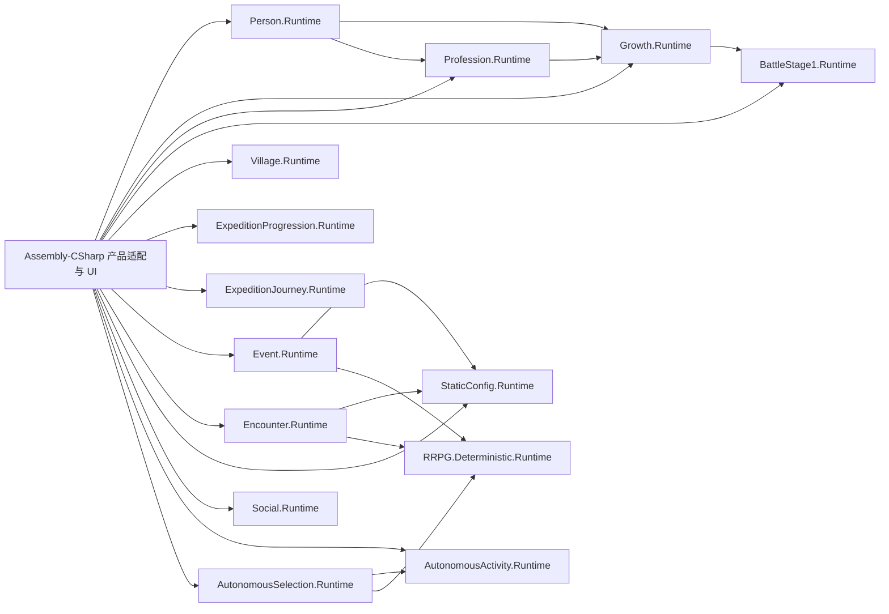

# 技术架构总览

> 文档类型：长期 Architecture / 技术架构总览。
>
> 状态：Current Architecture；更新日期：2026-10-06（WP-AL-1～4及日内A～D均Published Main / Current Implementation；本轮全仓文档审计）。
>
> Authority：技术对象职责、数据所有权、生命周期、依赖方向、Runtime / Persistence 边界。
>
> 适用范围：已核对的 Person、Battle、Expedition、Village、Profession / Growth、Event / Encounter、Social Foundation、Activity Lifecycle / Daily Integration、Autonomous Selection / Arbitration、配置与表现、Save 连接关系。
>
> 不负责范围：玩家规则、数值、玩法内容、Freeze 裁决和实时开发进度。GameSpec 仍是玩家规则 Authority；DevelopmentSpecs 只承担所授权开发期的 Binding。
>
> 上游规则：[GameSpec 总入口](../../GameSpec/README.md)、[Person](../../GameSpec/Person/README.md)、[Battle](../../GameSpec/Battle/README.md)、[Expedition](../../GameSpec/Expedition/Expedition-Progression-GameSpec-V0.1.md)、[Village](../../GameSpec/Village/Village-GameSpec-V0.1.md)、[Product Home](../../GameSpec/Village/Product-Home-World-GameSpec-V0.1.md)、[Resource Coupling](../../GameSpec/Village/Village-Resource-Coupling-GameSpec-V0.1.md)；Freeze 状态见 [GameDesign 当前设计状态](../../GameDesign/当前设计状态.md)。
>
> 当前实现依据：main 已快进纳入 WP-AL-2 Runtime commit 70754649e9ad8b0186a0944a1bccd06c81d79e12 与 Closeout commit 52aa035bfff2e7d0cc12ddcb398325343876a65f；两者均通过开发15.0 GitHub Real-Commit Review。§24 Activity能力属于main Current Implementation；§25 Selection能力已随四条已审提交快进发布main@b239c90e6370c39a6e21fd5986acad63820f95bd；Runtime、Integrity Repair与Closeout均通过开发15.0真实Commit Review，属于main Current Implementation。完整流水线其它能力仍为Target；证据见[WP-AL-3 Closeout](../DevelopmentSpecs/2026-10-04_RRPG_WP-AL-3_Autonomous-Selection_Closeout.md)。测试与历史发布证据见专项 Closeout 和 Git，实时状态见 [项目状态快照](../项目状态快照.md)。
>
> 全文既有基线最后核对提交：`ba09fe62eb56ea526c1a82dc3536ba11afa16bb3`；Return 生命周期增量核对实现提交：`5b8e37be6e6e361a059c6888dcbe0dd760963770`。
>
> 配套入口：[核心对象与术语映射](核心对象与术语映射.md)。具体条目的 Candidate、Not Frozen、Legacy、Existing Implementation / Semantics Pending 标签继续有效，文档整体 Current 不使候选系统转正。
>
> 长期静态配置生产架构：见 [决策记录 D-019](../决策记录.md) 与本文件 `# Static Configuration Architecture` 章节。该章按领域区分 Current Implementation 与 Selected Target Architecture；Monster / Enemy Presentation 的 M0–M4 波次已落地，其它领域未全部迁移。Target 不构成继续迁移授权。人工 Authoring 目标 = `XLSX + Source Assets（按内容需要）`（Source Art 是其已验证子类）。

---

# 0. 架构原则

核心原则：

> 一个事实只有一个 Authority。

必须避免：

- UI / View 维护第二套长期状态；
- 模板 ID 冒充 PersonId；
- Assignment 冒充 Profession；
- Occupancy 写回长期 Person 字段；
- RunState 与 ExpeditionProgressionState 合并；
- BattleUnit 成为长期人物；
- Product Home 创建第二套 Village Simulation；
- 能可靠派生的数据重复持久化。

---


# 0.1 架构状态标签

| 标签 | 含义 |
|---|---|
| Current Authority | 当前真正负责该事实/流程 |
| Persistent | 进入正式长期 Save |
| Runtime Only | 仅当前会话/运行期存在 |
| Derived | 从其它 Authority 派生 |
| Test / Not Frozen | 有实现但内容/数值/命名未冻结 |
| Legacy Implementation | 代码仍存在但 Current 规则已替代 |
| Implementation Pending | Current 设计已确定，但正式实现尚未完成 |
| Candidate / Not Frozen | 候选方向或未冻结内容，不构成正式开发依据 |
| Existing Implementation / Semantics Pending | 当前实现事实可核对，目标职责或产品语义仍待确认 |

---

# 1. 总体架构

```text
Long-Term Person Truth
PlayerCollection
├─ CharacterInstance
└─ HeroInstance
       │
     PersonId
       │
       ├──────────────┐
       ▼              ▼
Village Simulation   Run / Expedition
       │              │
       │              ├─ RunState
       │              └─ ExpeditionProgressionState
       │                       │
       │                       ▼
       │                     Battle
       │                   BattleUnit
       │
       └─ Assignment / Projects / TemporaryCommitment Fact / Place
                    │
                    ▼
          Formation / Profession / Growth
                    │
                    ▼
                  Save
```

人物对的长期关系事实与当前关系状态另归独立 `Social.Runtime` / `SocialWorldState`，由 `SocialRuntimeBridge` 接入同一 SaveSystem；不属于 Village 的 Project TemporaryCommitment 账本。当前数据链见 §23。

Presentation：

```text
Simulation Authority
       ↓
Read / Adapter
       ↓
Home World / HUD / UI / Battle View
```

---

# 2. Long-Term Person Architecture

## 2.1 统一人物身份

当前没有统一 `Person` 实体类。

统一长期人物概念依赖：

```text
PersonId
```

真实长期实例：

```text
CharacterInstance
HeroInstance
```

模板身份：

```text
CharacterId
HeroId
```

不可替代 PersonId。

---

## 2.2 PlayerCollection

职责：

- 持有 CharacterInstance；
- 持有 HeroInstance；
- 持有 Character Cards / Item Cards；
- 维护 CardId → PersonId 显式绑定；
- 提供 PersonId 解析入口。

Gold 继续归 `PlayerCollection.Gold`；它不进入 `VillageResourceState`。

它是长期人物集合的重要宿主，但不意味着所有 Person-owned 逻辑都必须写进 PlayerCollection。

---

## 2.3 Person 配置身份与 Fresh New Game Bootstrap

`PersonDefinition` 承担 Current 人物配置身份；`PersonDefinitionId` 是配置定义链接，`PersonId` 是 Save 内具体长期实例身份，`DisplayName` 只是表现字段。配置 ID、模板 ID、CardId 均不能替代 PersonId；卡上的 PersonDefinitionId 不能替代运行时 `CardId → PersonId` 显式绑定。

```text
Person.csv / Profession.csv
    → ExcelImporter
    → PersonDefinitionCatalog / ProfessionDefinitionCatalog（SO）
    → DataManager
    → PlayerCollection.InitializeDefaultCollection
    → PersonBootstrapper
    → 长期 CharacterInstance
```

> **状态：Current Transitional Implementation。** 该链**继续保留**；D-019 选定的 Static Configuration Target 将在**后续独立 Migration** 中逐步替换其 Authoring / Build / Static Representation 层（见本文件 `# Static Configuration Architecture` 与 [决策记录 D-019](../决策记录.md)）。**不得**从 D-019 推出：`PersonId` Identity Authority 变化、`PersonBootstrapper` 语义变化、Profession 规则变化或 Save 变化。

有效初始名册配置决定普通人物数量，不固定为五人；每个实例生成独立 PersonId。Bootstrap 创建长期人物，不创建 Battle 临时人物。无有效名册时仍有 Legacy 初始化兼容路径，不应反推为 Current 人物设计来源。配置内容可为 Test / Not Frozen。

`InitialProfessionConfig` 可初始化 Person-owned Profession 进度及 Starter 内容；采用配置快照/深拷贝，覆盖项按配置替换，不模拟历史升级，不制造 Formation LifeHistory 或 Formation 事件。Load 恢复已有实例，不重跑这条初始化链。

`CharacterData` 已退出 Person Identity Authority，但仍服务 Battle、旧卡牌和兼容加载，定位为 **Combat Compatibility / Legacy Compatibility**；退出 Authority 不等于依赖已删除，也不代表可立即删除。Legacy RecruitUI 和旧 Character Template / Growth 通道不作为 Current 人物创建或 Profession 成长依据，正式重接与删除条件仍待独立任务。

---

# 3. Person-owned Long-Term Data

## CharacterInstance

当前长期数据包括：

- PersonId
- CharacterId
- Growth-related data
- ActiveProfessionProgress
- FormationState
- PersonLifeHistory
- Hungry / ConsecutiveUnderfedDays（Person-owned 营养状态）
- 一部分 Legacy Compatibility 字段

## HeroInstance

当前长期数据包括：

- PersonId
- HeroId
- Growth / Starter / Pool / Trait 等
- Hungry / ConsecutiveUnderfedDays（Person-owned 营养状态）

---

# 4. Profession / Formation / Growth Architecture

真实依赖：

```text
BattleStage1.Runtime
        ↑
   Growth.Runtime
        ↑
 Profession.Runtime
```

## Growth.Runtime

职责：

- Growth Authority
- Character Growth Service
- Card Growth Resolver
- Growth Config / Lookup

开发边界：

> 普通 Character 当前成长不应继续直接依赖旧 Level / Exp 字段。

---

## Profession.Runtime

当前至少包含：

- FormationEvidence
- FormationResolver
- FormationRuntimeServices
- FormationState
- FormationTestConfig

Profession 是 Person-owned 长期身份成长。

已冻结的基础规则与 Formation Foundation 为 Current；普通 Character 的 `ActiveProfessionProgress` 是该人物的成长状态。Hero 不因同属 Person 就自动进入普通 Character 的 Profession 迁移。Profession 最终命名、正式内容与数值、Transition / Dormant、Profession Trait 具体效果仍为 Not Frozen / Supporting Candidate。

---

## Formation 数据流

M6 Formation 基础服务于运行期没有 Active Profession 的人物首次形成，不重跑 Bootstrap，不从 Assignment 直接推导 Profession。初始化 Profession ≠ Formation；两者是不同入口，不是两套 Growth Authority。正式算法、内容、数值、Transition / Dormant 继续 Not Frozen。

```text
Primary Assignment
      ↓ actual execution
VillageDailyExecutionFact
      ↓
Formation Evidence
      ↓
FormationResolver
      ↓
FormationState
      ↓
ActiveProfessionProgress
      ↓
LifeHistory
```

禁止：

```text
Assignment = Profession
```

或通过 Assignment / Template / Legacy Level 自动推断身份。

---

# 5. Village Runtime Architecture

## VillageRuntimeBridge

定位：

> Assembly-CSharp 层的 Village 会话级 Runtime Host / Orchestrator。

当前持有运行时唯一：

- VillageTime
- VillageState
- VillageResourceState（`VillageRuntimeBridge.Resources`，Ingredients / Food 唯一长期 Authority）
- VillageAssignmentSystem
- VillageProjectSystem
- VillageSocialFactLedger
- VillageSocialResponseLog
- VillageWorldRegistry
- FormationRuntimeServices（可注入）
- SimulationPersonSource（引用同一个 PlayerCollection）

它不能复制长期 Person 数据。

---

# 6. Assignment / Occupancy / Availability

## Primary Assignment

Authority：

```text
VillageAssignmentSystem
```

数据：

```text
PersonId → WorkplaceId
```

特性：

- Persistent
- 每 Person 最多一个；
- Capacity 有限；
- OccupantCount 由 Records 派生；
- Temporary Occupancy 不删除 Assignment。

---

## Temporary Occupancy

当前来源：

```text
Expedition
∪ Unavailable
∪ Active Project Participants
```

状态：

```text
Runtime Only
```

不写回 Person 长期字段，不独立持久化。

---

## Availability

由长期人物事实 + 当前 Expedition 登记派生：

```text
InVillage
Expedition
Unavailable
```

属于 Derived View。

---

# 7. Village Time Architecture

Authority：

```text
VillageTime
```

时间比例与正式数值为 Test / Not Frozen。

宿主链：

```text
VillageRuntimeBridge.IsSimulationActive
        ↓
VillageTimeDriver
        ↓
VillageTime.Update(deltaTime)
```

`VillageTimeDriver` 独立于 HUD 生命周期。

HUD 不拥有时间推进权。

## 7.1 Resource Authority 与 Daily Settlement

`VillageResourceState` 只拥有 Ingredients / Food 长期存量，通过自身写入口变化；由 Village Runtime 持有，并经 `VillageSaveData.Resources` 增量区块保存。`VillageState` 的既有 Test 状态不构成第二套资源库存。

```text
VillageTime Update / TickDay / Jump / Return
    → AdvanceTo / 唯一AdvanceSink
    → CompleteWorkInterval / CompleteWorkBoundary（生产 / 午餐）
    → 午夜HandleDayTick（DailyEvidence / Formation）
```

Bridge从同一SimulationPersonSource派生当前在村劳动者；VillageIntradayWork持有到岗/批次/材料/午餐状态，ProjectSystem.OnWorkInterval推进实际劳动，Assignments.CommitLabor接收日内聚合。唯一AdvanceSink串行处理工作、午餐、活动到场/完成与机会边界；午夜HandleDayTick处理State、完成观察、DailyEvidence、Formation与Feedback Barrier，不再次调用旧整日Projects/Assignments生产，也不午夜瞬时完成活动。

Formation 证据消费 **Daily Execution Delta（当日实际执行增量）**，不能将累计执行天数重新当作每日 delta 重复结算。VillageTime 仍是唯一 Daily Settlement 时钟；该约束不冻结正式 Formation 算法或数值。

Farm / Kitchen 复用 Workplace、Assignment 和 Capacity；`VillageResourceWorkplaceDef` 承载资源岗位规则。V17-R1把Completed建筑实例岗位薄映射至既有Resource Profile，实例批次仍由VillageIntradayWork持有；没有通用Recipe Framework或第二份资源库存。生产、加工、消费数值保持 Test / Not Frozen；公式与行为约束统一见 Resource Coupling GameSpec，本文件不重复。

资源边界：Gold 仍归 `PlayerCollection.Gold`；`PendingBuildingMaterial` 是 RunState 的 Legacy 槽位，没有产品生产者，`PlayerRunRewardSink.AddBuildingMaterial` 无 Current 长期落点，不能改解释成 Food / Ingredients。没有正式 Wood / Stone Authority。

## 7.2 Person Nutrition

`CharacterInstance` / `HeroInstance` 通过 `IFulfillmentHost` 暴露 `Hungry` 和 `ConsecutiveUnderfedDays`，状态归具体 Person。Village 不维护 Person Hunger Dictionary；`VillageResourceSettlement` 只写传入 host，Bridge 从既有可用性来源选择参与者。

两项状态进入各自 Character / Hero 长期 Save 区块，由 SaveSystem Build / Restore。正式阈值、惩罚和产品数值仍 Not Frozen；当前营养链不产生死亡、伤病、战斗减益或 Mood 后果。

---

# 8. Village Place / World Registry

Authority：

```text
VillageWorldRegistry
```

当前最小数据：

```text
VillagePlaceRecord
├ PlaceId
├ Kind
├ DisplayName
└ SourceRef
```

当前 Kind：

- Workplace
- ProjectSite

Current Registry 的第一包结构未冻结以下完整系统；2026-10-07 有限 Building 规则已由 [Building GameSpec](../../GameSpec/Village/Village-Building-World-GameSpec-V0.1.md)接收，技术目标见 [§27](#v16-product-world-target)，并非代码已存在：

- Grid
- 坐标
- 导航
- 碰撞
- 正式 Building System
- 正式地图

因此当前技术架构不会锁死未来 2D / 2.5D 世界布局。

---

## Persistence

Workplace：

```text
Derived from Workplace Definition
Not Saved
```

ProjectSite：

```text
Persistent
```

原则：

> 可可靠派生的数据不重复保存。

---

# 9. Product Home / Presentation

> 后续实施目标与 Current 复用边界见 [§27 Village Product World / Building Foundation](#v16-product-world-target)。本节 Adapter / Product World 链表示规则目标，不是已实现类清单。

Current GameSpec 目标：

```text
Village Simulation Authority
        ↓
Product Home Read Adapter
        ↓
Product World Presentation
```

最后核对基线中的表现宿主：

```text
VillageWorldLayer
```

仅是：

```text
Debug Visualization / Test / Not Frozen
```

不代表正式 Product Home 已完成。

正式 Product Home 不得创建第二套：

- Person State
- Assignment
- Occupancy
- Capacity
- Place Registry
- Long-Term Location Truth

---

# 10. Run Architecture

## RunState

职责：

> 一次 Expedition 内跨多场 Battle 连续保存的 Run 状态。

当前包括：

- Person CurrentHP / MaxHP
- Run Deck
- Insight
- Pending Rewards
- Pending GrowthExp / ProfessionExp 等

状态：

```text
Runtime Only
```

当前没有正式 Run Save / Resume 产品路径。

## 10.1 WP-2：Expedition Facts → Persistent Person State

```text
BattleSettlement
    → RunState.PendingProfessionExp[PersonId]
    → AdventureManager.SettleReturnDetailed
    → RunState.CommitPendingProfessionExp
    → PlayerRunRewardSink.TryAddProfessionExp
    → GrowthAuthority
    → CharacterInstance.ActiveProfessionProgress.ProfessionExp
    → Return Catch-up / Remaining Carry Return / Return Person Consequence / Clear Occupancy
    → Unique Final Save
```

Battle 结算只产生 Run Pending，不直接写长期 Person。Current ProfessionExp 通道面向实际参战且具有 Active Profession 的普通 Character；Hero 的既有 Legacy Growth 通道不自动等价于此通道。

Current 规则要求 SafeReturn / Retreat / Defeat 均完整提交已经真实产生的 ProfessionExp，不将其作为普通可损失 Pending；其它收益的保留策略不能从 ProfessionExp 推导。正常可解析长期 Person 的成功链已实现。Commit 按 PersonId 解析长期对象，仅在 sink 确认写入成功后清除对应 Pending，不回退到旧 Character Exp、不猜 Profession。

`SettleReturnDetailed` 提供明确的 Settlement 结果；产品 Return 只有在 `AllProfessionExpAcknowledged` / `SettlementSucceeded` 成立后才越过 Settlement。Retreat / Defeat 仅调用 `DiscardNonProfessionPendingRewards()`，不再静默清除 `PendingProfessionExp`；sink 未 ack 时 Pending 保留、`ExpeditionRecord.Phase` 保持 Active，可在同一内存会话重试。

`ExpeditionUI.FinalizeReturn` 按 `ExpeditionRecord.Phase` Begin-or-Resume，未完成 Record 不重新 Begin。`VillageRuntimeBridge._pendingReturnMode` 与 Return Record 同属会话状态，保存原始 `RunEndMode`，resume 沿用该模式；Final Save 失败时 Phase 保持 `OccupancyCleared`，后续只重试 Save。Legacy `AdventureManager.EndRun` 仍是 Compatibility / Test 入口，不形成第二套产品 Commit Authority。

上述保证不扩展为跨进程 Return transaction、应用崩溃 / 退出后的事务恢复、数据库式 rollback / exactly-once 或 stale checkpoint replay；Retreat / Defeat 正式损失比例也未冻结。长期查询失败边界已在 2026-10-02 本地独立修复：已注入 `BattleSettlement.LongTermPersonLookup` 后，查询 null / 抛异常不再借用输入实例的 Profession 资格；这不扩大 Return 事务的恢复保证。见[问题清单](../问题清单.md)问题90 的本地更新。

Event Profession Growth 尚未正式接线；预留的 Pending 接缝不代表完整 World、Relationship、Narrative 或新 Profession 内容已经实现。

---

# 11. Expedition Progression Architecture

WP-1 的纯域、产品接线与 Return handoff 已完成。以下记录长期数据所有权和依赖边界；开发生命周期与验收证据由项目状态、开发验收交接和对应历史开发记录维护。

Assembly：

```text
ExpeditionProgression.Runtime
```

依赖：

```text
UnityEngine
```

不依赖 Legacy Map。

---

## 11.1 Definition Layer

```text
ExpeditionGraph
└─ ExpeditionNodeData
   ├ NodeId
   ├ NodeKind
   ├ Connections
   ├ NodeElapsedDays
   ├ ExtraSupplyCost
   └ SuccessfulRouteTerminal
```

Graph 构造时校验：

- Node 非空；
- NodeId 唯一；
- EntryNode 存在；
- Connections 指向存在 Node。

---

## 11.2 Runtime Authority

```text
ExpeditionProgressionState
```

会话内唯一推进真相：

```text
Phase
CurrentNodeId
EnteredNodeIds
ResolvedNodeIds
CompletedNodeIds
ExpeditionElapsedDays
RouteCompleted
Supply
```

外部只读。

写操作只允许：

```text
ExpeditionProgressionResolver
```

---

## 11.3 Phase Model

```text
NotStarted
Entered
AwaitingNext
FailedResolved
ReturnRequested
```

核心不变量：

```text
Enter != Resolve != Complete
```

---

## 11.4 Resolution

唯一最终 outcome 入口：

```text
TryResolveCurrentNode()
```

Success：

```text
Resolved
+ Completed
+ elapsed exactly-once
+ supply exactly-once
+ successors available
```

Failure：

```text
Resolved
not Completed
+ elapsed exactly-once
+ supply exactly-once
+ no normal successors
+ Return only
```

---

## 11.5 Route Completion

明确：

```text
0 successor != RouteCompleted
```

只有：

```text
SuccessfulRouteTerminal
+ Success
```

才设置 RouteCompleted。

---

## 11.6 Supply State

```text
ExpeditionSupplyState
```

Enter 前 affordability validation。

真正扣减只发生在 Resolve。

它不是 Village Food Authority。

费用公式与正式规则见 Expedition / Resource Coupling GameSpec。具体数值保持 Test / Not Frozen。

---

## 11.7 Return

```text
RequestReturn()
```

是 Expedition 层独立操作。

规则：

- 未开始内容可 Return；
- Entered 未结算时拒绝；
- Return 不清空 Carry；
- ReturnRequested 后锁定 Progression；
- 产品请求已 handoff 到既有 V4F Return 会话；请求本身不负责长期 Commit 或 Save。

---

## 11.8 与 Legacy Map 的当前关系

当前状态：

```text
New ExpeditionProgression.Runtime
= Implemented / Verified

AdventureManager
= Current Product Orchestrator（StartProgression / Resolver 转发 / Return Settlement 编排）

AdventureManager 内旧 Map orchestration
= Legacy Implementation

Legacy Map Runtime
= Legacy Implementation

LegacyMapGraphAdapter
= Compatibility Graph Source → ExpeditionGraph 定义导入
```

产品已接通 `StartProgression`、Node Enter / Resolve 与 Return handoff。Legacy Map 仅提供 Compatibility Graph Source 和视图镜像；其 flags、SelectNode 与 IsAtBoss 不构成新规则 Authority。AdventureManager 和 UI 只负责产品编排，推进写操作仍经 Resolver。

Battle Outcome 是单场结果，Node Resolve 负责内容完成及 elapsed / supply 结算，Expedition Return 负责会话结束与长期归置，三者互不等同。

## 11.9 WP-3：Departure / Carry / Return

Departure 经 `VillageRuntimeBridge.CarryFoodForDeparture` 扣减长期 Village Food，把实际转移量作为 `StartProgression` 的 Initial Carry。消费只作用于 `ExpeditionProgressionState.Supply`；Run Carry / Supply 是会话 Runtime，不是长期 Village 资源副本。

Current 产品正常成功 Return 顺序（包含 V4 增量）：

```text
Settlement
    → Catch-up
    → Remaining Carry Return
    → Return Person Consequence
    → Clear Occupancy
    → Unique Final Save
```

`ExpeditionUI.FinalizeReturn` 编排上述顺序。Catch-up 期间保持远征 Occupancy，未来返还的 Food 不参与返回前的日消费。Catch-up 完成后，`VillageRuntimeBridge.ReturnRemainingCarry` 从 Supply 剩余量返还 Food，并在现有 `ExpeditionRecord` 置 `RemainingCarryReturned`；没有第二套 Resource Return Transaction。

保证范围是同一内存会话内按 Phase 恢复与防重复提交。ProfessionExp sink 未 ack 时 Settlement 不越过 Active；既有前置守卫或 Catch-up 失败也会阻止后续步骤；Final Save 失败保持 `OccupancyCleared`，只重试 Save，不标记 Completed。它不是跨进程原子事务，也不承诺回滚已经发生的内存写入；Run Save / Resume、崩溃恢复、数据库式 exactly-once 与 stale checkpoint replay 不属于 Current。

## 11.10 V4 Capability / Return Person Consequence

Project 完成增量经 `VillageCapabilityGrant` 定位长期 Person，将结果写入该 Person 当前 Growth Pool；Growth Offer 与 Run Reward 读取同一长期状态。Capability 没有独立 Save Authority 或 Global Capability State，结果随既有 Person-owned Growth 状态保存。授予内容、顺序与正式配置仍 Test / Not Frozen。

`VillageReturnPersonConsequence` 位于 Carry 返还之后、Clear / Final Save 之前：复用既有 Person `Injury` 字段写入长期健康结果；普通 Character 记录 `ExpeditionReturned` 经历，Hero 不新增同样的 LifeHistory。`ExpeditionRecord.HealthConsequenceCommitted` / `ExperienceCommitted` 是活跃会话提交标记，不是新的长期 Save 区块。复用 Injury 不恢复 Death's Door 或全部 Legacy Injury 规则；阈值、severity 和正式健康设计仍 Not Frozen。

V4 Objective Functional 已关闭的实现范围不等于 Milestone A 五问体验结论已确定，后者仍 Deferred；实时验收事实继续由项目状态与交接负责。

---

## 11.11 远征表现宿主与运行时面板生命周期

当前产品推进表现由 Scene 内 `ExpeditionJourneyRoot` 的 `ExpeditionJourneyCoordinator` / `ExpeditionJourneyView` 承担。`ExpeditionUI` 负责出征准备及现有流程编排；人物候选和补给说明由 `ExpeditionIdentityPanel` 显示，推进规则仍由 Resolver 决定。

运行时面板由 `ExpeditionUI.EnsureIdentityPanel()` / `EnsureProgressionPanel()` 显式按需创建并缓存。`IdentityPanel` 保持挂在 ExpeditionUI 下，随其显隐；`ProgressionPanel` 保持原顶层宿主，仅作 Journey 缺失时的 Compatibility / Test seam，不与 Journey 组成两个正式推进表面。Hide / Refresh 路径沿用已有字段及可见性检查。

`IdentityPanelRef` / `ProgressionPanelRef` 只返回已有引用，可以为空；读取不创建 GameObject。工具审计优先读取序列化字段，不对业务组件任意遍历 getter。上述面板不持有独立规则或长期 Save Authority，视觉仍 Functional / Test / Not Frozen。

---

# 12. Battle Architecture

长期人物：

```text
CharacterInstance / HeroInstance
```

进入单场 Battle 后：

```text
BattleUnit
```

BattleUnit：

- Runtime Only
- 不长期持久化；
- 不应作为 Person Authority。

当前 `BattleUnit` 有 `UnitId` / `SourceId`，没有 `PersonId` 字段。人物归属由战斗外的显式 Card → Person 映射、`BattleUI.GetPersonIdOfUnit` 适配及结算 `deployedPersonIds` 参数维持。模板 `CharacterId` / `HeroId`、角色卡 `CardId`、战斗 `UnitId` / `SourceId` 都不能直接替代长期 `PersonId`。

---

## 12.1 Battle 临时人物与长期查询

BattleUI 创建临时 `CharacterInstance`，复制战斗所需数据和 PersonId 链接，但不复制长期 ActiveProfessionProgress。它与 BattleUnit 都不是长期 Person Authority；Profession 资格与长期成长事实应来自 PlayerCollection 中的长期 Person，CharacterGrowthUI 也读取长期 ProfessionProgress，而非 Battle 临时实例。

当前产品 `BattleUI.DoSettlement` 注入 `LongTermPersonLookup`，按 PersonId 查询长期 Person。已配置查询时，空 PersonId、查询 null 或抛异常均不借用输入实例的 Profession 资格，不新增该人物的 PendingProfessionExp；null / 异常分支记录警告，已有 Pending 保留。只有未注入 lookup 的 Compatibility 入口仍按传入实例判断。正常长期查询、Hero Legacy、金币与 Return Commit 接缝保留；修复边界见[问题清单](../问题清单.md)问题90，最新累计验证查[工程审计](../DevelopmentSpecs/2026-10-02_RRPG_工程现状与引用审计.md)，不代表跨进程事务已完成。

## 12.2 战前人物卡与战中行动牌宿主

`BattleUI` 仍是 `BattleController` 上的正式表现和操作宿主，复用既有 `BattleCanvas`、六个战场排、按钮与卡牌 Prefab。两种手牌按实际职责分开：

| 职责 | Scene 对象与绑定 | 代码链 |
|---|---|---|
| 战前人物 / 英雄准备卡及单位拖拽暂存 | `BattleController/BattleCanvas/PrepCharacterHandRoot` → `BattleUI.prepCardContainer` | `PrepCardHost` → 初次生成、回手生成、RearrangeHandCards、OnUnitDragBegin、RestorePrepHandVisibility、开战隐藏、CleanupBattleUI |
| 战中行动牌 | `BattleController/BattleCanvas/BattleActionHandRoot` → `BattleUI.handContainer` / `BattleV1Runtime.handContainer` | 共享牌库生成、行动牌布局、选牌、目标与 Feedback |

`PrepCharacterHandRoot` 仅有 RectTransform，full stretch、零偏移、单位缩放，在当前 Overlay Canvas 激活后保持同尺寸、同 pivot 与坐标原点。没有新增 Canvas、LayoutGroup、Mask 或 Graphic，也未重挂原有静态 UI；其绘制层保持准备卡原先追加至 Canvas 末尾的语义。人物准备卡继续用 `PrepCard_` / `HeroPrepCard_`，部署单位继续用 `Card_`，行动牌继续用 `V1Card_`，这些动态名称仍是已使用的查找契约。

正式场景已显式绑定准备卡容器，移除或隐藏 `infoText` 不影响准备卡创建、排列和清理。未绑定的新旧局部测试/旧场景暂由只读 `PrepCardHost` 回退到原 `infoText.canvas`；这是迁移兼容边界，不是新的正式宿主，也不在 getter 中创建对象。原 `PrepCardRoot` 已原位改名为 `BattleActionHandRoot`，与 `PrepCharacterHandRoot` 按实际职责区分；原组件、对象身份和两个 handContainer 字段绑定保留，没有新建第二套行动牌容器。旧报告中的 PrepCardRoot 按历史名称读取。

---

## Current vs Legacy

Current Battle 已明确替代：

- Death's Door
- 常规 Battle 永久死亡
- 旧 Battle 战后伤残判定（不等于否定§11.10 V4 Return 对既有 Injury 字段的限定复用）
- 个人 AP + TP 双资源
- 旧角色卡部署逻辑
- 旧角色卡/道具卡分离牌堆

上述旧规则路径属于（不能仅凭同名字段判断所有使用者均为 Legacy）：

```text
Legacy Implementation / Pending Migration
```

---

## 12.3 Battle 静态名称与引用维护

主场景顶层现在为 Main Camera、EventSystem、SceneUIHosts、VillageTimeDriver、ExpeditionJourneyRoot。SceneUIHosts 是常驻启用、单位变换、只有 Transform 的编辑整理容器，不承担显示开关、Canvas 排序或产品编排。MainMenuUI 至 RunRewardUI 的 13 个界面宿主按原顺序作为其直接子对象，包含 CharacterGrowthUI Prefab 实例；没有重建原宿主。独立场景 Text_Owner 已确认无 Canvas、无外部业务绑定或名称查找消费者并删除；BattleCard Prefab 中的同名对象仍被 ownerText 引用，保留。本文其它以 BattleController / TownUI 等开头的路径是宿主相对路径，完整场景路径须加 SceneUIHosts 前缀。

各界面仍由自己的产品代码启停，不能通过关闭 SceneUIHosts 来退出玩法；Camera、EventSystem、VillageTimeDriver 与 Journey 根 Canvas 保留顶层。CharacterGrowthUIAuthoring 按包含 inactive 的子树组件识别现有宿主，避免整理后再次创建；Legacy TMP 白名单按 MapUI / ShopUI / RecruitUI 的组件祖先识别，不依赖根层级名称。分组不授予 Legacy 界面 Current 玩家规则身份。

Legacy UI 的保留边界按调用链判断：当前 ExpeditionUI 确认出征使用自身显式 compatibilityGraphRows / compatibilityGraphColumns（主场景 4 / 3，最低 2 / 1），交给 AdventureManager.StartProgression → MapGenerator.Generate → LegacyMapGraphAdapter，再由 Progression / Journey 负责当前推进与表现。参数是兼容图来源的临时制作配置，不是长期内容图规格；MapUI.rows / columns 只保留旧预览 / 兼容显示用途，不再控制正式出征初始化。MapUI 的 HideMap 和兼容派生显示调用仍保留，组件不能随参数迁移整体删除。ShopUI.ShowShop / RecruitUI.ShowRecruit 当前源码未找到产品调用点，但保留旧界面、序列化绑定与 Legacy 契约；这个结果不等于可以恢复旧道具购买或第二套人物创建入口，也不自动授权其整体物理退休。

`BattleController/BattleCanvas` 下的 `BtnStartBattle`、`BtnCancelOp`、`InfoText` 已移除名称尾空格；`BtnStartBattle / BtnCancelOp / BtnEndTurn` 的 TMP 标签子对象统一命名 `Label`，替代历史 `Text (Legacy)`。保留对象身份、组件、Inspector 字段和 UnityEvent；没有重建、换字体、搬父节点或调整显隐。代码字段名保持不变，动态卡牌前缀仍按 §12.2 的契约维护。

静态改名先查代码/工具/测试字符串与资产路径，再核验对象身份、组件序列化状态和引用；仅凭名称整洁不能推断可以删除旧对象或给产品根对象统一套父节点。

HUD 装饰使用 HudDecorationRoot / DecorationImage、TurnFrameImage / TurnBackdropImage；两处行美术使用各父行内的 RowArtwork；抽 / 弃牌堆图片为 DrawPileImage / DiscardPileImage。这些都是既有对象原位更名，不承担 Gameplay Authority。18个隐藏列标签仍被作者化工具按直属子名称读取；6个透明 RowVisual 仍有可选 Runtime 着色入口；InfoText 仍保留调试、字体和 Legacy Prep fallback。保留项的具体路径与职责查[核心对象映射](核心对象与术语映射.md)。

结算返回时 BattleUI.HideBattleCanvas 只关闭自身子树的 Canvas，含 inactive，不再依赖全局固定名称。开始 / 取消 / 结束回合的 BindButton 只管理自身 Runtime 回调并复用启用的同目标 / 方法 Inspector 监听；BattleResultUI.ShowResult 只替换自己的返回意图，换按钮 / 设空 / 销毁时释放旧绑定，保留其他监听。公开 API、结算和返乡顺序保持。

## 12.4 Battle Editor 作者化入口边界

当前产品 Scene / Prefab 绑定不再由旧 Stage1 初始化器重装。原 `BattleStage1Editor.CreateDefaultBattleCardAssets / IntegrateV1Runtime / BatchIntegrateV1`、`BattleStage2Editor.ConfigureDemoCardEffects`、`BattleStage3AEditor.ConfigureDemoRangeModifiers` 保留方法名，但调用立即抛出 `NotSupportedException`，不再写场景、Prefab 或牌内容；旧写入菜单已撤下。历史自动化若仍调用这些方法须迁移，不能把调用成功当作当前产品初始化契约。

菜单 `RRPG/Battle Authoring/检查当前战斗绑定（只读）` 调用 `BattleStage1Editor.AuditCurrentBindings`，使用 SerializedObject 检查当前 SampleScene 的唯一 BattleUI、准备/行动牌容器、V1 Runtime、BattleCard Prefab 与共享行动力文本。检查不切换场景、不创建对象、不保存、不自动修复；仅覆盖关键绑定，不替代全仓引用和产品流程验证。

Gate0 内容生成器与表现作者化工具仍按各自现行职责维护；本次退休不代表所有带 Stage 名称的类型、测试程序集或演示内容都可删除，也不改变 Battle / Save / 配置 Authority。

BattlePresentationCutoverAuthoring 对 HUD 文字优先复用现有绑定，并在 Canvas 子树（含 inactive）查找同名宿主；重名、错误组件、绑定与名称冲突或 Canvas 外绑定明确拒绝。四个宿主在创建或重绑前预检，避免嵌套宿主被旧直接子查找漏掉后创建第二份。它仍是既有作者化工具，不自动授权重跑全部布局覆盖现场。

## 12.5 战斗规则事实与 Feedback 播放

输入由 BattleUI 接收，BattleSystem 与 BattleCardRuleExecutor 负责实际规则结算；BattleV1Runtime 承担共享牌库、行动力和回合适配。BattleUI 的 ExecuteCardWithFeedback / ExecuteEnemyWithFeedback 先执行规则并捕获事实差量，再交 BattleFeedbackPlayer 播放 BattleFeedbackRecord。Record 是表现输入，不是另一个 HP、Down 或 Formation Authority。

播放期间通过 BeginPresentationBatch 延迟牌面刷新，并由 IsFeedbackPlaying 门禁约束继续输入。CompleteFeedback 释放批次、定位与刷新视图；敌方播放完成才继续推进玩家回合。关闭表现或即时播放仍走同一结算事实，不能用动画回调再次扣血、扣行动力或结算牌。文件按 partial 拆开只是源码组织；规则、事务与 View 的耦合还须按调用链判断。

# 13. Card / Deck Architecture

Current：

- BattleCard
- Shared Deck
- Run Deck
- Shared Action Point

Legacy：

- 旧 CardSystem
- 角色卡 / 道具卡独立牌堆
- 旧部署区与旧抽牌边界

---

# 14. Save Architecture

顶层：

```text
SaveData
├ SaveVersion
├ GameVersion
├ SavedAtUnixTime
├ Player
├ Village
├ EventWorld
├ SocialWorld
├ ActivityWorld
├ AutonomousDecisionWorld
└ SocialFeedbackWorld
```

---

## Player Save

```text
PlayerCollectionSaveData
├ Gold
├ Heroes
├ Characters
├ Character Cards
├ Item Cards
└ CardId → PersonId bindings
```

---

## Character Save

包含：

- CharacterId
- PersonId
- Growth data
- ActiveProfessionProgress
- FormationState
- LifeHistory
- Hungry / ConsecutiveUnderfedDays
- 部分 Legacy 长期字段

---

## Hero Save

包含：

- HeroId
- PersonId
- Growth / Starter / Pool / Trait
- Hungry / ConsecutiveUnderfedDays

## Village Save

`VillageSaveData`保留Time（含IntradayTime）/ IntradayWork / State / Assignment / Project / Social / World区块，并通过 `Resources` 保存 `VillageResourceSaveData.Ingredients / Food`。SaveVersion 保持 1；不因资源归位创建另一份 Save 或新 Schema。

## Social World Save

`SaveData.SocialWorld` 是已实现的顶层可空增量区块，保存 `RelationalFacts[]` 与 `Relationships[]`，不嵌入 Character / Hero / Village。当前 `Affinity` 仅是 **V0.1 Test / Not Frozen channel**，不冻结正式关系维度或数值。SaveVersion 仍为 1；DTO 与替换恢复边界见 §23。

---

## 不保存

当前正式长期 Save 明确不保存：

- Battle Runtime
- RunState
- ExpeditionProgressionState
- ExpeditionSupplyState / Carry / ExpeditionRecord（含 RemainingCarryReturned）
- Legacy Map Progress
- UI
- Camera
- Product Home Presentation
- Temporary Occupancy
- ScriptableObject 对象引用

---

# 15. Save Build / Restore

Save：

```text
SaveSystem.Save
   ↓
VillageRuntimeBridge.EnsureInitialized
   ↓
VillageRuntimeBridge.BuildSaveData
   ↓
SaveSystem.BuildSaveData(PlayerCollection, Village)
   + EventRuntimeBridge.BuildSaveData()
   + SocialRuntimeBridge.BuildSaveData()
   + ActivityRuntimeBridge.BuildSaveData()
   + AutonomousSelectionRuntimeBridge.BuildSaveData()
   + AutonomousSocialFeedbackRuntimeBridge.BuildSaveData()
   ↓
JSON
```

Load：

```text
JSON / SaveVersion / 真实Player对象
 → 只读preflight IntradayTime / IntradayWork / ActivityWorld及时间一致性
 → 只读preflight DecisionWorld / SocialFeedbackWorld
 → RestorePlayerCollection成功
 → RestoreVillageWithoutTime / EventWorld / SocialWorld
 → ActivityWorld / DecisionWorld / SocialFeedbackWorld Replacement
 → 最后恢复预检时间 / Legacy Pending migration（不Tick / Selection / Drain）
```

SaveVersion=1；新的日内nullable块在任何World Restore前验证，非法保留旧世界。ActivityWorld只保存Scheduled ActiveInstances的稳定语义，重建必要Claim；不保存任意候选列表/Provider/Trace/RNG/动画。普通Save仅Idle且无未完成Expedition/Return；FinalSave必须可信Return会话、失败继续世界锁，仅重试保存。世界级global transaction仍未由此承诺；各域边界见Save GameSpec与§24～26。

## 15.1 Person 增量字段与 Active Profession 显式哨兵

`CharacterSaveData.PersonDefinitionId` / `DisplayName` 是 additive 兼容字段，SaveVersion 仍为 **1**。Load 恢复已有长期 Person 及 Profession 进度，不重新执行 Bootstrap。旧档缺新增字段时沿现有兼容解析/显示回退处理，不以缺失配置链接替换 PersonId 或凭空初始化 Profession；Runtime 对象不直接进入 Save DTO。

`JsonUtility` 对缺失字段、null 与可序列化 class 的恢复不能可靠表达“没有 Active Profession”。Save 使用 **`HasActiveProfessionProgress`** 显式区分无 Active Profession与存在可恢复进度；Restore 必须先检查哨兵，再决定是否恢复进度对象，不能仅检查嵌套 class 是否为 null。这是 Current 持久化实现约束，不代表 Schema 永远冻结。

## 15.2 Save 触发职责：Existing Implementation / Semantics Pending

Current 实现事实：Return 最终 Save 仍由产品 UI / 编排链触发，领地路径经 `TownUI.OnReturnFromExpedition`，非领地路径由现有 `ExpeditionUI` 收尾调用 SaveSystem。Village 资源日结本身不自动 Save。

长期目标职责尚未冻结；当前 UI 触发方式不提升为目标 Architecture。领域持久化语义服从 Current GameSpec，长期保存边界见[Save GameSpec](../../GameSpec/Save/Save-GameSpec-V0.1.md)，旧编号Save文档只作Legacy追溯。本轮仅记录事实与边界，不提出或实现 Save 重构。

---

## 15.3 Event World 存档接缝

SaveData.EventWorld 与 Player / Village 同在 SaveVersion 1 本地存档内。BuildSaveData 调用 EventRuntimeBridge.BuildSaveData → EventWorldPersistence.Build；Load 调用 EventRuntimeBridge.Restore，并由 VillageEventFlow.TryMigrateLegacyPending 收敛已知旧 Pending，未知旧 Pending 保留兼容诊断，不重跑 Recognition 作为新事件。

保存的是 World Flags、World Event History 和至多一条 Pending Village Event 的实例身份、绑定及 Context。EventExecutionState.Completed、Expedition 会话事件历史、ActiveExpeditionEvent、Active EnemyRoster与Event结果反馈UI不持久化（Social Feedback Outbox另归SocialFeedbackWorld）。Load 后 Execution 重建为空，长期重复规则读 World History；不能把这条持久化接缝当作完整 Run Save / Resume 或跨进程事务恢复。

# 16. Restore Invariants

Social Restore 是 Replacement，直接恢复 Fact 与当前 Relationship State，不重跑 Interpreter；null / 旧档缺 SocialWorld 恢复为空，未知或当前不活跃 PersonId 保持字面事实。Failed Load 不提前清空 Social；successful NewGame 显式 reset Social。这些保证不扩展为 Village / Event / Player 的世界级统一事务，见 §23。

恢复时禁止猜测：

- 不用 CharacterId 推断 Profession；
- 不用 Assignment 推断 Profession；
- 不用旧 Level/Exp 推断 Profession；
- 不用累计执行天数自动 Formation；
- 不用卡册顺序猜 Card→Person；
- unknown Profession 条目保持字面事实；
- 旧档缺 PersonId 时生成新 PersonId，并在后续 Save 写回。

---

# 17. Assembly Map

Post-Bootstrap 依赖方向：`Person.Runtime → Growth.Runtime / Profession.Runtime / UnityEngine`。配置定义与初始化配置位于 Person.Runtime，Editor 的 ExcelImporter 生成 Catalog / SO，DataManager 提供配置读取，Assembly-CSharp 的 PlayerCollection / PersonBootstrapper 创建长期实例；配置层不依赖产品 UI。

BattleUI 通过 `LongTermPersonLookup` 委托接入 PlayerCollection，只读长期 Profession 资格；Return sink 经 GrowthAuthority 写入长期进度。VillageCapabilityGrant / VillageReturnPersonConsequence 是产品适配逻辑，经长期 Person 和既有会话记录接线，不把 UI、PlayerCollection 依赖倒灌到纯域，不建立独立成长或 Save Authority。

Scripts 内全部 Runtime asmdef 的显式依赖如下；目录不等于程序集，`noEngineReferences=false` 也不代表已经与产品 UI 隔离。

| 程序集 | Scripts 下的位置 | 显式 references | noEngineReferences |
|---|---|---|---|
| BattleStage1.Runtime | Battle/Stage1 | UnityEngine | false |
| Growth.Runtime | Growth/Runtime | UnityEngine、BattleStage1.Runtime | false |
| Profession.Runtime | Profession/Runtime | UnityEngine、Growth.Runtime | false |
| Person.Runtime | Person/Runtime | UnityEngine、Growth.Runtime、Profession.Runtime | false |
| Village.Runtime | Village/Runtime | UnityEngine | false |
| ExpeditionProgression.Runtime | Adventure/Progression/Runtime | UnityEngine | false |
| ExpeditionJourney.Runtime | Journey/Runtime | UnityEngine | false |
| StaticConfig.Runtime | StaticConfig | UnityEngine | false |
| RRPG.Deterministic.Runtime | Shared/Deterministic | 无 | true |
| Encounter.Runtime | Encounter | StaticConfig.Runtime、RRPG.Deterministic.Runtime | true |
| Event.Runtime | Event | StaticConfig.Runtime、RRPG.Deterministic.Runtime | true |
| Social.Runtime | Social/Runtime | 无 | true |
| AutonomousActivity.Runtime | AutonomousLife/Activity/Runtime | 无 | true |
| AutonomousSelection.Runtime | AutonomousLife/Selection/Runtime | AutonomousActivity.Runtime、RRPG.Deterministic.Runtime | true |



图省略 Unity/TMP/UI 自动引用；箭头表示依赖方向，不是运行顺序。BattleSystem、Battle/V1、EventHost、AdventureManager、SaveSystem、VillageRuntimeBridge 与 UI 没有自己的 Runtime asmdef，仍位于 Assembly-CSharp；它们所在目录不能直接视为纯逻辑程序集。Event / Encounter 的纯核通过只读数据与 Host 契约接产品，不反向依赖这些具体适配对象。

Adapter / Orchestrator 位于 Assembly-CSharp，未把 Legacy Adventure / UI 依赖倒灌到 `ExpeditionProgression.Runtime`。`VillageResourceState`、`VillageResourceSettlement`、`IFulfillmentHost` 位于 `Village.Runtime`；Character / Hero 在 Assembly-CSharp 实现接口，纯逻辑资源层不依赖 PlayerCollection 或 UI。

`Social.Runtime` 的 `references=[]`、`noEngineReferences=true`、`autoReferenced=true`；不依赖 Village / Event / Person / Battle / UI / UnityEngine。`SocialRuntimeBridge` 位于 Assembly-CSharp，通过该自动引用接入纯域；没有修改既有 asmdef。SocialFoundation.Tests 仅显式引用 Social.Runtime，Editor only，SaveSystem / Bridge 集成测试通过反射访问 Assembly-CSharp。

> 以上为 **Current Transitional Implementation** 的 Assembly 事实；Static Configuration 的 **Selected Target** 见下章（[D-019](../决策记录.md)）。不得把当前 Assembly Map 反推为长期目标，也不因历史 Stage1 名称退休正在被产品引用的程序集。

---

# Static Configuration Architecture

> 定位：本章分层记录 RRPG 静态配置的**当前实现**与 **D-019 已确认的长期目标分层**。
> **当前核对范围：** Monster Definition、Enemy Presentation、共享 VisualAsset、Encounter与Event均有Compiler / Mirror / Builder / Runtime链；WP-AL-3 AutonomousLife及WP-AL-4 Social同链已实现并发布main。Person / Profession 等其它领域仍须逐域核对；本章 Target 仍是长期方向，不构成其它领域的迁移授权。
> 权威依据：[决策记录 D-019](../决策记录.md)；Monster 波次当前制作链见 [Development/Config/README.md](../../Development/Config/README.md)，关闭事实见 [M4 Closeout §11.8](../DevelopmentSpecs/2026-09-23_RRPG_M4-Monster-Legacy-Physical-Retirement-Closeout-Report-V0.1.md)；术语定义见 [核心对象与术语映射](核心对象与术语映射.md)。
> 本章**不拥有** Gameplay Rule / Runtime State / Person Identity / Battle / Expedition / Village Simulation / Save Authority。

## Current Implementation（按领域区分）

当前真实存在的静态配置生产链按领域分开核对：

| 人工源 | 当前 Runtime 入口 | 产品消费者 |
|---|---|---|
| RRPG_Monsters.xlsx / Monster | StaticConfigRegistry / MonsterRegistry | 敌人定义查询，不决定本场阵容 |
| RRPG_EnemyPresentation.xlsx | EnemyPresentationResolver / EnemyPresentationDatabase | EnemyPresentationBinding、战斗与准备界面 |
| RRPG_VisualAssets.xlsx / VisualAsset + SourceAssets/Enemy/*.png | VisualAssetCatalog | EnemyPresentationResolver；正式 Event 插图按 IllustrationAssetId 解析 |
| RRPG_Encounters.xlsx + RRPG_Monsters.xlsx 中 Encounter 子表 | EncounterConfigDatabase | EncounterGenerator → AdventureManager 冻结 EnemyRoster |
| RRPG_Events.xlsx 十张事件表 | EventConfigDatabase | EventResolver / EventOptionExecutor → VillageEventFlow / ExpeditionEventFlow |
| RRPG_AutonomousLife.xlsx（Selection配置与ActivitySocialProjection） | AutonomousLifeConfigDatabase / StaticConfigRegistry.TryGetAutonomousLifeConfig | WP-AL-3 Host → immutable SelectionCatalog / DecisionSnapshot；Prototype / Calibration Not Frozen，已发布main |
| RRPG_Social.xlsx / RelationalFactType、RelationshipInterpretationRule、SocialCalibration | SocialConfigDatabase / StaticConfigRegistry | Social-owned ConfiguredRelationshipInterpreter；Prototype / Calibration Not Frozen |

这些工作簿经同一 Config Compiler → Canonical Mirror → Unity Builder 链落地，不建立第二套配置系统。VisualAsset 是独立共享人工源，不再复制在 EnemyPresentation 表内；有意不配置 Event 插图可使用类别占位，非空 IllustrationAssetId 失效时明确诊断并禁止偷偷换图。当前制作步骤以 [Config README](../../Development/Config/README.md)为准，下面 Monster 链只是已落地链之一：

```text
RRPG_Monsters.xlsx + RRPG_EnemyPresentation.xlsx + SourceAssets/Enemy/*.png
→ Config Compiler → Canonical JSON / Asset Manifest（Git Review Mirror）
→ Unity Builder → StaticConfigRegistry / EnemyPresentationResolver
→ Battle / Expedition 消费者
```

其它尚未迁移领域仍有以下历史混合路径（具体以代码为准）：

```text
CSV
→ ExcelImporter（Editor）
→ per-entry SO / Catalog
→ Resources / DataManager
→ Gameplay Consumer
```

当前实现事实（不因D-019生效而自动消失）：

- **Person / Profession 部分已有 Registry / Catalog 形态**：`PersonDefinitionCatalog` / `ProfessionDefinitionCatalog`（`Person.Runtime`，含 `PersonDefinitionValidator`），由 `ExcelImporter` 从 `Person.csv` / `Profession.csv` 导入 SO，再由 `DataManager` 读取；`PersonDefinitionId` 是配置定义链接，**不等于** `PersonId`；
- 其它领域仍并存 per-entry SO、Catalog 资产、C# Seed / Initializer、C# Content Builder、Scene / Prefab Inspector 序列化、测试 Seed 等多种来源；
- `DataManager` 仍是部分未迁移领域的静态配置读取入口，`Resources.LoadAll` 仍在部分路径使用；
- 旧 `MonsterData` 类型、Monster SO 与 `Monster.csv` 已于 M4 物理删除；其它领域的旧 CSV、SO 和旧卡牌模板仍须逐项核对，不能据此推断已全部退役；
- 人物视觉绑定当前仍需人工配置（AppearanceKey / 手工 Catalog 维护等）。

上述未迁移领域仍属 **Current Transitional Implementation**；Monster 波次的物理退休不授权清理其它领域 Legacy。

## Selected Target Architecture（D-019 / 部分领域已落地）

各层职责与依赖方向（**长期目标**；Monster / Enemy Presentation / 共享VisualAsset / Encounter / Event已按各工作包范围落地，尚未迁移的其它领域继续按当前来源维护）：

```text
Authoring        XLSX + Source Assets（按内容需要；唯一人工 Authoring Authority）
        ↓
Compiler         Config Compiler（外部；读取 XLSX + Source Assets）
        ↓
Canonical IR     Canonical JSON / Asset Manifest（确定性 text mirror；Git / AI / CI / Debug）
        ↓
Unity Builder    Unity-specific 阶段（一切 UnityEngine.Object 落地）
        ├─ Config Database            Aggregate Config Asset（XLSX-authored pure static config 默认表示）
        ├─ Presentation Database      按需要（表现层映射）
        ├─ Asset Catalog              stable AssetId → UnityEngine.Object
        └─ Managed Unity Assets       Sprite 导入 / GUID / .meta / stale 回收
        ↓
Registry         Pure Definition / Registry（Runtime 稳定查找契约）
        ↓
Gameplay         Gameplay Consumer（只依赖 Definition / Registry 契约）
```

依赖方向规则：

```text
Gameplay
    → 只依赖 Pure Definition / Registry
Registry
    → 由 Unity Builder 生成的 Config Database / Presentation Database（按需要）/ Asset Catalog 支撑
Canonical IR
    → 由 Config Compiler 从 XLSX + Source Assets 产出；不由人工编辑
```

**禁止方向**：

- Gameplay **不得**反向依赖 XLSX / Config Compiler / Editor Builder / `AssetDatabase`；
- Runtime **不得**要求 `AssetDatabase` 或 Editor assembly；
- Generated JSON / SO / Catalog / Config Database / Asset Manifest **不得**成为第二套人工 Authority。

**状态边界（2026-10-04核对）**：Monster Definition / Enemy Presentation 的 M0–M4、Encounter与Event内容基础已按各自范围进入 `main`；具体Schema、制作入口和产品消费看[配置手册](../../Development/Config/README.md)及各自Closeout。本节仍描述跨领域长期目标，不能据此推断全域迁移。`DataManager` 与尚未迁移领域现有 per-entry SO / CSV 继续按当前实现保留；后续迁移须另按 Configuration Architecture Migration FDS 与任务授权实施。

### Authoring / Source Assets 边界

- **XLSX（表格数据）+ Source Assets（按内容需要）** 构成唯一人工 Authoring Authority；Generated JSON / SO / Catalog / Config Database / Asset Manifest **不得**成为第二套人工 Authority。
- **Source Assets（按内容需要）**：**Source Art 是其已验证子类**。Spike A 直接实证的是 `PNG Source Art → Managed Sprite → Visual Asset Catalog → Runtime`。
- **Prefab / AudioClip / Material 属 Selected Target Pattern 的扩展对象**，**尚未逐类完成 Spike 实证**，不得写成「全部已验证」。
- **纯数值 / 纯文本 Static Configuration 不要求存在 Source Assets。**
- **适用范围**：D-019 只适用于 producer/content-authored、data-driven static configuration；不得推出「所有技术常量必须放进 XLSX」「Schema grammar 必须由 XLSX 定义」「测试 Fixture 必须进正式 Workbook」「Gameplay Rule Authority 转移给配置表」或「程序语义由表格决定」。配置可以承载 **Gameplay Parameter**，但参数的**游戏语义 / Rule Authority 仍服从 GameSpec 与对应系统 Authority**。

### Canonical Mirror 的 Git 策略（D-019 已冻结）

- **Canonical JSON + deterministic Asset Manifest 默认作为 `Generated Review Mirror` 进入 Git**；硬边界：**不允许人工编辑**、**不成为第二 Authoring Authority**、**必须能从 XLSX / Source metadata 确定性重建**、**Build / CI 应能检测 mirror 与 Authoring 不同步**。
- **不进入 Git 的执行态内容**：latest `BuildReport`、`.build-state`、`.build-tmp`、临时日志、机器本地执行状态。
- **Generated Unity runtime assets**（Config Database / Presentation Database / Asset Catalog / Managed Unity Assets）**是否进入 Git → 继续 Not Frozen**，交给 Migration FDS。

### Producer 入口边界

- 制作人的正常目标：**配置表 + Source Assets + 单一 Build Action**；不需要手工复制 JSON、手工维护 Catalog Size、手工拖 Sprite、理解 `.meta` / GUID、逐阶段执行脚本。
- **实现形式不冻结**：`RRPG_*.cmd`、PowerShell、未来 Editor Window / GUI、具体文件名与路径**都不是** D-019 的冻结内容；正式 Producer UX 形态继续 **Deferred to Migration / Production Rollout**。

---

# 18. Current Architecture Debt / Migration Register

## BattleStage1.Runtime naming

实际职责已包含 RunState / Growth 基础契约。

状态：

```text
Architecture Debt Candidate
Do Not Refactor Yet
```

## Character Legacy Growth Fields

状态：

```text
Legacy Compatibility
Cleanup Pending
```

## Battle Death Legacy

状态：

```text
Legacy Implementation
Pending Migration
```

## AdventureManager Legacy Map

状态：

```text
Compatibility Graph Source / Legacy API retained
Current product progression uses Resolver
```

## SaveSystem stale comment

存在一处旧注释仍暗示旧档 Card→Person 可按顺序补建，而实际实现已禁止猜绑。

状态：

```text
Stale Comment
Cleanup Recommended
```

---

## UI 静态命名维护

当前主场景的 GameObject 名称已清理前后空格；主菜单 `InfoText`、英雄选择 `BtnConfirm / TitleText`、`ExpeditionUI`、`ShopUI / ShopCanvas / ShopContainer` 均沿用原对象。HeroSelectionUI 的代码字段 `btnConfirm` 保持原名；场景标题节点更名不引入新的标题 Authority 或数据源。

`Assets/Prefabs/UI/CharCard.prefab` 的文本子节点为 `CardText`，原名称前有一个空格。Prefab GUID、组件和子对象 fileID 保留；TMP 仍由原 GetComponentInChildren 等组件链填写，动态卡牌身份和前缀未变。不能据此将所有界面的 Text (Legacy) 全部改为 Label：部分测试仍按既有具体路径查找，迁移须联动调用者。

# 19. 新模块接入规则

以后新增或修改系统，必须先回答：

1. Authority 是谁？
2. 数据存在哪里？
3. 是 Persistent / Runtime Only / Derived 哪一种？
4. 使用 PersonId 还是模板 ID？
5. 是否已有相同数据源？
6. 生命周期从哪里开始/结束？
7. 是否影响 Save？
8. 是否跨 Assembly？
9. 是否误用了 Legacy 实现？
10. 是否需要新增术语，还是复用已有术语？

---

# 20. 未冻结边界与后续核对

以下条目不因本文件成为 Current Architecture 而获得正式内容或开发授权：

- Product Home 正式表现与 Building 技术落地仍 Target / Not Implemented；有限 Building 规则已 Current，见 [§27](#v16-product-world-target)；完整建筑系统 / 正式内容仍未冻结；
- Skill 正式语义；
- Profession 最终命名、正式内容与数值、Transition / Dormant、Profession Trait 具体效果；
- Farm / Kitchen 正式数值；Fulfillment / Hunger 阈值与惩罚；
- Carry 正式数值、正式 elapsed-days 产品参数、失败额外 Carry 损失；
- Run Save / Resume、崩溃恢复和跨进程事务；
- Event / Shop / Recruit 重新设计及接线；
- Save 触发职责的长期技术方案。

后续已授权实现改变对象职责或所有权时，按当前代码、Editor 与发布状态核对本文件；测试计数、实时阶段计划和验收结论只在状态、专项证据与交接文件维护。历史 Architecture 审计稿只用于追溯，不再作为默认开发依据。

# 21. Event / Encounter 产品接缝

## 21.1 Event 纯核与产品 Host

Event.Runtime 的 EventResolver、EventOptionExecutor、条件/效果/模板/持久化 DTO 只依赖 StaticConfig.Runtime 与确定性随机模块。世界查询与效果落地经 IEventWorldView 和 Host 契约；它不直接取得 PlayerCollection、Scene、SaveSystem 或具体 UI。

| 对象 / 层 | 持有或执行 | 不拥有 |
|---|---|---|
| EventRuntimeBridge（Assembly-CSharp） | EventWorldState、PendingVillageEvent、村庄运行时 Execution；接 Save / Load | Person、VillageResourceState、远征会话状态、静态配置 |
| VillageEventFlow + VillageEventWorldView / EffectGateway | Recognition → Resolver → Pending；Option Preflight → 执行 → 历史与 Pending 收口 | 第二套人物、资源、村庄时间或 Save Authority |
| AdventureManager + ExpeditionEventFlow | 会话历史、ActiveExpeditionEvent 的生命周期与节点编排 | World History 的第二份长期宿主 |
| ExpeditionEventCardAdapter / VillageEventOptionView | 已解析事件到两个 UI 表面的只读投影 | 重新 Resolve、偷偷选 Outcome、修改 Supply 或结算节点 |
| EventPresentationTexts → EventTemplateRenderer | 两表面共同模板渲染；内容来自 EventId → EventPresentation | 各 UI 自行实现第二套模板替换或读取旧 Pattern 文本作为正式内容 |
| EventOptionFeasibilityPreview | 复用 Preflight 只读投影可用性与原因 | 提前 Commit、扣资源、生成历史 |

村庄链：VillageRuntimeBridge 的 Recognition → VillageEventFlow.RaiseRecognition → EventResolver → EventRuntimeBridge.PendingVillageEvent → 村庄事件表面 → Option 执行与原领域效果。Pending 至多一条；已经存在时不排队或覆盖。已知旧档 Pending 的迁移是已发生事实的恢复，不是新的随机识别。

远征链：Journey 到达节点 → 预检与 EventResolver → TryEnterNode 成功后提交同一个 Active Event → Journey 正式 Event 卡。非战斗结果经结果卡“继续”统一结算当前节点和额外 elapsed / Supply；StartBattle 消费同一份预备 EnemyRoster，战斗结果仍结算同一个 Event Node。失败保留可诊断状态，不用占位 Continue 或默认事件伪装成功。具体内容与规则冻结范围仍按各领域 Authority 核对。

## 21.2 Encounter 与 Journey

EncounterGenerator 输入 Pool、Depth、Seed 与只读静态配置，输出 EnemyRoster；生成器不创建 BattleUnit、UI 或保存玩家数据。Monster Registry 只是 MonsterId → 定义目录，不是“本场所有敌人”。

AdventureManager.TryPrepareAndEnterBattleNode 的产品顺序为：ValidateEnterNode（查询）→ 按进入后的深度预生成 → TryEnterNode（成功后修改推进）→ 提交同一份 ActiveEncounter。生成失败拒绝进入，Progression / Supply / elapsed 不因该失败改变；Prep 重开、Battle 开始与 View 重建不得重抽阵容，节点结算/返乡时清除冻结状态。Node 内容到 Pool 的兼容选择器与诊断 override 仍是临时接缝，不能直接当长期内容设计。

JourneyPresentationCycleController 只管理表现周期；EnterNodeViaProductEntry 的 bool 回传真实产品进入结果。进入失败时不消费 Transition、不继续重调度或自动重试；视觉旅行时长不产生规则 elapsed days。CycleController 在 ExpeditionJourney.Runtime，Scene Coordinator / View 在 Assembly-CSharp，两个层次不能混为推进 Authority。

## 21.3 History 容器与真实持久化边界

既有三份记录保持各自职责；WP-AL-1 新增独立 Relational Fact Authority。四者不是同一粒度的历史库，不能按名称合并：

| 容器 / 持有者 | Producer → Consumer | 保存位置 |
|---|---|---|
| VillageSocialFactLedger / VillageRuntimeBridge.SocialFacts | Project 投入成功 → 年内 TemporaryCommitment 计数 → Recognition | SaveData.Village.Social.Facts；按 PersonId + ProjectId 判重 |
| WorldEventHistory / EventRuntimeBridge.World.History | Event Option 成功提交 → Seen / Count / Repeat 条件 | SaveData.EventWorld.History；按 EventId 聚合次数、最近日期 / InstanceId |
| PersonLifeHistory / CharacterInstance.LifeHistory | Profession Formation / Return Consequence → 人物经历读取 | SaveData.Player.Characters[].LifeHistory.Events；当前不提供共同 FactId 或跨容器映射 |
| RelationalFactLedger / SocialWorldState.Facts | WP-AL-4 Activity Projection / Outbox → Social-owned Interpreter / SocialCommitService成功提交 → 只读Canonical Fact查询；已发布main，Event Producer仍Deferred | SaveData.SocialWorld.RelationalFacts；按SourceOccurrenceId字面ordinal判重；Outbox不是第二套Ledger |

WorldEventHistory 的真实保存链是 SaveSystem → EventRuntimeBridge → EventWorldPersistence → EventWorldSaveData；加载清空后以 RestoreRecord 精确恢复累计值，不用 RecordOccurrence 重新增加次数。旧 1B“不持久化”注释已落后于实现。Resolver 只解析，不记录执行 occurrence；它不是逐次完整事件流水。PersonLifeHistory 的 Return 会话内提交标记不等于跨进程 Exactly-Once。完整工程证据见[History Authority Mapping](../DevelopmentSpecs/2026-10-04_RRPG_架构优化总结与验收清单.md#history-authority)，该报告的旧档静态风险不当作已复现缺陷。

# 22. 产品引用链与修改定位

下表是入口级调用索引，帮助定位跨模块影响；不是全仓逐字段反向引用清单。

| 触发 | 已有产品链 | 修改时核对的出口 |
|---|---|---|
| 新游戏 | MainMenuUI.OnNewGame → HeroSelectionUI.Show / OnConfirm → SaveSystem.NewGame / Save → TownUI.Initialize | Person Bootstrap成功后的Social / Activity / DecisionWorld / SocialFeedbackWorld reset、长期集合、村庄模拟激活 |
| 继续游戏 | MainMenuUI.OnContinue → SaveSystem.Load → DecisionWorld / SocialFeedbackWorld preflight → Player Restore → Village / Event Restore → Social Restore → Activity Restore → DecisionWorld Restore → SocialFeedbackWorld Restore → EnterTown | DecisionWorld / SocialFeedbackWorld非法预检先失败；Player成功后才替换Social / Activity / DecisionWorld / SocialFeedbackWorld；不reopen / replay当天窗口 / Decision Round；长期人物 / Pending 恢复、Town 初始化 |
| 出征 | TownUI.OnExpedition → ExpeditionUI.ShowExpeditionFromTown / OnConfirmExpedition → ExpeditionSystem / AdventureManager → Journey | Person/Card 选择、占用、Carry、RunState；暂停 Village 模拟 |
| 战斗节点 | Journey 产品进入回调 → ExpeditionUI.HandleNodeClick → TryPrepareAndEnterBattleNode → 绑定 EnemyRoster → BattleUI | 进入失败零修改、阵容冻结、真实 Prep 宿主 |
| 正式 Event 节点 | HandleNodeClick → ExpeditionEventFlow → Resolver → Active Event → CardAdapter / Journey → OptionExecutor | Preflight、领域 Gateway、结果继续或同节点战斗 |
| 开战与出牌 | BattleUI.OnStartBattle → ExecuteBattle → BattleSystem 初始化 / V1Runtime → 选牌与 RuleContext → RuleExecutor / Feedback | 成功部署阵容、牌主 PersonId、HP/Down/占位、共享牌库 |
| 战斗结果 | BattleUI.ShowBattleResult → ExpeditionUI.OnReturnFromBattle → HandleProgressionReturnFromBattle → 当前 Battle / Event Node Resolve | RouteCompleted 与 Battle Victory 分开，继续 Journey 或进入 Return |
| 返乡 | ExpeditionUI.FinalizeReturn → 既有 Settlement / Village catch-up / Carry / Person consequence / occupancy clear → Final Save → Completed | Save 失败只重试 Save，不重复提交其它阶段；保留同会话恢复入口 |

Scene 根对象的分组同样需要遵循这些生命周期。MainMenuUI 门禁、Town Simulation、Journey、Battle 和运行时面板并不同时启用；仅为 Hierarchy 美观把它们挂到一个可关闭父节点，会改变初始化、OnEnable / OnDisable 或协程的行为。

# 23. Social Foundation — Current Implementation

本节只描述 WP-AL-1 Social Foundation；已发布 main 的 WP-AL-2 Activity 域见 §24。完整 Autonomous Life 流水线仍按 [Target Technical Architecture](../DevelopmentSpecs/2026-10-04_RRPG_Autonomous-Life_Technical-Architecture-V0.1.md)读取，日期化首页不覆盖已发布实现事实。

## 23.1 Authority 与数据链

```text
Semantic Relational Fact
→ SocialCommitService
→ IRelationshipInterpreter（只读查询，生成提案）
→ RelationshipMutation（全部预验证）
→ Directed Relationship State
```

`RelationalFactRecord / RelationalFactLedger` 拥有已经发生的 Canonical Fact；`DirectedRelationshipState / DirectedRelationshipRegistry` 拥有截至当前的有向关系状态。这是不同 Authority，不把历史事实与当前分数合成一条记录。两者由 `SocialWorldState` 持有，以长期 `PersonId` 标识人物，不依赖人物当前能否从 PlayerCollection 解析。

Runtime Fact 是 sealed、get-only 的不可变对象，Ledger 返回真正只读集合。Relationship Query 返回不可变状态；缺失 Pair 返回 Neutral（当前测试通道为 0），不创建 Registry 记录。A→B 与 B→A 独立，自关系不建立持久记录。Append / Apply / Clear 保持域内可见，不对一般调用方提供直接写入口。

## 23.2 Commit 边界

`SocialCommitService` 是业务修改入口：Validate Fact → occurrence 判重 / 冲突检查 → Interpreter → 完整枚举并预验证全部 Mutation → Append Fact / Apply State。相同 SourceOccurrenceId 与 payload 返回 Duplicate / No-op，不再次解释；不同 payload 返回 SourceOccurrenceConflict / Fail Closed。一次 Commit 每个 Directed Pair 最多一条 Mutation。

Interpreter 只获得只读 Query facade；异常、非法 Mutation、重复 Pair、非有限值或结果溢出在正式持久内存修改前拒绝。提交阶段不再调用 Interpreter / 外部业务回调；重入 Commit / Restore 受保护。这是纯内存逻辑原子性，不宣称数据库或跨域事务。

## 23.3 Host / Persistence

`SocialWorldPersistence.Build` 深拷贝 DTO：Facts 保持历史顺序，Relationships 按 SourcePersonId / TargetPersonId ordinal 排序。`Restore` 清空后字面恢复两类记录，不重解释 Fact；非法数据过滤，重复 occurrence / Pair 保留首条有效记录，冲突与过滤计数通过 SocialRestoreResult 返回。unknown / inactive PersonId 不自动删除。

`SocialWorldSaveData` 包含 RelationalFactSaveData[] 与 DirectedRelationshipSaveData[]。Fact 字段为 SourceOccurrenceId、FactType、ActorPersonId、TargetPersonId、Year / Month / Day；Relationship 字段为 SourcePersonId、TargetPersonId、Affinity（V0.1 Test / Not Frozen）。SaveVersion 仍为 1。

Bridge 提供 EnsureInitialized、QueryFacts、QueryRelationship、CommitRelationalFact、BuildSaveData、Restore、ResetForNewGame / ResetForTests；不公开可修改 Current World。查询与 Build 不隐式初始化持久世界。Save / SaveWithVillage 均经统一 Build 携带 Social snapshot；Load 在 JSON / Version / Player 校验与 Player Restore 成功后才 Restore Social。JsonUtility 会物化缺失 / null class 字段，因此 SaveSystem 明确校验真实顶层 Player object，缺失 / null / 重复根成员 fail closed。旧档无 SocialWorld → empty；successful NewGame → empty；failed Load 保留此前 Social。

## 23.4 后续边界 — Target / Deferred

WP-AL-3 Selection已实现并通过真实Commit Runtime / Integrity Repair Review，已发布main、属于Current Implementation；已实现Prototype Desire / 只读Relationship参与评价、Plausibility Cut、Weighted Ordering、Proposal / Arbitration、Trace和Headless自动执行。Production Activity Providers / 正式活动内容、完整Personality / Trait、Behavior / Preference Formation / Evolution、Needs / Mood / Habit、richer Target Acceptance Utility、Negotiation / Invitation、reciprocal proposal coalescing、global optimization / maximum matching、RepeatStreak / recent-N history、Autonomous Life Event / Recognition、Life Episode Runtime、Navigation / Animation / 完整Village World Presentation继续Target / Deferred。Prototype / Calibration仍Not Frozen；WP-AL-4 Social Feedback已实现并通过开发15.0真实Commit Runtime Review PASS，已发布main，Published Main，见[Current §26](技术架构总览.md#wp-al-4-current)及[Closeout](../DevelopmentSpecs/2026-10-05_RRPG_WP-AL-4_Social-Feedback_Closeout.md)；WP-AL-5 Not Started。 Life Episode V0.1 仍是 Target Derived Projection，Materialized Life Episode Runtime 为 Deferred。

生产入口现在是SocialRuntimeBridge.CommitRelationalFact(fact)，由Social Domain单一选择ConfiguredRelationshipInterpreter与SocialRuleCatalog；调用方不再传生产Interpreter。SocialCommitService的低层纯域 / 测试注入保留。Ownership已Implemented / Verified / Review PASS，已发布main；既有Village / Event世界级事务债不因此解决。见[WP-AL-4 Closeout](../DevelopmentSpecs/2026-10-05_RRPG_WP-AL-4_Social-Feedback_Closeout.md)。

Village / Event 的 NewGame / failed-Load 世界级统一事务隔离仍是既有遗留风险，WP-AL-1 只保证 Social 自身正确，未重构其它 World Host；不是 WP-AL-1 新缺陷。两项后续边界见 [问题清单 Current Queue](../问题清单.md)。

# 24. Activity Lifecycle & Daily Integration — Current Implementation

本节对应 Runtime commit `70754649e9ad8b0186a0944a1bccd06c81d79e12` 的已实现能力，现已随 Closeout commit `52aa035bfff2e7d0cc12ddcb398325343876a65f` 快进进入 main。Social 与 Activity Foundation 均为 main Current Implementation，两域仍不直接互相依赖；WP-AL-4独立integration域完成生产接线，见§26。完整目标架构不因这两个基础包通过而全部成为 Current。

## 24.1 模块与 Authority

`AutonomousActivity.Runtime` 位于 Scripts/AutonomousLife/Activity/Runtime，asmdef 的 references=[]、noEngineReferences=true；不依赖 Village / Social / Event / Person / Battle / UI / UnityEngine。ActivityRuntimeBridge 位于 Assembly-CSharp，持有 Activity 世界与生命周期服务，接入现有 Village Host 和 SaveSystem。Activity 只消费长期 PersonId 与调用方传入的 ActivityDayStamp，不建立 Clock。

ActivityDailyWindow 独立表达 ActorEligiblePersonIds 与 ParticipantAvailablePersonIds。构造去空、去重、ordinal 排序并只读暴露；产品日内Window含OpportunityMinute / Id；同一机会完全相同snapshot为no-op，冲突或倒退fail closed。新机会刷新Window但保留活跃实例/Claim，仅清终态实例；跨日不抹掉Scheduled计划。旧OpenDailyWindow兼容入口同日snapshot冲突，新日只在无Scheduled实例时清unscheduled transient。ActivityCandidate 不可变且 defensive copy；IActivityProvider仍是WP-AL-2候选契约，无Production Provider / 正式内容；WP-AL-3的PrototypeActivityProvider / IDecisionCandidateProvider在后续Selection Phase生成候选，见§25。

ActivityClaimRegistry 是活动互斥占用 Authority，独立于 Village Temporary Occupancy；不写 Expedition / Unavailable 集合、Active Project 或 Primary Assignment。ActivityCandidate.TargetParticipation区分Exclusive（旧兼容默认）与ReceptionAtArrival。Exclusive目标参与Claim；ReceptionAtArrival目标不预占，实际到场验证接待，actor及其它明确exclusive参与者才一次性Claim。同一 Commit 在 create instance / acquire claims 前完整验证 Window、资格、可用性、既有Claim、当前机会/计划时刻、稳定ActivityInstanceId冲突（旧daily兼容入口另检查当天成功参与）及 Candidate 合法性；失败无 half claim。InstanceId 由调用方提供，不生成随机身份。

## 24.2 生命周期与长期状态

显式 FSM 的成功链为 Committed → Executing → Completed；Committed / Executing 可进入 Failed 或 Interrupted。终态不可改变；重复 Complete 是 no-op，不重复消费参与，也不再输出成功 Snapshot。Completed / Failed / Interrupted 均释放 Claim，只有 Completed 返回不可变 ActivityCompletionSnapshot。

PersonActivityState保留LastMajorParticipationDay、LastInitiatedActivityDay、LastInitiatedActivityType，并增最小LastCompletionMinute、Presence/LastPresenceMinute及最近一次扑空type/target/minute（不建历史数组）。Completed 为所有参与者更新成功参与日，只有 actor 更新发起日 / 类型；Failed / Interrupted 不更新。缺失人物查询返回 Empty / Neutral，不创建记录。不存在 RepeatStreak、最近 N 次历史或 LastMajorParticipationActivityType。Completion Snapshot是ephemeral projection input；Activity纯域自身不生成Social Fact / Relationship / Event、不创建GameObject；WP-AL-4在独立integration域接入，见§26。

## 24.3 唯一日内接线

VillageTime.Update / TickDay / Jump / Return统一AdvanceTo和同一AdvanceSink。午夜HandleDayTick仅日聚合/Formation/Barrier；实际分钟边界负责工作、午餐、Activity到场/完成、Social settlement与OpenIntradayOpportunity。每个机会先DrainBarrier，settled后才生成一个有效Window / Snapshot与Selection，选择仅Commit，后续到场Begin、持续时间后Complete。

Assignment / Project名册与PersonRest不是全天Hard Gate；实际劳动/通勤、Expedition / Unavailable / Dead、本人Claim约束当前机会。Project完成在实际分钟边界改变执行，再通勤原职责，旧“完成日整日blocked”只属历史daily模式。Eligibility与ParticipantAvailability独立；ReceptionTarget不是remote availability保证。SimulationPersonSource缺失明确诊断，不替换旧Window或猜人物；活跃计划缺来源时preflight保留完整推进游标，绑定恢复后续原请求；bound-empty合法。

## 24.4 Save / Load / NewGame

SaveData.ActivityWorld为nullable增量，IntradaySchemaVersion=1，保存PersonActivityStates与Scheduled ActiveInstances（稳定候选语义、opportunity / destination / target mode、Committed / Executing、commit/arrival/completion minute）；这不保存整个候选顺序、Provider、Window、任意unscheduled Instance、CompletionSnapshot或动画。人物ordinal排序，非法/重复/时间不一致计划preflight拒绝，不先清旧世界。

Restore为Replacement，清旧transient后恢复计划与必要Claim，不执行/重开Window/重放Phase。legacy缺块为空，原Schema0仅最小人物状态兼容；日内重参与使用完成时刻/机会marker，不沿旧“一天只完成一次”。Player restore成功后才替换域；NewGame显式reset，未宣称全世界global rollback。字段与Save许可详见[Save GameSpec §7](../../GameSpec/Save/Save-GameSpec-V0.1.md)。

## 24.5 Target / Deferred 与已落实接入边界

WP-AL-3 Selection已实现并通过真实Commit Runtime / Integrity Repair Review，已发布main、属于Current Implementation；已实现Prototype Desire / 只读Relationship参与评价、Plausibility Cut、Weighted Ordering、Proposal / Arbitration、Trace和Headless自动执行。Production Activity Providers / 正式活动内容、完整Personality / Trait、Behavior / Preference Formation / Evolution、Needs / Mood / Habit、richer Target Acceptance Utility、Negotiation / Invitation、reciprocal proposal coalescing、global optimization / maximum matching、RepeatStreak / recent-N history、Autonomous Life Event / Recognition、Life Episode Runtime、Navigation / Animation / 完整Village World Presentation继续Target / Deferred。Prototype / Calibration仍Not Frozen；WP-AL-4 Social Feedback已实现并通过开发15.0真实Commit Runtime Review PASS，已发布main，Published Main，见[Current §26](技术架构总览.md#wp-al-4-current)及[Closeout](../DevelopmentSpecs/2026-10-05_RRPG_WP-AL-4_Social-Feedback_Closeout.md)；WP-AL-5 Not Started。

WP-AL-3已验证Window属于当前Village Day / 当前有效Daily Phase，不能仅凭CurrentWindow非空消费；MissingPersonSource保留旧Window是WP-AL-2已审阅行为，Selection明确拒绝消费。规划完整先于Activity mutation；异常不逃逸到Day Tick，执行失败通过既有FSM cleanup，不重抽、不回滚此前成功。上述接入边界已实现并Review PASS，详见§25。D已实现ReceptionAtArrival作为到场接待模式；纯语义且完全不参与的其它Target内容仍后置，不混同两者。

Production Relationship Interpreter ownership已Implemented / Verified / Review PASS，已发布main；Village / Event全世界Load transaction仍是独立既有债务。历史WP-AL-2边界保留当时语境，当前证据见[WP-AL-4 Closeout](../DevelopmentSpecs/2026-10-05_RRPG_WP-AL-4_Social-Feedback_Closeout.md)。

<a id="wp-al-3-current"></a>

# 25. Autonomous Selection & Arbitration — Current Implementation（Published Main）

本节仅归位WP-AL-3已真实实现并通过Review的职责，不把整个Autonomous Life Target Architecture转为Current。Authority Landing 1bbb67f、Runtime e2dd368及Integrity Repair 0a87394均有真实Commit证据；当前WP-AL-3已Executed / Verified / Runtime、Integrity Repair与Closeout Review PASS，并快进发布main@b239c90e6370c39a6e21fd5986acad63820f95bd。完整证据见[WP-AL-3 Closeout](../DevelopmentSpecs/2026-10-04_RRPG_WP-AL-3_Autonomous-Selection_Closeout.md)。

## 25.1 模块、身份与Snapshot Ownership

[AutonomousSelection.Runtime](../../UnityProject/RRPG1.0game/Assets/Scripts/AutonomousLife/Selection/Runtime/AutonomousSelection.Runtime.asmdef)仅引用AutonomousActivity.Runtime与RRPG.Deterministic.Runtime，noEngineReferences=true。它不依赖mutable Social / Village / Person / Event / Battle / UI / UnityEngine。AutonomousSelectionRuntimeBridge在Assembly-CSharp构造投影并编排执行；StaticConfig.Runtime仍拥有配置数据。

PersonId是长期人物Runtime Identity，PersonDefinitionId仅作静态配置provenance；不把Prototype Behavior写入Person核心。Host从唯一SimulationPersonSource、Social只读关系查询、WP-AL-2最近参与 / 发起状态、配置和Context复制一次DecisionSnapshot。Evaluation只读取immutable Snapshot，不泄漏mutable world查询。

ResolvedBehaviorProfile missing channel返回其定义Neutral，SpecificPreferenceView missing key返回0且zero side effect；不是Personality / Trait / Formation Runtime。SelectionCatalog、ActivityDesireProfile与BehaviorChannelDefinition是静态配置的冻结投影，内容 / 数值仍Prototype / Calibration。

## 25.2 Current决策链与Authority分工

```text
ActivityDailyWindow
→ DecisionSnapshot
→ Prototype Candidate Generation（Possibility）
→ Eligibility
→ Additive Desire / Contribution Breakdown
→ Plausibility Cut
→ Deterministic Weighted Candidate Order（含NoMajor）
→ Proposal / Minimal Acceptance
→ Round-based Fair Arbitration / Candidate Pointer Fallback
→ WP-AL-2 Commit → Begin → Complete
→ Daily DecisionWorld Resolved
```

Possibility是Provider能表达的候选，Eligibility消费Actor / Participant窗口与当日成功参与事实，Plausibility消费Desire结果。加法评价分别输出Behavior / Preference / Relationship / Context / Repetition贡献及家族Breakdown，不整本读取History。Relationship参与仅复制现有Social Authority的只读Affinity测试通道，不生成Feedback。

SelectionOption中Candidate=null / IsNoMajor表示Synthetic NoMajorActivityOption，不进入Activity FSM、不持有Claim、不消费成功Daily Participation。没有主动发起不等于不能参与其它人的活动；整轮NoMajor仍被DecisionWorld防重。

WeightedCandidateOrder使用既有DeterministicRandom.StableHash64，round / actor / candidate组成独立selection identity；同输入及集合reorder结果稳定。序列只生成一次，Reject / ConflictLoss只前进原pointer。Proposal / FairArbitration使用独立arbitration domain / priority，不读取或重新比较Utility、不采用固定Person更新顺序、不做Global Max-Utility Matching。MinimalAcceptance / IParticipantAcceptance提供最小合法性与可用性接缝，丰富Target Acceptance Utility尚未实现。

DecisionPlan / ActorDecisionTrace保留候选、贡献、过滤、随机identity / 顺序、提案轮次和规划结果；DecisionRoundResult.Executions独立记录实际Commit / Begin / Complete结果。Trace是Runtime解释证据，不持久化，不把规划赢家冒充成功Completed。

## 25.3 日内机会接线与Headless执行

当前接线见§24.3：唯一AdvanceSink在有效机会边界settle反馈、打开Window、构造一份Snapshot；direct / Update / Jump / Return共用同一流程。Window机会身份/分钟与当前VillageTime必须一致，不因CurrentWindow非空消费stale快照。MissingPersonSource fail closed；bound-empty可resolve空轮。

全部Snapshot / Provider / Acceptance规划先于Activity mutation；PlanningFailure零Activity写。赢家只Commit为计划，真实arrival后Begin、持续完成后经Feedback Host Complete；失败/中断释放本人Claim，不能伪装Completed、reroll或回滚其它成功。D接待目标到场验证，多个访客按个人有效参与时长独立结果；工作/目标离开在真实边界中断，不无限延后到下一次来访。

Decision Trace区分计划/Commit与实际Begin/Complete结果；自动推进是headless时间语义，不是导航/动画。旧daily Headless一次Commit→Begin→Complete仍为兼容测试接缝，不是当前产品每次午夜立即完成的承诺。

## 25.4 StaticConfig与Persistence完整性

RRPG_AutonomousLife.xlsx的Selection表与ActivitySocialProjection → 现有Compiler / AutonomousLifeValidator → Generated JSON → 现有Unity Builder / AutonomousLifeMirrorReader → AutonomousLifeConfigDatabase / RRPGStaticConfigRoot → StaticConfigRegistry → Host。不另建authoring / Registry / 生成系统，不人工编辑Generated。

三个InjuryLight / InjuryHeavy / InjuryDisabled key由Compiler要求存在且finite / 0..1；Builder输入与Host BuildCatalog共用Prototype完整性校验，拒绝缺失 / 重复 / 非法值。检查遵守Context输入契约，具体映射值仍Calibration，不成为长期伤病Product Rule或算法常量。

SaveData.AutonomousDecisionWorld为additive nullable区块，SaveVersion=1，含兼容HasLastResolvedDay、LastResolvedYear / Month / Day及HasLastOpportunity、LastOpportunityMinute / Id。所有Save入口经统一Build携带快照；不存Candidate Order、Trace、Proposal、Arbitration、RNG、Window、Claim或Instance。它只拥有Decision Round / 日内Opportunity exactly-once（包括NoMajor），不拥有成功活动状态，也不宣称全世界或跨进程事务。

Restore为Replacement且不replay：null / legacy / 未Resolved → empty；valid → 字面替换；invalid → false且旧日期 / LastResult保留。SaveSystem在任何World Restore前只读preflight DecisionWorld，非法则明确Load失败；Player成功后才实际Restore，并消费返回值。failed Load保留旧DecisionWorld，NewGame显式reset；Load不reopen / replay当天Window或Selection。Village / Event世界级Load事务债未由此解决。

## 25.5 Calibration与后续边界

当前4测试画像、3测试Place、5测试Activity，以及Behavior值、Weak / Medium / Strong、Family Budgets、Threshold、Weight Curve、NoMajor Weight、RelationshipReferenceMagnitude、Injury映射均为Prototype / Calibration / Not Frozen，支持配置不等于正式内容冻结。

完整Personality / Trait、Behavior / Preference Formation、Evolution、Needs / Mood / Habit、richer Target Acceptance Utility、Negotiation / Invitation、reciprocal coalescing、global optimization / maximum matching、RepeatStreak / recent-N history继续Target / Deferred；最小重复贡献只消费最近主动发起类型。

Autonomous Life Event / Recognition、Life Episode Runtime、Navigation / Animation / 完整Village World Presentation未实现。Production Interpreter ownership已Implemented / Verified / Review PASS；Village / Event世界级统一Load transaction仍保留；D已新增到场接待，纯语义Target未来扩展仍保留，见[问题清单](../问题清单.md#wp-al-3-integrity)。WP-AL-4 Social Feedback已实现并通过开发15.0真实Commit Runtime Review PASS，已发布main，Published Main，见[Current §26](技术架构总览.md#wp-al-4-current)及[Closeout](../DevelopmentSpecs/2026-10-05_RRPG_WP-AL-4_Social-Feedback_Closeout.md)；WP-AL-5 Not Started。

<a id="wp-al-4-current"></a>

# 26. Social Feedback & Historical Reciprocity — Current Implementation（Published Main）

WP-AL-4已Executed / Verified / Runtime Review PASS / Closeout Review PASS / Published Main，真实Runtime commit为`70a65341c5ee3a1f26e9c90b75f4aa0e155b10bd`；Authority / Runtime / Closeout三条已审提交已标准fast-forward发布main@`617b7b834dd75a50889f9f55a1cf77c23ed5546a`，无merge commit。WP-AL-1/2/3主线事实不变；完整证据见[WP-AL-4 Closeout](../DevelopmentSpecs/2026-10-05_RRPG_WP-AL-4_Social-Feedback_Closeout.md)，其正文保留发布前历史语境。

## 26.1 模块与Authority

`AutonomousSocialFeedback.Runtime`为纯integration domain，references=[AutonomousActivity.Runtime, Social.Runtime]、noEngineReferences=true。Activity与Social继续不互相引用；VillageTime仍是唯一时间Authority，Activity保有Window / Claim / FSM，Social保有Canonical Relational Fact与Directed Relationship State。Outbox仅拥有待投递payload，不成为第二套历史Ledger。

Social-owned `ConfiguredRelationshipInterpreter`与`SocialRuleCatalog`从Social静态配置解释Fact；生产API为`SocialRuntimeBridge.CommitRelationalFact(fact)`，生产调用方无选择解释器权。`SocialCommitService`保留低层纯域 / test seam注入；Interpreter仍只获得只读Relationship Query Surface。

## 26.2 Projection、Completion与Delivery

`AutonomousSocialFeedbackRuntimeBridge.TryComplete`先Prepare Projection并验证mapping / FactType / Actor / Target / rule与Outbox conflict，再经WP-AL-2 TryComplete。只有成功Complete后Enqueue已验证payload并immediate Drain；NoFeedback直接完成，不调用Social。Stable SourceOccurrenceId=`activity:<ActivityInstanceId>`。

Rest / Drink / Talk不产生Persistent Relational Fact；VisitSick→`relational.visited_sick_person`，Help→`relational.helped_person`。Failed / Interrupted / NoMajor不产生成功关系事实。Completion是ephemeral occurrence，RelationalFactRecord是canonical persistent fact，Significant / LifeEpisode未来是downstream derived projection。

Durable Outbox的immutable payload为SourceOccurrenceId / FactType / ActorPersonId / TargetPersonId / Year / Month / Day，另有Pending / Faulted和FaultCode。同occurrence同payload幂等、不同payload显式Conflict。Drain按ordinal occurrence处理：Success / Duplicate删除，CommitInProgress保持Pending，其它业务失败Faulted；Faulted不自动重试。诊断由FeedbackDrainResult / DeliveryTrace与Host暴露。Complete后Delivery失败不把Activity改成Failed。

Outbox重试加Social canonical occurrence判重构成effectively-exactly-once feedback，不宣称跨域global 2PC。当前生产规则为Fact.Target→Fact.Actor、Affinity、Positive Medium，不自动创建对称Mutation、不使用current-affinity曲线。Weak / Medium / Strong=4/8/12及VisitSick / Help具体强度均Prototype / Calibration / Not Frozen。

## 26.3 Config与Persistence

`RRPG_AutonomousLife.xlsx / ActivitySocialProjection`只映射ActivityType→PersistentRelationalFactType，不包含Relationship delta。独立`RRPG_Social.xlsx`负责RelationalFactType / RelationshipInterpretationRule / SocialCalibration。现有Compiler→Generated JSON→SocialMirrorReader / StaticConfigBuilder→SocialConfigDatabase / Root / Registry链已接入，提前验证规则 / 引用 / Calibration；没有第二套配置系统。

SaveData.SocialFeedbackWorld只保存Outbox[]的稳定payload / Status / FaultCode；不保存Completion、Delivered History、解释器或Activity transient。SaveVersion=1。Build按occurrence稳定排序；IsValid preflight在任何World Restore之前，invalid或重复occurrence fail closed、旧Feedback World不变。valid replacement、null / legacy empty；Player Restore成功后才Restore；Load不Drain / replay，NewGame显式清空。

## 26.4 Daily Barrier与Historical Reciprocity

当前午夜HandleDayTick在Formation后Drain，且每次日内OpenIntradayOpportunity / 新Snapshot前再次Drain。未settled时不打开新Window、不运行Selection，保留SocialFeedbackUnsettled结构化诊断；Selection Host也在构建新Snapshot前检查Barrier。direct Tick / Update / Jump / Return Catch-up仍共用VillageTime AdvanceTo与分钟边界，不重放过去日期、不向DayTick外抛delivery异常。

已验证prior VisitSick→王五→张三Affinity增加→Save / Load保留→下一次相同NeedsHelp输入下Help张三的Relationship Contribution / Desirability / Weight高于无历史Control World。WP-AL-3只读当前Relationship Snapshot，raw Fact不进入Utility，不double-count；不保证某候选必定排序第一。

## 26.5 Target / Deferred与现场边界

Autonomous Life Recognition / Event Integration、LifeEpisode Runtime / persistence、History UI、Character Knowledge、Witness / Rumor、Significance Algorithm、richer Relationship channels、current-affinity curves / saturation / diminishing return、Production Fault Recovery UI，以及Village / Event世界级统一Load transaction继续Target / Deferred。 WP-AL-5 Not Started；整个Autonomous Life Target并未完成。Production Interpreter ownership已落实，不能据此关闭世界级Load事务债。

TMP字体存在已知workspace integrity exception，未进入Runtime Commit，不代表Runtime Semantic失败；不以HEAD或猜测覆盖。验证数字与保护范围见Closeout，本轮仅文档同步、不运行Unity Runner / Builder。

<a id="intraday-a-target"></a>
## 日内生活 A→B→C→D（Published Main / Current Implementation / Verified）

[A Spec V0.2](../DevelopmentSpecs/2026-10-05_RRPG_Intraday-Time-Expedition-Arrival_Development-Spec-V0.2.md)、[B～D Spec](../DevelopmentSpecs/2026-10-05_RRPG_Intraday-Work-Lifecycle-Onsite_Development-Spec-V0.1.md)与[实施记录](../DevelopmentSpecs/2026-10-05_RRPG_Intraday-AD_Execution-Record.md)为本次迁移的契约与实际证据。WP-AL-1～4 Published Main 事实保留；原WP开发报告中的每日/即时/不保存活跃Activity描述保留当时语境；本文件对应活动章节已原位迁移为当前日内规则。A～D 已于 2026-10-06 标准 fast-forward 发布 main，发布点 `93a9e8cd6e0409ce335753221276bf88fe35f53f`；日期化规格和实施记录保留生成时语境。

- **A**：VillageTime 唯一 WorldInstant / AdvanceSession；Update/TickDay/Jump/Return 同推进链。Progression 整数 DurationMinutes，整次补给累计 ceil/节点增量，真实 departure+elapsed 到达；返程 Pending 真 UI、成功结果关闭后续原请求，FinalSave 失败世界写锁与专用重试。
- **B**：VillageIntradayWork 拥有到岗、批次材料投入/余量、当日实际劳动及 Noon evidence；ProjectSystem.OnWorkInterval 唯一进度/完成。职责/项目名单是保留的意图/容量，不等于全天执行；午休/下班不劳动，远征暂停而不删除；Equal Share 午餐与实际劳动 Formation。
- **C**：稳定日内 Opportunity Identity，NoMajor 也 exactly-once；Selection 只 Commit，实际通勤后 Begin、时长后 Complete。唯一 AdvanceSink 组织真实边界，不午夜瞬时完成。刷新不清活跃实例，ActivityWorld 保存经过预检的计划/执行语义；DecisionWorld 保存最后机会 marker，Load 不开窗/重放，顶层 SaveVersion=1。
- **D**：ReceptionAtArrival 与 Exclusive 明确区分；访客不预占目标，到场验证实际 Presence，在家 Rest 可接待，工作/离村不可强制打断。个人 MemberResultId 与 activity occurrence 对齐，有效参与后 Prepare→Complete→Enqueue→Drain，一人早退不释放其他人/目标 Rest Claim；扑空没有成功 Fact。最小 Presence/最近扑空存档及可配置冷却。现有 WorldLayer 的只读现场面板支持查看/本人中断，不创建 Clock、Fact 或 Group Ledger。

新快照前仍经 Social settlement barrier；缺来源在活跃计划推进中预检暂停，保留旧游标/Claim，修复 host 绑定后只续原请求。Activity/Selection 纯域无新增 UnityEngine 或 mutable Social/Village/Person 依赖；实际时间与存在性由 Host 投影。

最终 Compile 0、targeted 94/94、full EditMode 1456/1456、full PlayMode 99/99、真实 Town 专项 8/8；A～D 分阶段数字和首次失败保留于实施记录。默认值仍 Prototype / Calibration Not Frozen。原 WP-AL-5 完整世界表现、Knowledge/Recognition/Event/LifeEpisode 与 Village/Event 世界级事务债继续 Deferred。TMP exception 明示，不声称保护文件全部未变；隔离建立后 17/17 无新增变化。

<a id="v16-product-world-target"></a>

# 27. Village Product World / Building Foundation — A/B Current；C1/C2 Current；D Sprite Proof Current

2026-10-07 规则 Authority：[Product Home](../../GameSpec/Village/Product-Home-World-GameSpec-V0.1.md) / [Building World](../../GameSpec/Village/Village-Building-World-GameSpec-V0.1.md)。实施契约：[V16 Development Spec](../DevelopmentSpecs/2026-10-07_RRPG_Village-Product-Home-and-Building-Foundation_Development-Spec-V0.1.md)。A/B已验收发布；C1已制作人验收并收尾发布main；C2已获制作人验收，Work Package Closed / Published main；D Work Package Closed / Product Accepted / Published main。

## 27.1 Current 可复用 Authority

VillageTime / Intraday Work / Presence继续拥有分钟推进、实际通勤、到场与劳动。Assignment / Workplace拥有长期职责、容量与Occupancy；Project拥有临时承诺、实际Person-Time、进度与唯一完成点。Activity / Social保持既有生命周期与事实投影。产品Home只读这些事实，不让动画决定Arrival，不建立第二套Clock或Capacity。

## 27.2 已落地职责与持久化边界

| 对象 | 当前职责 / 所有权 |
|---|---|
| ProductHomeReadAdapter / ProductHomeSnapshot | A/B已发布；只读组合Person / Place事实，C1增加独立HomeBuildingSnapshot，不写Place Registry |
| ProductHomeWorldHost / HomeWorldEntityView | 同身份持续更新视图；C1按BuildingInstanceId增删Building视图，绝不伪造成Place |
| HomeSelectionContext / Inspector / Camera | 会话表现；Person / Place / C1 Building同一选择上下文，不保存 |
| HomeProductShell / Router / Attention / Feed | B已发布；内部Surface不暂停Simulation；明确Domain事件投影，不猜长期历史 |
| BuildingDefinition / BuildingRegistry | C1 Current / Published；RRPG_Buildings.xlsx → 同一Compiler → BuildingDefinition.json → Builder → BuildingConfigDatabase → 唯一Root / StaticConfigRegistry；Definition五字段，另有BuildingFunctionBinding静态Slot/Profile表 |
| BuildingRuntime / BuildingInstance | C1 Current / Published；唯一实例集合、查询与创建，独立单调ID；新实例UnderConstruction，C2实际劳动经Project完成同一实例 |
| BuildingPlacementValidator | C1 Current / Published；居中轴对齐Footprint、白模矩形范围与已有Building重叠；相邻可放。Preview与Command共用，Command重检当前集合 |
| Village.Buildings | C1 Current / Published；nullable additive DTO，SaveVersion1；实例ID / DefinitionID / Village-local X,Y / Lifecycle / ConstructionProjectId + allocator。缺失为空；未知定义拒绝加载且诊断，不silent drop |
| BuildingWorldMapper | C1 Current / Published；唯一local↔Home表现offset转换。Home WorldOrigin=(10000,0,0)不入存档 |
| HomeBuildingPlacement | C1 Current / Published；同一Shell建造目录、候选位置和Ghost，Cancel不创建实例；Save按钮委托SaveSystem。Ghost / Selection / Camera / VisualAsset不保存 |
| HomePresentationResolver | 默认视觉Profile A的Person / Place复用中性标记，建筑经Definition / Lifecycle → PresentationKey → 共享VisualAssetId；R2可选Profile B经同一映射与目录解析候选Person / Place / Building Sprite。两种Profile保持原实体，Runtime事实与Sprite分离 |

SaveSystem先准备完整建筑恢复候选，经过所有既有Load成功步骤后才原子发布Buildings。失败Load保留当前建筑集合与allocator。旧档实际JSON路径缺失 / null识别，不依赖JsonUtility生成的零值嵌套对象；NewGame重置为空。

## 27.3 C2 Current / Deferred边界

C2已接入Building ↔ Project薄绑定、派生Construction Place、实际到场Person-Time与唯一完工点；撤工保留进度及Primary Assignment。同一BuildingInstance转Completed后注册workplace:<instance>:<slot>，多实例容量与职责独立，施工Place退役。进度仍归Project，职责/容量仍归Assignment/Workplace，不增加第二套Clock或劳动Authority。

Load在候选Buildings / Assignments / Projects / World / IntradayWork内按Definition → BuildingInstance → Completed Runtime Workplace → Assignment次序恢复，通过剩余既有Load检查后发布；失败保留这五项当前事实，不宣称世界级Load事务。SaveVersion1，ConstructionProjectId及Project allocator是additive事实；NewGame清理实例与派生功能。

RRPG_Buildings.xlsx为Current Authoring；Function Binding沿Compiler → Mirror → Builder → Registry，V0.1仅Workplace。C2阶段Deferred的实例资源产出已由V17-R1接入，Current边界见§27.5。其他FunctionType、最终美术、正式建筑数值、Grid / Road / NavMesh / Terrain / 完整Economy / Upgrade继续Deferred。RRPG_VillagePresentation.xlsx的建筑Sprite绑定已Current；R2已验证同链候选Person / Place Sprite，正式视觉规范与anchor / offset数据化仍Target。Person / Place会话表现位置不保存；玩家建筑local位置属于Gameplay事实并保存。


## 27.4 D Current：窄的 Building Sprite Presentation 接缝

独立`RRPG_VillagePresentation.xlsx`拥有两张映射表：BuildingPresentationBinding以Definition + Lifecycle选PresentationKey；VillagePresentation以Key引用共享VisualAssetId。仅通用Compiler的必需字段登记与既有ref/key/allowed校验；Mirror Reader在Builder任何写入前再验证引用、重复身份与生命周期，生成VillagePresentationDatabase并挂唯一RRPGStaticConfigRoot。共享VisualAssetCatalog继续是唯一资源目录，Definition / Instance / Save不持有VisualAsset。

HomePresentationResolver只读这些映射；ProductHomeWorldHost对既有Building View每次Snapshot刷新重解析，不销毁/重生；Sprite按Footprint归一化，Collider、选中占地框与Camera Focus保持独立。源PNG替换改变AssetManifest的内容哈希；仅绑定替换只改变VillagePresentation镜像。正式Compiler / Builder之后当前Editor Play中的既有视图自动刷新；Home内部Management→World重新进入也读取新配置。不是发布Player的文件热监控协议。

Current实证仅PNG→Sprite、三座Farm（两Completed、一UnderConstruction）的源图与绑定替换。Prefab / Animator / Spine / Material、多种视觉对象、正式美术、更多表现参数仍未验证/Target。缺失绑定或Sprite明确诊断并使用Resolver已有统一占位；不静默换成其它正式资源。执行与保存不变量证据见[V16累计记录](../DevelopmentSpecs/2026-10-07_RRPG_V16_Execution-Record.md)。

<a id="v17-r1-current"></a>

## 27.5 V17-R1 Current：动态Farm / Kitchen资源闭环

制作人已验收BuildingInstance → Runtime Workplace → Actual Labor → Resource Batch → Village Resources。Bridge保留静态Resource Profile目录与派生运行目录；仅合法Completed Function把既有规则值映射到workplace:<instance>:<slot>。实际人员、容量、到场与劳动继续由既有Assignment / Presence / Clock组织。实例WorkplaceId是批次身份，共用Profile不共用余量。

NextWorkBoundary与CompleteWorkInterval读取同一派生资源目录。实际到场的Kitchen按稳定WorkplaceId顺序投入材料，边界使用同序非写入预算，区间末Farm产出不能追溯资助区间内加工；无工人或缺料不投入、不伪造资源劳动。既有静态岗位、批次、午餐与库存Authority不变，排序只是确定性技术仲裁。

Load候选先派生Completed岗位及资源规则，再恢复Assignment与实例批次；校验实例身份、余量及InputPaid语义，经过剩余Load预检才发布候选目录。重复恢复/注册幂等，NewGame恢复静态目录并清实例状态；旧档兼容，SaveVersion=1 / DTO不变。不宣称Village/Event全世界Load事务债已解决。

真实Home、清理后全量回归与保护证据见[V17-R1执行记录](../DevelopmentSpecs/2026-10-08_RRPG_V17-R1_Execution-Record.md)。仅此工作包获验收，完整V17产品路线未冻结；Wood/Stone、材料成本、Recipe Framework、经济平衡、升级物流、新AI及正式美术继续Deferred。

<a id="v17-r2-technical-prototype"></a>

## 27.6 V17-R2：已验收的可逆视觉/空间技术原型

2026-10-09制作人确认 **Technical Prototype PASS / Art Master NOT FROZEN**。这里的视觉Profile A/B不是V16开发Gate A/B：A仍默认白模，B是可选技术原型。候选PNG沿SourceAssets → VisualAsset / VillagePresentation → Compiler Mirror → Builder → 唯一Root/Catalog → Resolver/View消费；不建立第二个资源、坐标、Clock或Save Authority。

Profile切换保留Person/Building身份与领域状态，建筑local坐标与占地Collider继续服从BuildingWorldMapper / Footprint；Sprite自然显示尺寸与附加点击包络不改占地规则。人物/建筑按表现锚点深度排序，选中人物以轮廓/标签/Inspector保持可读，镜头参数仅属会话。B按稳定PlaceId保留视觉位置缓存，动态ActivityPlace引用增减不重排已存在地点；来源PlayerCollection变化清缓存。地点投影不创建永久玩法建筑，缓存与镜头均不入Save。

技术契约及长期回归见[V17-R2执行记录](../DevelopmentSpecs/2026-10-09_RRPG_V17-R2_Execution-Record.md)。不冻结PNG风格/内容、最终人物建筑比例、地块道路住宅布局、镜头参数、屋顶遮挡方案、动画技术或美术量产规则；不扩大玩法或自动进入新工作包。
