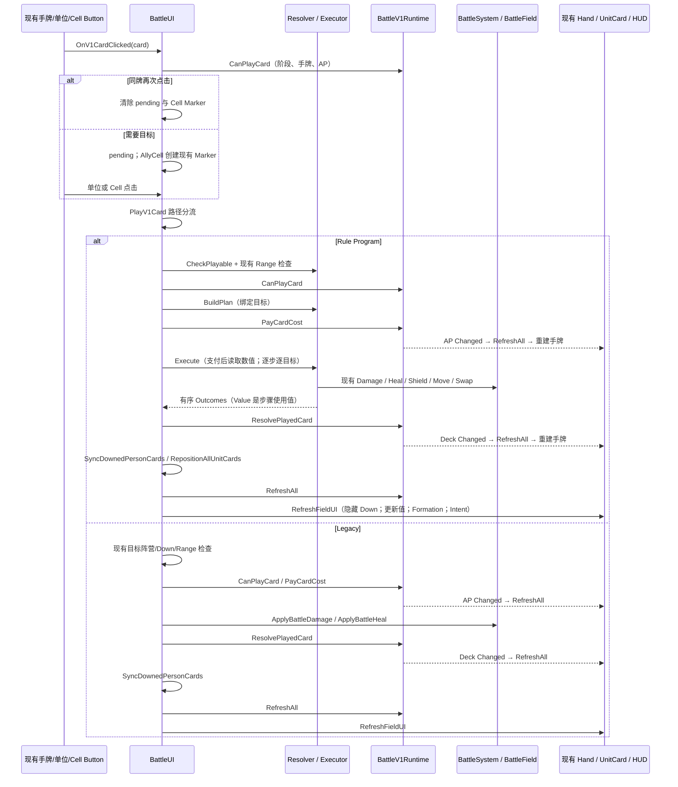
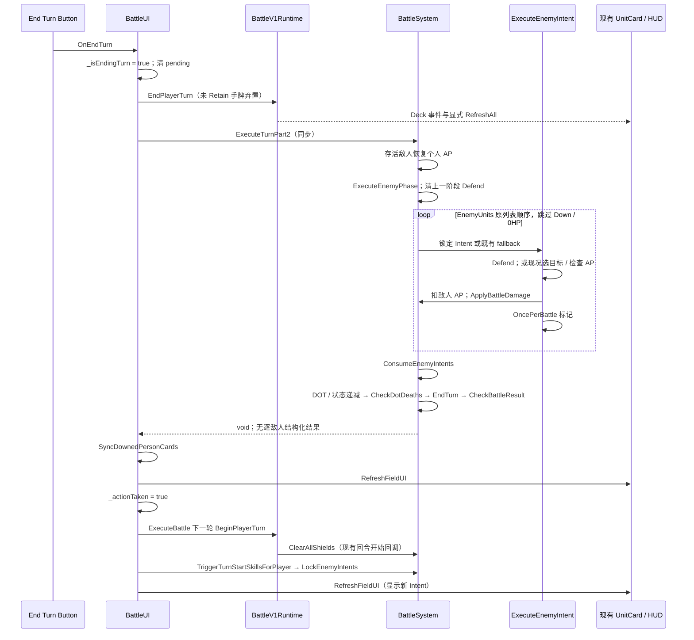

# Battle Combat Feedback Foundation V0.1 — 实施前审计

日期：2026-10-02。执行：Codex。规划 / 验收：开发14.0。

状态：**实施前历史审计**。随后 MCP 已恢复、实现已落地；最终状态与本轮证据见同目录的 `2026-10-02_Battle-Combat-Feedback-Foundation-V0.1-Report.md`。
本文件保留实施前代码事实、接入约束和当时的环境阻塞，不是 Gameplay Authority，也不能作为实施后的验收状态读取。

## 基线与工作区保护

- Target Branch：`main`。
- 本轮实际查询 HEAD 与 origin/main 均为 `72e40690d3ece8f66e7588511d806bccc38c2775`。
- 既有 tracked 改动：`Development/Config/RRPG_Events.xlsx`、`UnityProject/RRPG1.0game/ProjectSettings/QualitySettings.asset`。
- 既有 untracked：Battle 实验图片及 meta、UnitHUD 的意图/血条实验图片及 meta、Assets 根目录实验图片及 meta。
- 上述内容均作为制作人工作保护；没有 reset、stash、覆盖、暂存、commit 或 push。
- 指定历史验证基线为 Compile 0 Error、EditMode 1048/1048、PlayMode 89/89；本轮没有重跑测试，不能将历史数字作为本轮通过证据。

## A. Current Battle Timing Audit

`RefreshAll()` 当前直接调用 `RefreshHand()` 与 `RefreshCounters()`；`RefreshHand()` 销毁旧 `V1Card_` 对象并重新 Instantiate。`_suppressRefresh` 目前只保护初始化事件回调，不能覆盖出牌后的显式刷新。

## B. Root Architectural Problems

1. **请求值不是视觉 Delta。** Executor 的 `Value` 经 ResolveValue 与 Bonus 得到，随后交给 Authority。Damage Authority 再进行 Enemy Defend 的 Ceil 减伤、Shield 吸收、HP Clamp、Down 和 Board 释放；Heal Authority Clamp 到 MaxHP。DamageEvent / HealEvent 的数值也不能替代 before/after 真实 Delta。
2. **AP 与 Deck 事件过早重建手牌。** 即使只删除出牌函数最后一次 Refresh，支付费用和牌堆去向仍会提前销毁 Card Commit 宿主。Draw、移除失能人物牌也可能触发相同刷新。
3. **敌方为同步整体。** 必须按实际 EnemyUnits 遍历结果捕获，不能从最终状态反推每个敌人的目标或伤害；后一个敌人的目标选择依赖前一个敌人的实际结果。
4. **Down 视觉提前隐藏。** `RefreshFieldUI` 的 `SetActive(!IsDown && HP > 0)` 随后触发 Formation；需把最终视觉退出留到 Down Cue 之后。逻辑 Down、Board 释放、人物牌移除仍必须即时执行。
5. **战斗结束与回合切换不能越过播放。** `ExecuteBattle` 等待循环直接读取 `IsBattleOver`，致命伤会让它提前进入 `DoSettlement`；EndTurn 的 `_actionTaken` 也会推动下一轮。必须增加表现完成等待，不能延迟 Authority 的胜负判定。
6. **HUD 另有只读轮询。** `BattleHudPresenter.LateUpdate → Refresh` 读取真实 Deck/Turn；仅保护 V1Runtime 不能冻结全部 Presentation。需令现有 HUD 尊重同一 batch。
7. **敌方批次后存在 DOT。** `ExecuteTurnPart2` 的状态系统、CheckDotDeaths 在敌方行动后执行。反馈序列需捕获该尾段变化，不能把 DOT 的 Down 错归到最后一个敌人的 action。
8. **输入锁必须覆盖所有入口。** 手牌入口已有 waiting/ending/phase 检查，但单位目标入口、Cell Marker、Cancel、EndTurn 都需尊重播放锁；不能仅禁用一个 Button。

## Existing Host Map

本轮 MCP 实际读取：`SampleScene` 已加载、非 Play、非 Compiling、非 Updating、Scene 未 dirty；Console Error 查询返回空数组。

| 职责 | 已核实宿主 / 代码 |
|---|---|
| Battle 产品编排 | `BattleController` 上的 `BattleUI` |
| 共享牌库 / AP / Hand | 同对象 `BattleV1Runtime`；BattleUI 的 `handContainer`、`v1Runtime` 均有引用 |
| HUD | 同对象 `BattleHudPresenter`，需尊重 batch |
| Canvas | `BattleController/BattleCanvas`；RectTransform、Canvas、Scaler、Raycaster |
| 单位视觉 | BattleUI `unitCardPrefab` 已有引用；具体 Prefab 层级仍需继续 MCP 核对 |
| HP / Shield | 代码稳定宿主 `Text_HP`、`Anchor_Shield/Text_Shield`；当前制作人 Slider/Radial 宿主与引用仍需 MCP 精查 |
| Actor / Intent | `Anchor_Visual/Body_Visual`、`Anchor_Intent`；本轮未重新排版 |
| Formation | `RepositionAllUnitCards` / `ApplyFormationPresentationToAllRows`；仍由 BattleUnit + Board 定位 |
| 选目标 | 现有 Rule Resolver 合法目标与 Cell Marker；不新增规则 |

## C–I. 实施接缝与约束（尚未实现）

- Structured Feedback Fact：只保存 scalar 身份与 before/after。Rule 层可补充中立 TargetRef 和逐步骤事实快照，不引用 Player/Profile/UI 类型；Move 必须捕获 owner，Swap 必须捕获双方。
- Refresh Transaction：在 V1Runtime 初始化抑制之外增加可嵌套、可释放的 Presentation Batch；事件仍发送。显式 Refresh 和自动 Refresh 同时延迟，最外层释放统一刷新；异常、Skip、Disable 必须释放与恢复输入。
- Player/Profile：Battle-local Coroutine 消费有序 records，统一 Speed/Instant/Skip 时钟；Profile 为 Inspector 配置入口。替换 Hook 只能消费事实，不决定 Gameplay。
- Value Presenter：局部组件统一驱动部分绑定的 Slider、Filled Image、TMP。Shield 最大值的表现量程需由配置明确，不能误把 HP 上限当 Shield 规则。
- Player Card：先完成已有 validation，batch 内支付、原执行器结算、牌堆去向与 Down 人物牌移除；再 Commit → AP → Actor → 按序 Delta / Down → 最终视觉刷新与 Formation。
- Enemy：已有同步 Gameplay 不改顺序，捕获逐敌人 result（含 Defend、不适用原因、实际 source/target/request 与 Delta），然后播放；DOT 尾段独立记录；下一玩家回合生成后才显示新 Intent。
- Down / Formation：逻辑即时 Down / Board 释放；视觉仍保留旧宿主，Cue 完成后隐藏，再以现有 Formation 目标插值。致命伤播放期间禁止提前结算。

## J–N. 当前交付与验证状态

- Changed Files：只有此审计文件。没有新增/修改产品 C#、Scene、Prefab、Profile 或测试。
- Gameplay Non-Changes：没有修改规则、公式、目标合法性、敌方顺序、Card Pile、AP、Board、Formation、Person、Run 或 Save。
- Tests：本轮尚未新增/执行 Feedback 测试。
- Full Validation：仅取得实施前 Console Error 空数组与 Editor/Scene/宿主部分读取；**Compile after changes、定向测试、全量 EditMode/PlayMode、真实产品反馈路径均未验证**。
- 环境阻塞：最初 MCP 的 `localhost:29387` 连接失败；用户打开 Editor 后连接恢复并取得上述基线。随后会话中断，当前暴露工具列表不再包含 Unity MCP，调用 `editor_application_get_state` 得到 `is not a function`。不得据此绕过 serialized asset 边界或冒充验证。
- 恢复位置：恢复 Unity MCP 工具到当前会话 → 继续核对 UnitCard/HUD 具体引用 → 分段实现、编译、定向测试 → 产品路径与全量测试 → 任务报告/交接。已完成审计无需重做，除非工作区或基线发生变化。
- 未生成最终 Handoff、未标记 Acceptance Passed / Closed、未 commit / push。未来正式 Spine / VFX / Audio / Camera 不在本轮范围。
