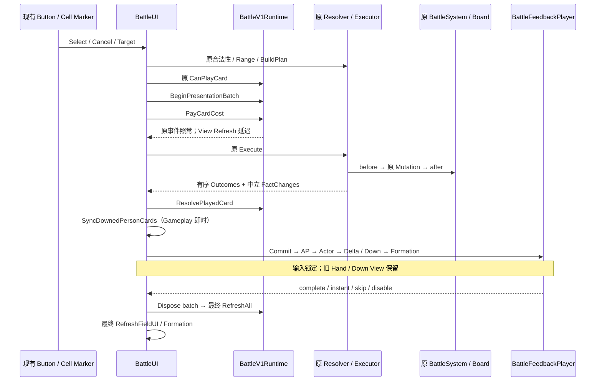

# Battle Combat Feedback Foundation V0.1

日期：2026-10-02；任务日期：2026-10-01。执行：Codex。规划 / 验收：开发14.0。

状态：**Acceptance Passed / 开发14.0 Technical Review PASS**。用户已授权纯 Closeout：白名单 commit / push main。本文与 Handoff 记录提交前生成时事实；最终发布 SHA 与同步状态从 Git 查询，不预测自身提交 SHA。本次收尾不追加实现，不替代 GameSpec。

## A. Current Battle Timing Audit

完整实施前 Input → Validation → Mutation → Refresh 时序见 [实施前审计](2026-10-02_Battle-Combat-Feedback-Foundation-V0.1-Audit.md)。原 Rule / Legacy 出牌在 PayCardCost、Deck Changed、结算末尾反复 RefreshAll；敌方同步批次在结尾刷新；RefreshFieldUI 立即隐藏 Down。以下为接入后的正式路径：



## B. Root Architectural Problems

- Rule Outcome.Value 是请求/步骤使用值；Defend、Shield 和 Clamp 必须由现有 Authority 处理后读取真实 Delta。
- 仅删除出牌末尾刷新无法保护手牌；AP / Deck Changed 与 HUD 轮询同样需要尊重一个局部 Presentation Batch。
- 敌方整体末态不能反推单个敌人的实际目标；在原 foreach 内捕获每次执行的结果。
- Down 的逻辑占位释放与牌库过滤必须即时；隐藏 View、Formation 和结算窗口等到反馈完成。
- 战斗结束与下一回合会越过播放；ExecuteBattle 增加表现完成等待，60 秒玩家输入预算在反馈期间暂停计时。

## C. Structured Feedback Fact

`BattleRuleFactSnapshot` 保存 UnitId、HP、MaxHP、Shield、Row、Column、IsDown；`BattleRuleFactDelta` 保存 before/after。每个 Executor 目标执行前后从 `IBattleRuleContext` 读取真实 Authority；不改变步骤、目标或执行顺序。Outcome 新增 TargetRef / FactChanges，不引用 UI 类型。

`BattleFeedbackRecord` 保存 Type、Source/Target UnitId、CardInstance/TemplateId、RequestedValue、HP / Shield / AP before/after、坐标 before/after、BecameDown、Applied 与 Enemy IntentType。HPDelta / ShieldDelta 直接做事实差；BecameDown 读取实际 IsDown 转换。没有复制 BattleUnit、公式或第二套战场。

SourceUnitId 使用 Commit 前捕获的实际牌主身份；牌主在自身结算中 Down 时，不能在结算后重新按存活资格查询 source。该边界有产品路径回归。

Move 捕获 owner 坐标，Swap 捕获双方；无实际数值变化的步骤不制造假的飘数。Legacy 原 ApplyBattleDamage / ApplyBattleHeal 保留，通过同一 before/after 接缝生成等价记录。

## D. Refresh Transaction

`BattleV1Runtime.BeginPresentationBatch()` 返回 IDisposable，支持嵌套，重复 Dispose 幂等，最外层释放时 RefreshAll。原 `_suppressRefresh` 仍负责初始化；新 depth 只负责 Presentation。

Gameplay 事件继续发送，AP 支付、牌堆去向、Down 人物牌移除先完成。Runtime.RefreshAll、BattleHudPresenter 轮询和 BattleUI.RefreshFieldUI 尊重 deferral/busy。最终统一刷新。同步异常、嵌套动画异常、Instant、Skip、Player 停用、BattleUI 停用均有释放路径。不会靠动画回调才能支付费用或改变牌堆。

## E. Feedback Player / Profile

Battle-local `BattleFeedbackPlayer` 消费 IReadOnlyList，Coroutine 按记录顺序播放。统一 Tween 使用 unscaled 时间 × PlaybackSpeed；支持 1x、2x、Instant、SkipCurrent（跳过当前剩余序列）和 CompleteImmediately。停止时恢复临时 transform / color / number 宿主并执行 completion。

`BattleFeedbackProfile` 是 BattleUI Inspector 内嵌的 Serializable 配置（等价 Inspector 入口，无需新增 SO 或修改 Scene）。包括 Select Scale/Offset、Commit Duration、Actor Distance/Duration、Hit Punch/Duration、Floating Number Duration/Offset、HP / Shield Tween、Down、Formation 与 TargetHighlight。AP 共用 HpTweenDuration。

配置入口：`SampleScene → BattleController → BattleUI → Combat Feedback`。现有 Custom Inspector 新增明确配置组；Feedback Enabled、Feedback Profile、可选 Sequence Player / AP Value Presenter Override 均可调。未指定 Player 时在同一 BattleController 创建局部运行时组件；未指定 Value Presenter 时绑定现有宿主。

默认路径无需额外人工 Unity 配置；参数观感可由制作人在该组调整，已有布局和绑定保持原样。

预留 ActorClip、SpineAnimationKey、VfxPrefab、AudioClip、CameraCue；本轮不播放这些资源。未来修改 PresentFeedback / Profile / 局部 View 适配，不改 Gameplay Executor 或 AI。未增加 Timeline、Animator Graph、Spine、第三方 Tween 或音频框架。

临时飘数字体从 Current 默认字体源创建 Battle-local TMP_FontAsset，保持当前字体来源，仅隔离动态字形缓存，避免负号写回制作人的正式字体资产；播放器销毁时释放临时字体、材质与 atlas。

## F. Value Presenter

`BattleValuePresenter.SetImmediate(current,max)` / `AnimateTo(current,max,duration)` 统一支持部分绑定：Slider.normalizedValue、Filled Image.fillAmount、TMP 数字。normalized = clamp01(current/max)，max≤0 为 0。数值 tween 可接 Player 时钟。

现有 UnitCard HP、Shield anchor、AP HUD 为稳定宿主；运行时只补局部组件。优先使用 Inspector 已绑定的 Linear/Radial/Number，否则在宿主局部查找 Slider / Filled Image。未重排 BattleCanvas、人物比例、背景或卡牌。

Shield 显示量程为本次 before/after 中较大值，只是第一版表现量程，未建立护盾玩法上限；HP/AP 使用真实 Max。普通条与圆环可同时或单独绑定。

## G. Player Card Sequence

现有 OnV1CardClicked / PlayV1Card / PlayRuleV1Card / PlayLegacyV1Card 保持 Validation 分流。Select 抬升/放大，同牌点击或 Cancel 恢复；Rule 合法 Unit 目标使用现有 Resolver + Range 简单着色，AllyCell 沿用原 Marker。

确认后 Gameplay 先支付 → 结算 → ResolveCard → Down 同步；表现后播放 Commit 缩小退出 → AP before/after → Actor 简单位移 → 按步骤真实 HP / Shield 飘数、Hit 与 Presenter → Down → Formation。Commit 期间原手牌宿主保留，最终牌已在 Discard/Exhaust，播放结束再重建手牌。

## H. Enemy Sequence

原 `BattleSystem.ExecuteTurnPart2 → ExecuteEnemyPhase foreach → ExecuteEnemyIntent` 保持同步。ExecuteEnemyIntent 返回 EnemyActionResolution：EnemyUnitId、IntentType、TargetUnitId、RequestedValue、Before/After、Applied。LastEnemyActions 保留本次实际执行顺序，初始化及下一次批次前清空。

UI 捕获后按 Enemy A Actor → A Delta → Enemy B Actor → B Delta 播放。Defend/无目标也可表达 Applied 状态；不重新选目标、不让动画控制 AI。DOT / TurnEnd 的后续差额独立记录。完成后才让 ExecuteBattle 进入下一玩家回合；新 Intent 按原 LockEnemyIntents 生成后刷新。

## I. Down / Formation Sequence

Authority 同步设置 IsDown、HP=0、释放 Board 占位、判定胜负。SyncDownedPersonCards 即时过滤人物牌，但 batch 保留旧 View。真实 Delta → Down scale cue → 隐藏 → 原 Formation 计算目标 → View 位置插值 → 最终刷新。致命伤不能越过播放提前打开结算。

Instant / absent 路径直接最终刷新；正常、2x、Skip 的最终 Gameplay 不依赖动画时长。

## J. Changed Files

原实施阶段 35 个文件全部归类为 **This Task**；本次 Closeout 增加已获授权的交接文件，共 36 个精确白名单文件。路径均相对仓库根。新 C# 的 `.meta` 由 Unity 导入生成，随代码配对保留。

**Must Stage（This Task，含 Closeout 交接，共 36 个文件）**

```text
Docs/DevelopmentSpecs/2026-10-02_Battle-Combat-Feedback-Foundation-V0.1-Audit.md
Docs/DevelopmentSpecs/2026-10-02_Battle-Combat-Feedback-Foundation-V0.1-Report.md
Docs/DevelopmentSpecs/README.md
Docs/项目状态快照.md
Docs/开发验收交接.md
UnityProject/RRPG1.0game/Assets/Editor/BattleAuthoringInspectors.cs
UnityProject/RRPG1.0game/Assets/Editor/BattleFeedbackTestClock.cs
UnityProject/RRPG1.0game/Assets/Editor/BattleFeedbackTestClock.cs.meta
UnityProject/RRPG1.0game/Assets/Scripts/Battle/BattleSystem.cs
UnityProject/RRPG1.0game/Assets/Scripts/Battle/BattleSystemEnemyIntent.cs
UnityProject/RRPG1.0game/Assets/Scripts/Battle/Stage1/Rules/BattleCardRuleExecutor.cs
UnityProject/RRPG1.0game/Assets/Scripts/Battle/Stage1/Rules/BattleRuleContext.cs
UnityProject/RRPG1.0game/Assets/Scripts/Battle/Stage1/Rules/BattleRuleResolutionResult.cs
UnityProject/RRPG1.0game/Assets/Scripts/Battle/Stage1/Rules/BattleRuleFactDelta.cs
UnityProject/RRPG1.0game/Assets/Scripts/Battle/Stage1/Rules/BattleRuleFactDelta.cs.meta
UnityProject/RRPG1.0game/Assets/Scripts/Battle/V1/BattleRuleContextRuntime.cs
UnityProject/RRPG1.0game/Assets/Scripts/Battle/V1/BattleV1Runtime.cs
UnityProject/RRPG1.0game/Assets/Scripts/UI/BattleHudPresenter.cs
UnityProject/RRPG1.0game/Assets/Scripts/UI/BattleUI.cs
UnityProject/RRPG1.0game/Assets/Scripts/UI/BattleUIRulePipeline.cs
UnityProject/RRPG1.0game/Assets/Scripts/UI/BattleUIUnitVisualHosts.cs
UnityProject/RRPG1.0game/Assets/Scripts/UI/BattleFeedbackPlayer.cs
UnityProject/RRPG1.0game/Assets/Scripts/UI/BattleFeedbackPlayer.cs.meta
UnityProject/RRPG1.0game/Assets/Scripts/UI/BattleFeedbackProfile.cs
UnityProject/RRPG1.0game/Assets/Scripts/UI/BattleFeedbackProfile.cs.meta
UnityProject/RRPG1.0game/Assets/Scripts/UI/BattleFeedbackRecord.cs
UnityProject/RRPG1.0game/Assets/Scripts/UI/BattleFeedbackRecord.cs.meta
UnityProject/RRPG1.0game/Assets/Scripts/UI/BattleUIFeedback.cs
UnityProject/RRPG1.0game/Assets/Scripts/UI/BattleUIFeedback.cs.meta
UnityProject/RRPG1.0game/Assets/Scripts/UI/BattleValuePresenter.cs
UnityProject/RRPG1.0game/Assets/Scripts/UI/BattleValuePresenter.cs.meta
UnityProject/RRPG1.0game/Assets/Tests/EditMode/BattleFeedbackFoundationTests.cs
UnityProject/RRPG1.0game/Assets/Tests/EditMode/BattleFeedbackFoundationTests.cs.meta
UnityProject/RRPG1.0game/Assets/Tests/PlayMode/BattleFeedbackFoundationPlayTests.cs
UnityProject/RRPG1.0game/Assets/Tests/PlayMode/BattleFeedbackFoundationPlayTests.cs.meta
UnityProject/RRPG1.0game/Assets/Tests/PlayMode/EncounterProductPathPlayTests.cs
```

**Must Not Stage**：既有 `Development/Config/RRPG_Events.xlsx`、`ProjectSettings/QualitySettings.asset`、Battle / UnitHUD / Assets 根目录制作人实验 PNG 与 meta，以及临时日志/运行器/测试结果。

首次飘数测试触发正式动态字体自动写入负号字形；已改为临时字体实例，并按用户继续执行的授权仅恢复该原本干净的指定字体文件到任务初始 HEAD。最终该字体无内容 diff，`git hash-object --path` 与 HEAD 均为 `c065b309de2bcf944d022a05698eb5a8f41447f3`；Git 的 stat 标记不作为内容改动或提交项。没有修改 Scene、Prefab、美术内容或正式字体配置。

## K. Explicit Gameplay Non-Changes

Damage / Defend / Shield 吸收 / Heal Clamp / 目标与 Range / AP 费用 / Card Pile / Draw / Retain / Exhaust / 敌方目标选择与顺序 / Down / Board 释放 / 逻辑 Formation / 胜负 / Run / Save 规则均未改变。新增的是 capture 与 Presentation 生命周期接缝，不是新的 Battle Event Bus。

## L. Tests

长期最小契约集合：权威普通/Shield/Defend/Clamp Damage、Overheal、Shield、Move/Swap、Down、敌方实际顺序/目标、嵌套批次释放、Slider/Radial 终值、2x/Instant 时钟；真实产品路径覆盖 Select/Cancel、Commit View 保留、AP/Delta、Discard/Exhaust、Down/Formation、EndTurn/Enemy/NewIntent；Rule 与 Legacy 的 enabled/Instant/absent/2x 全状态一致性；Skip/Disable 释放。

新增 EditMode 12 个 case、PlayMode 4 个 UnityTest。保留理由是用户明确要求的 Authority Delta、Gameplay invariance、事务释放与可替换 Presenter 核心契约；不是一次性验收流水账。`BattleFeedbackTestClock` 是长期 Editor Test Runner 适配器，让一般测试默认 Instant，专项测试显式覆盖 1x/2x；普通玩家 Play 不受影响。

既有 `EncounterProductPathPlayTests` 的单人随机初始一张牌可能合法不可打，原测试会偶发失败。本轮测试修复仅在首次尝试无可打牌时，通过原 SharedDeck.Draw 补抽真实牌、刷新并重试，次数受剩余 DrawPile 限制；仍经现有 Button 与 Rule Authority 出牌，不改产品抽牌数/规则，也不制造替代卡。

通过 MCP Test Runner 执行真实 SampleScene → MainMenu Continue → Town Expedition → Confirm → Journey 战斗节点 → 部署 → PlayerTurn → 既有 Card/Unit Button → EndTurn。固定卡/HP 是测试输入，执行仍交给正式 UI、Runtime、Resolver 和 Authority。

## M. Full Validation

最终代码机器证据：

| 项目 | 本轮结果 |
|---|---|
| Compile | **0 Error**；Editor IsCompiling=false / IsUpdating=false，测试程序集成功加载执行；最终最近一分钟 Console Error / Exception 均为空 |
| 定向 Feedback EditMode | **12/12 PASS**，覆盖普通 / Shield / Defend / Clamp / Overheal / Shield 增加 / AP transaction / Move / Swap / Down / Enemy / Presenter / Speed；最终全量包含这些 case |
| 定向 Feedback PlayMode | **4/4 PASS**；最终字体恢复后再跑 4/4，覆盖真实产品闭环、Rule/Legacy 四种播放模式、Enemy 四种模式、Skip / Disable / source 在牌主 Down 后保留 |
| 全量 EditMode | **1060/1060 PASS**，20 个程序集，failed=0 / skipped=0；最终代码复跑，不是历史 1048 |
| 全量 PlayMode | **93/93 PASS**，5 个程序集，failed=0 / skipped=0；最终代码复跑，不是历史 89 |
| 产品路径 | MCP Test Runner 调用真实 SampleScene、MainMenu/Town/Expedition/Journey/Prep/Battle 入口和现有 UI Button；没有使用独立 Demo 替代产品集成 |
| Profile 回读 | MCP 读取 BattleController.BattleUI，feedbackEnabled=true；Profile 的 Select=1.08/(0,24)、Commit=.16、Actor=12/.12、HP/Shield=.18、Down=.25、Formation=.2 均与配置一致；Player / AP Override 为空时运行时补宿主 |
| Scene / Layout / Font | SampleScene 已加载、IsDirty=false；最终无 Scene/Prefab/正式字体 diff；静态对象未移动 |
| Diff | 生成前tracked git diff --check PASS；stage后精确36项集合相等。新增Unity meta空字段有27处标准尾空格，保留；排除meta后的cached检查及命令级忽略blank-at-eol检查PASS，不修改全局配置 |
| Technical Review / Acceptance | 用户明确确认开发14.0 Technical Review PASS，授权纯 Closeout；不等同正式 VFX / 美术内容验收 |
| MCP Product Acceptance | **PASS**；真实产品路径覆盖 Player Turn → Select/Target/Commit/AP/Actor/Damage/HP/Down/Formation → EndTurn/Enemy Sequence/New Intent |

全量程序集明细（Passed 数相加，不把每次 MCP 的 TotalTests 全局发现数重复相加）：

| EditMode 程序集 | Passed |
|---|---:|
| BattleStage1.Tests | 261 |
| VillageV4.Tests | 21 |
| VillageResource.Tests | 47 |
| VillageStage1.Tests | 130 |
| StaticConfig.Tests | 61 |
| ProfessionM6.Tests / ProfessionM5.Tests / ProfessionM4.Tests | 32 / 23 / 16 |
| BattlePersonExp.Tests | 7 |
| Event.Tests | 126 |
| ProfessionM3.Tests | 17 |
| Encounter.Tests | 48 |
| EventProduct.Tests | 72 |
| PersonBootstrap.Tests | 7 |
| ProfessionM2.Tests | 16 |
| ExpeditionJourney.Tests / ExpeditionProgression.Tests | 44 / 37 |
| PersonVisual.Tests | 24 |
| ExpeditionV4F.Tests | 32 |
| PersonIdM1.Tests | 39 |
| **合计** | **1060** |

| PlayMode 程序集 | Passed |
|---|---:|
| BattleStage1.PlayModeTests | 51 |
| VillageV4.PlayModeTests | 12 |
| VillageStage1.PlayModeTests | 19 |
| PersonBootstrap.PlayModeTests | 1 |
| ExpeditionV4F.PlayModeTests | 10 |
| **合计** | **93** |

真实玩家序列断言：Select 位移 → 同牌 Cancel 恢复 → Card/Unit Button Commit → Gameplay AP 先支付、牌先进入 Discard/Exhaust → busy / batch 保留旧 Hand View、拒绝 EndTurn → 实际 HP -3 / Shield -3（request=6） → Presenter 终值 → lethal 时 Gameplay IsDown 在 Cue 前成立、View 保留 → Cue 后隐藏 → Formation 已落到原 Authoring 终位 → EndTurn → LastEnemyActions 与 EnemyAction Cue 的 source 顺序一致 → 完成后下一玩家回合 + 新锁定 Intent。

历史基线 1048 Edit / 89 Play 不冒充本轮结果。MCP 无过滤或模式切换第一调用曾返回 No tests found，Play 返回后部分调用曾遇仍在清理的 active request；改为显式逐程序集执行、确认 Editor 状态并重试，最终覆盖全部。早期测试 fixture failure 与预期故障注入 Error 单列为开发过程，不把失败重试隐去，也不把它们当编译错误。没有保留临时 TestResults、截图或一次性 Runner；外部 MCP 诊断脚本已清理，长期回归与 TestClock 保留理由见 L。

Git Facts（Closeout 文档生成时）：Repository `LINQI2/RRPG1.0W`，当前分支 / Target Branch = `main`，HEAD = origin/main = `72e40690d3ece8f66e7588511d806bccc38c2775`，index 为空。用户已授权 36 文件白名单 stage / commit / push main；后续发布结果以 Git 与最终报告为准，不提前声明关闭。实施阶段唯一 restore 为获准恢复本任务测试污染的原本干净字体文件，不涉及制作人保护项；本次纯 Closeout 不执行 reset / stash / restore。

工作区分类：原 35 文件均为 This Task，本次新增 Handoff 为 This Task；六张实验 PNG 与各自 meta 共 12 文件为 Producer Work；RRPG_Events.xlsx 与 QualitySettings.asset 共 2 文件为 Unrelated Dirty。14 项全部保护、排除，逐项内容哈希在 Closeout 前后核对。字体内容与 HEAD 一致，仅 stat 标记，单独排除；不宣称 Repository clean。

文档影响：审计保留实施前事实；报告与 DevelopmentSpecs 索引同步 Technical Review PASS；项目状态快照和开发验收交接同步已验收范围、最终验证与下一 Gate。Handoff 仅更新标记内，Git Facts 保留生成时快照。GameSpec / GameDesign / Architecture 无变化。本次只做文档与发布收尾，未修改实现或重跑已通过的测试。

## N. Remaining Risks / Future Replaceable Hooks

- 第一版只有 scale / 位移 / TMP 飘数，无正式攻击动画、VFX、Spine、音效或 Camera 系统。
- Profile 是 Inspector 内嵌配置；今后需要跨 Battle 共用时可抽 SO，消费者事实接口不变。
- 普通回合开始的 AP 恢复、抽牌与清盾仍沿用即时刷新；本轮出牌 AP 变化已 tween。
- Shield 径向量程策略是表现选择，未来可由 Profile 明确；不推导护盾规则上限。
- Legacy 保留已有目标校验；Unit 高亮第一版来自 Rule 合法目标，Legacy 仍可正式选取/结算。
- 开发14.0 Technical Review 已通过；正式资源和最终美术观感不属于本次验收范围。
- 下一节点仅记录为 **Battle First Playable Content Slice — Product/Game Design Gate**，不启动实现。不进入 Feedback V2、VFX / Spine / Audio。
