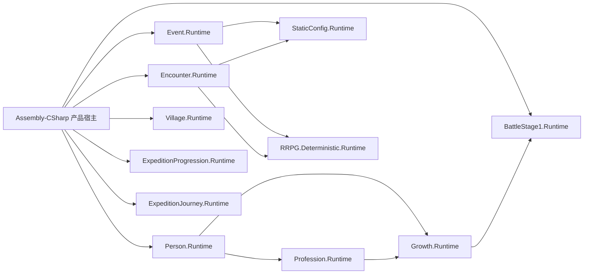

# RRPG 工程现状与引用审计

> 日期：2026-10-02 建档，2026-10-04 更新；状态：第二十三批完成战场保留项复核，并对截至第二十二批的累计实现重新执行全量 EditMode 1064/1064、PlayMode 93/93，均通过；场景与原存档核对恢复。文档交接和精确发布范围仍待收口，未提交 / 推送。全仓外部资产逐字段反向引用未穷尽；下文初始审计描述保留为历史证据，不代表实时状态。
> Target Branch：`main` 本地工作区；开始查询 HEAD `37852d4b079cf53c1639f3b992310c3addfbf5a1`。没有 commit / push 授权。
> 职责：本任务的审计证据与迁移准备，不是新的长期 Architecture 或玩家规则 Authority。
> 输入：[已并入的审计方法与范围](#audit-method)、仓库权威入口、实际代码、Unity MCP 与磁盘资产只读抽查。当前交付与后续边界看[优化总结](2026-10-04_RRPG_架构优化总结与验收清单.md)；初始结论及旧名称保留为历史记录。
> 本轮覆盖：Scripts 一级模块与 asmdef 全量清单、主产品入口、Battle / Prep 主要绑定和三份产品卡牌 Prefab；不宣称全仓所有资产的反向引用审计已经穷尽。

## 1. 对制作人的结论

当前工程可以沿已有产品宿主逐步整理。首轮宜做战斗里的准确命名，随后再治理战前牌的生成宿主与场景分组。不能按旧名字或 inactive 状态直接删除对象：部分名称已经落后于实际职责，部分调试对象仍被正式逻辑借用。

本轮确认了三个关键依赖：

1. `BattleController` 实际同时挂着 `BattleUI`、`BattleV1Runtime`、`BattleHudPresenter`，不是一个只负责战斗规则的 Controller。
2. `PrepCardRoot` 是两份 handContainer 绑定的同一对象，但实际战前人物牌在 `BattleCanvas` 下直接生成；战前牌与战中行动牌的布局由不同代码负责。
3. `BattleCanvas/InfoText ` 的 TMP 文本绑定同时提供 `infoText.canvas`。这个表面上是 Debug 的对象，仍参与战前卡创建、拖动、归还、排序和清理。先迁走这些宿主依赖，才能考虑删除调试文本。

不要求制作人解释这些技术引用。制作人需要判断的是实际用途与观察习惯；无法由代码说明的装饰对象会在具体列表中提出。

## 2. 现场基线与覆盖边界

- 查询时 Editor 在 Edit Mode，未编译；团结引擎 2022.3.62t9。
- 初始审计时场景 `Assets/Scenes/SampleScene.scene` 为 `IsDirty=true`；制作人随后保存，现场恢复后再次通过 Editor 保存，最终回读 `IsDirty=false`。
- 本轮早期读到 18 个根对象、269 个对象；落盘[Scene 对象快照](2026-10-02_RRPG_工程现状与引用审计.md#historical-scene-snapshot)时记录 19 个根对象、271 个对象，随后 root 查询仍为 19。已查明属性读取副作用，详见下节；Snapshot 的两个新增面板不是整理后的正式资产。
- Snapshot 保存路径、activeSelf 和当前会话 instanceID；实施时重新查询。会话 ID 不是持久 fileID / GUID。
- 读取了初始 18 个根对象及 Battle 的主要静态宿主/按钮/标签组件，详细回读 BattleUI、BattleV1Runtime、HUD、主菜单、Town、Expedition 和三份卡牌 Prefab 的主要字段。没有完成全场景每个组件的 Missing Script 与反向引用证明。
- Console 20 条 Error 样本均包含测试相关堆栈，其中也有一次工具报告“找不到测试程序集”；这只作为日志来源证据，不代表本轮测试通过或当前产品有同样故障。
- 初始审计未清日志、未开关 Play、未调用 Scene 保存/重载或 Component/Prefab 修改工具；但反射属性读取触发了 getter 创建对象，不能宣称场景未受影响。后续已删除两项副作用对象并保存，见 §2.1。一次批量查询通道中断，已缩小查询范围继续；不把中断期间结果算作已验证覆盖。
- 工作区既有 Event XLSX、字体、QualitySettings、图片与 meta 修改继续保留，仅记录类别；本轮没有读取这些任务外修改的 diff。

### 2.1 已定位的读取副作用与恢复

制作人确认没有其它对话在编辑当前场景。本轮 `object-get-data` 对 ExpeditionUI 使用未限定成员的 ViewQuery，会反射读取属性；`ProgressionPanelRef` 和 `IdentityPanelRef` 两个 private getter 在字段为空时执行 `new GameObject`，因此创建了：

- `ExpeditionProgressionPanel`：顶层，会话 instanceID `-2256766`。
- `ExpeditionUI /ExpeditionIdentityPanel`：远征 UI 子对象，会话 instanceID `-2256772`。

证据：`Assets/Scripts/UI/ExpeditionUI.cs` 的 ProgressionPanelRef（约 899 行）和 IdentityPanelRef（约 912 行）；与此前 269 对象树相比新增的就是上述两个面板。随后重复场景树仍为 271。

初始删除工具未暴露，制作人后续明确授权由本 Agent 删除，并开启、重新连接 MCP。重新按路径读取确认两个对象均无子对象，新会话 instanceID 分别为 31858、30944；通过 `gameobject-destroy` 精确删除两者。`scene-save` 拒绝 `.scene` 扩展名，因此经 `script-execute` 调用 `EditorSceneManager.SaveScene`，并先校验 active scene 路径必须为 `Assets/Scenes/SampleScene.scene`；保存成功，未另存为 `.unity`，未编辑 YAML。

状态：**恢复已完成**。保存后完整树回读：18 个根对象、269 个对象，两项面板均不存在，原有 18 个根对象名称保留，`IsDirty=false`。未安装 CLI、未升级 Package、未触碰其它待整理对象；这次恢复不是产品重构验收。后续使用 SerializedObject 或精确 fields/paths，不对业务组件做无过滤属性遍历。

恢复后的只读 `SerializedObject` 扫描覆盖 Scene 内 269 个对象的组件：Missing Script 为 0；对象引用值为空但仍具有非零 instanceID 的序列化断引用为 0。此结果不证明所有必填字段均已绑定，也不覆盖磁盘未加载资产、字符串路径或运行时引用。BattleUI 的 infoText / handContainer / prepCardPrefab / v1Runtime / btnEndTurn 回读分别为 `InfoText ` / `PrepCardRoot` / `CharCard` / `BattleController` / `BtnEndTurn`；BtnEndTurn 持久事件为 `BattleUI.OnEndTurn`、RuntimeOnly。扫描后 Scene 仍 `IsDirty=false`；未启动 Play，未修改业务代码。

这也是需要补进工程规范候选的问题：用于观察/反射的 getter 应避免隐式创建产品宿主；是否改代码另行确定，不在本轮自动修复。

## 3. 代码模块清单

### 2026-10-04 第二十八批：Final Closeout与发布准备

- 制作人阅读交付和仓库治理结果后授权收尾推送；最终检查未发现新增阻塞，不扩大Legacy清理或重构范围。当前生成时状态为Acceptance Passed / Final Closeout，实际Closure SHA / Push结果查询Git。
- Unity MCP本轮只读核对：SampleScene.scene，dirty=false、非Play / 编译 / 刷新，5 roots / 270 objects / 6758引用字段，Missing Script / broken reference=0，scriptCompilationFailed=false。没有执行新游戏测试、保存场景或更改资源；沿用第23批现有实现累计回归证据。
- fetch origin main及实时ls-remote成功，远端与本地基线均为37852d4b079cf53c1639f3b992310c3addfbf5a1，发布前无漂移；命令级绕过不可用本地代理，不改全局配置。
- 第54版最终Handoff实际落盘，仅更新HANDOFF标记内，完整列出38文件白名单与15文件保护清单；无新增独立报告。38=新增3份Markdown+修改35份（18 C#、15既有Markdown、2资产）；SampleScene含制作人增量整体纳入，不手拆YAML。保护项与收尾前逐文件字节核对。
- 最终复查文档引用 / 格式和stage集合一致性后执行单个Closure Commit与普通Push；不merge / rebase / reset / clean / force，不宣称整个共享工作区clean。Handoff保留生成时事实，最终发布由实际Git核验。

### 2026-10-04 第二十七批：全仓文档引用链与当前信息治理

- 用户要求按仓库管理员职责检查合并后的所有受影响文件；本批只维护Markdown，不变更Runtime、配置产物、Scene / Prefab、设计或玩法Authority，不替换最近一次Handoff。
- 全仓Markdown初查发现两处断链：生成镜像README的配置手册目标应为 `../../Config/README.md`，Event FDS的问题清单目标应为 `../问题清单.md`，均已修正。生成镜像治理README可以维护，旁边机器生成JSON仍只读。
- 内容同步：Event FDS首页补充工作包已关闭的后续来源，1B“不进Save”限定为当时阶段并连接现行持久化链；旧Battle作者化报告补充宿主更名 / 分组的后续说明。未改写历史测试数字、旧参数、旧会话ID或已发生的实施事实。
- Current快照纠正“只迁移Monster / Enemy Presentation”的过期范围、PrepCardRoot旧名称、上一任务的“最新验证 / 唯一下一步”；Architecture同步已落地配置领域，根README补本地验收与远端附件边界，文档地图的Bootstrap顺序与根AGENTS一致。玩法Freeze仍由设计侧负责。
- 当前候选37份：新增3份Markdown、修改34份（18份C#、14份既有Markdown、2份序列化资产）；第26批33份是当时的历史范围。本批新增纳入的4份既有文档是根README、生成镜像README、Event FDS与旧Battle作者化报告，未新增第四份任务报告。清单外继续保护15条制作人增量路径。
- 最终验证：全仓96份Markdown，548处本地文件链接目标均存在，25处链接锚点按显式ID / 标题生成规则检查无未解析项；不包含外网可达性或页面渲染验证。4份已删除文档仅在合并清单保留历史文件名，无活动链接。37份候选路径唯一且全部对应当前改动，含14份修改 / 3份新增Markdown，清单外正好15条受保护路径。tracked Markdown diff --check通过，新任务Markdown无行尾空白。index为空；未暂存 / 提交 / 推送，游戏回归沿用第23批当前实现证据，不冒充本批重跑。
- Git只读核对：main的当前HEAD仍为37852d4，Combat Feedback提交eef0c153c02684b1a1e9f26bb62c13bb2cf08b21已是其祖先；Current快照标明“已纳入本地main”，不把旧报告提交前快照当新的提交任务，也不声称本批核验了远端实时同步。

### 2026-10-04 第二十六批：任务文档整合与入口收敛

- 本轮仅整理Markdown及导航，不修改Runtime、Scene、Prefab、Save或玩法Authority；第23批累计机器回归继续作为当前实现证据，未宣称重跑测试。
- 新增任务文档由7份整合为3份：优化总结负责交付 / 验收 / History Authority Mapping / 并行与后续边界；本审计负责分批证据、有效审计方法和完整初始Scene快照；场景指南负责制作人日常查找。
- 原初始快照273行表格（含表头 / 分隔行、271个对象记录）逐行一致迁入附录B；History调查内容完整迁入总结第7节，仍为只读历史调查，不把旧1B注释当成真实持久化结论。原规划的有效方法迁入附录A，重复进度和已过期任务安排不再维持独立入口。
- 删除已合并的4份未跟踪Markdown；不是删除4份已跟踪产品文件，不留重定向空壳。第二十五批清理的4份物理临时文件与本次文档整合分别记录。
- 当前候选33份：新增3份Markdown、修改30份（18份C#、10份既有Markdown、2份序列化资产）。制作人既有Excel、字体、QualitySettings及12份图片 / meta共15条路径继续排除；SampleScene保留混合增量边界，待验收确认。
- 验证：13份活动文档的203处本地链接目标均存在，4个迁移用显式锚点正确；全仓Markdown链接不再指向4份已删除文件。快照表273行与合并前逐行相同，History正文非标题行无遗漏。tracked Markdown diff --check通过，3份新Markdown无行尾空白。候选33条路径唯一且均对应当前改动；清单外正好15条受保护路径，无未知遗漏，index为空。未暂存、提交或推送。第24 / 25批的35 / 37份数量是历史时点，不能作为当前交付范围。

### 2026-10-04 第二十五批：制作人收尾材料、临时文件清理与验收准备

制作人明确要求先收尾、提供新增 / 修改 / 删除清单与两份说明，等待验收后才提交 / 推送。本批新增架构优化总结与验收清单、引擎场景层级与配置查找指南。指南按当前Editor只读回读的完整路径、组件字段与Prefab引用编写，包含13个SceneUIHosts子宿主、Journey / Village入口、BattleUI自定义Inspector分组、准备 / 行动牌区分、图片 / 字体 / Catalog / XLSX源入口。配置查找不创建新对象、不重跑作者化、不改变Play状态。

最新候选共37份：新增7份Markdown、修改30份（18份C#、10份已有文档、2份资产），无重复、无遗漏；余下正好为受保护3份tracked与12份图片/meta。没有Git tracked文件删除。本批删除根目录ignored的.gitstatus.tmp、gitstatus.tmp，以及Library中RRPGDecoration18-dirty.scene.meta、RRPGNames22-current.scene.meta两份孤立备份meta。此前清理了scene本体却遗漏两份meta，本轮已补齐；先确认对应scene不存在后经Editor删除，未清空Library / Temp / Logs。最终已知RRPG*顶层Library文件数0，根目录两临时文件不存在；不把历史审计 / 规划 / Snapshot / History调查当垃圾删除。

Scene / CharCard递归资产依赖与制作人12份未跟踪资源精确路径比较无命中；已存在Card子目录的同名图片不与根 / Battle目录的新图混淆。字体资产是已存在依赖，其本地修改仍排除本任务，不评审字体增量。混合SampleScene保留，验收及发布范围确认前不整文件暂存 / 回退。

17份文档214处本地链接存在、任务文档diff --check通过；不冒充外链 / 锚点 / 渲染验收。最终Editor回读dirty=false、非Play、scriptCompilationFailed=false；5 roots / 270 objects / 6758字段，Missing Script / broken reference为0，指纹仍为9FA14464DC9CB7FF845F18DCBA138E5077889FFDE50C20A85915F210452ACFF9。本批无新Runtime / 资产行为改动，不重复第23批1064 / 93全量回归，历史与本轮证据分开。index为空，未commit / push，最终Handoff按制作人要求等待验收后生成。

### 2026-10-04 第二十四批：文档一致性与精确交付范围

将协调说明改写为可直接附件转交的当前版本，统一全部已完成优化、保留风险、Person / Village / Event / Save 接缝、设计侧只读 Authority 与后续范围。不再让读者从顶部增量注释覆盖旧“16 cs / C–E 暂缓”正文来推导当前。两份 Current Architecture 已归位 HUD / 图片名、作者化嵌套查找、按钮监听所有权、结算自身 Canvas 及三份 History 的真实保存边界；不改玩法或新增 Runtime。快照与 DevelopmentSpecs 导航更新，项目日志新增本轮里程碑。

候选清单核对当前 Git：18份 C#（含4份既有长期回归适配）+ 1份 CharCard Prefab + 15份文档 = **34份可独立审阅文件**；加 SampleScene 共 **35份**，无重复、无遗漏。清单外正好为受保护3份 tracked 与12份图片 / meta，没有未知文件混入。SampleScene 含制作人既有增量，需确认是否一并发布；未整文件暂存、未回退或手拆 YAML。最终 Handoff 尚未替换，范围确认后新增该文件并重新核对数目。Git HEAD仍37852d4，分支main、index为空、未 commit / push；不提前写 Ready for Commit / Push 或任何 Closed。

15份候选文档最终200处本地路径检查存在，本批文档 diff --check 通过；不冒充锚点 / 外链 / 渲染验收。已知本任务临时备份、Preview Scene / 动态探针均清理；没有新增一次性测试脚本、Runner 或资源，原长期回归文件保留理由见协调说明。Runtime / 资产本批无新改动，不重复第二十三批累计回归；第二十三批1064 / 93结果为最新代码基线。剩余仅发布范围 / Git授权、最终交接与实际发布核验，不再将新功能或大规模退休放入本任务。

### 2026-10-04 第二十三批：战场保留项复核与累计全量回归

本批未改 Runtime 或序列化资产；复核当前 Editor 与代码后，完成本轮战场原型保留项判断：

- 六排的 18 个 Text_Left / Text_Center / Text_Right 当前 inactive；两份既有 Editor 工具使用 row.Find 直属子名称定位，保留原名 / 原父级。没有 Scene 业务序列化引用，不代表没有字符串消费者。
- 六个 RowVisual 当前 active、alpha=0、raycast=false；Runtime RefreshRowVisualHosts 和 Editor 布局仍按 RowVisualChildName 读取，保留可选视觉宿主，不改 Row 规则映射。
- InfoText 当前 inactive，BattleUI.infoText 明确绑定；仍有调试输出、GetFont、Legacy Prep Canvas fallback，RefreshFieldUI 直接写入文本。正式 HUD 与专用 Prep 宿主不等于旧兼容依赖全部退出，保留。
- 原排名大字此前已核对隐藏，本批没有以裸文本精确匹配未命中为“已删除”结论。Shop / Recruit / Map 等保留边界沿第十四批；无证据支持本轮进一步破坏性清理。
- 其余 RemoveAllListeners 不按关键词自动替换：旧操作按钮即将销毁；RuleCellMarker 当前由空白 GameObject 创建后绑定一次；单位卡从 Prep 进入 Battle 的监听替换是阶段切换；BattleV1Runtime 行动牌来自 Prefab 实例，仍需按具体消费者评估，不在本批改共享核心。没有把这些静态线索冒充已穷尽的事件所有权证明。

正式累计回归：第一次无过滤 EditMode 调用返回 No tests found，未算 PASS；检查编译失败标记为 false、测试程序集确实已加载。MCP GetMatchingTestCount 最多等待 5 秒且将异常 / 超时转为 0，因此该提示不单独证明工程无测试。随后重试成功：**EditMode 1064/1064 PASS，0 Failed / 0 Skipped，1:43.036**；完整结束后串行启动 **PlayMode 93/93 PASS，0 Failed / 0 Skipped，1:05.521**。此次是截至第二十二批累计实现的本轮结果，替代第十一批历史回归作为最新机器证据；不能替代制作人的视觉 / 玩法主观验收或宣称所有指针路径均覆盖。

测试前经 Editor 成功备份 Scene 和原存档并核对字节；结束 Scene 磁盘与备份相同、原存档恢复并逐字节核对。只刷新 VillageDateText 与 BtnViewDeck 两份已知 TMP 派生网格，恢复 5 roots / 270 objects / 6758 ObjectReference 字段；Missing Script / broken reference 为 0，引用指纹 `9FA14464DC9CB7FF845F18DCBA138E5077889FFDE50C20A85915F210452ACFF9`，IsDirty=false、scriptCompilationFailed=false。三份临时备份已清理，无临时测试脚本 / 资产。累计 18 个 C# 文件与 Current Architecture 的 diff --check 通过；Scene 既有两处空值尾空格边界沿第二十二批，不手改 YAML。

本轮层级保留项调查与累计机器验证已收敛，下一步为文档一致性、剩余风险与精确发布范围交接，不继续无边界增加微改动。Target Branch main；未 stage / commit / push，尚非 Engineering Baseline Closure。

### 2026-10-04 第二十二批：剩余默认图片对象原位命名

当前 BattleCanvas 子树只剩四个默认名 Image / GameObject 候选，不能用历史快照的六个行图片数量代替现场。通过 Editor 将 playerFrontRow/Image（GO fileID 33885049）和 playerMiddleRow/Image（356969784）分别改为其父行内的 RowArtwork；DiscardPileRoot/Image（819905991）改为 DiscardPileImage；DrawPileRoot/Image（951734093）改为 DrawPileImage。用途依据当前 Sprite 与父宿主，场景组件反向扫描未发现业务引用，代码 / 动画 / Controller 字符串路径搜索未命中这些旧路径；这不等于全仓所有外部资产反向引用已穷尽。

实施前通过 Editor 成功备份 Scene 并逐字节核对；实施后磁盘与本批备份的 diff **恰好四处 m_Name 修改**。四个对象的组件 JSON、active、parent、sibling 摘要一致，未改变布局、Sprite、射线或身份。场景仍 5 roots / 270 objects / 6758 ObjectReference 字段，Missing Script / broken reference 均为 0，引用指纹仍为 `9FA14464DC9CB7FF845F18DCBA138E5077889FFDE50C20A85915F210452ACFF9`；Editor 保存成功，IsDirty=false，最近 Error 查询为空。纯命名变更未重复 Play 回归，累计全量回归仍待工程基线收口。核验后清理本批临时备份，没有改 Runtime / Save / 玩法 Authority，未 stage / commit / push。

保存后 Editor 曾再次置 dirty：未直接清除，先经 Editor 另存 Library 副本并确认与主场景逐字节相同，再清除无实际差异的 dirty 标记。最终 dirty=false、5 roots / 270 objects，BattleCanvas 内默认 Image / GameObject 名称数量为 0；两份临时副本均已清理。本批三份文档 diff --check 通过；累计全仓 diff --check 仍报告 Scene 的 SpineAnimationKey / CameraCue 空值尾空格，本批备份对照证明不是这四处命名新增，不手改序列化 YAML。

剩余工作收敛为四包：战场层级与原型保留项收尾、已确认依赖 / 生命周期问题收尾、累计差异与产品链基线验证、架构文档与交接汇总。预计还需 4–6 批（含本批，为工作量估计而非通过率或承诺）；新发现超出收口范围的问题另列，不持续扩大本轮。Git 提交 / 推送另需制作人授权。

### 2026-10-04 第二十一批：结算返回按钮监听所有权

Existing Host Map：BattleResultUI 组件 fileID 1569393772，btnReturn fileID 813321587，当前无 Inspector 持久回调；ShowResult 每次 RemoveAllListeners 会清掉其他系统的 Runtime 监听。仅修改此前未改的 `Assets/Scripts/UI/BattleResultUI.cs`，用私有 _boundReturnButton / _onReturn 与固定 OnReturnClicked 管理当前视图的返回回调。

反复 ShowResult 只移除自己的旧监听、使用最新回调；按钮换绑或设空时旧按钮解除本视图监听；OnDestroy 释放自己的绑定和回调。保留其他 Runtime / Inspector 监听，无新增序列化字段 / 资产或公开方法，ShowResult / Hide / 上游 BattleUI 回调签名和顺序保持。没有改结算收益、返乡事务、Save 或自主生活 Runtime。

- Refresh / 编译完成，Error 查询无新增返回，代码 diff --check 通过。
- Preview Scene 直接调用真实 ShowResult 并 Invoke 真实 Button.onClick：最新回调只执行一次、其他 Runtime 监听保留、Inspector 监听保留、旧按钮换绑后不执行旧回调、新按钮执行最新回调、null 回调安全、缺按钮解除旧绑定、销毁释放，共 **8 项 PASS**。这些是组件级回调验证，用空显示字段隔离结算数据，不冒充真实玩家入口。
- 正式 Test Runner 定向 `JourneyVisualFoundationPlayTests.Journey_RealProductChain_PartyVisuals_WalkingRules_BattleReturn_Return` **1 PASS / 0 Failed / 0 Skipped**；全局发现数 93 不计为通过数。现有用例覆盖 Journey / Battle 返回与返乡链，不能与组件验证合称完整真实指针结算按钮验收。
- Play 前成功备份现场 Scene / 原存档；结束场景磁盘字节不变、原存档存在性及字节恢复，两份已知 TMP 派生网格刷新后引用核对，成功后删除三份临时备份。没有留下临时脚本、资产或新增长期测试。

本批只改既有 UI 事件所有权，保持引用链；累计新增的本任务代码文件为 BattleResultUI.cs，协调说明明确覆盖后续批次，不把第十二批的 16 cs 清单当实时总数。Target Branch main，未 stage / commit / push，整体工程基线尚未 Closure。

### 2026-10-04 第二十批：战斗按钮回调的幂等绑定

Existing Host Map：当前三个按钮引用保持，BtnStartBattle / BtnCancelOp 无持久回调；BtnEndTurn 存在 BattleUI.OnEndTurn 的 RuntimeOnly Inspector 回调。原 BindButtons 又无条件 AddListener(OnEndTurn)，产生两种来源的同一监听；第十三批已确认同步防重入能挡住连续处理，未将它报告为重复结算缺陷。

仅改 `Assets/Scripts/UI/BattleUI.cs`：三个现有回调统一经私有 BindButton 注册。先 RemoveListener(自身 callback)，再查持久列表；同 target / method 且非 Off 的 Inspector 回调存在则复用，否则 AddListener 一份。只管理当前三个直接方法的自身运行时监听，不 RemoveAllListeners，不删除 / 禁用 Inspector 事件，不改按钮身份或 EndTurn 防重入 / 回合规则；多次绑定不累积，Off 持久项仍可得到运行时补齐。此方法没有清理既有多条持久回调的行为，不能泛化为所有 UnityEvent 去重器。

- Refresh 后编译结束，最近 Error 查询为空，代码 diff --check 通过。
- Preview Scene + 临时 ScriptableObject 计数接收者，调用真实 BindButton：重复运行时绑定仅一次执行；其他 Runtime 监听保留；启用持久项复用；Off 持久项不改状态且 Runtime 补齐；其他持久项保留；RuntimeOnly 持久项不再添加 Runtime 监听；缺 Button 安全跳过，共 **7 项 PASS**。RuntimeOnly 在 EditMode 不执行，故该项核对真实 Runtime 调用列表为空而非伪造一次执行。临时对象 / Preview Scene 均销毁，无落盘测试资产。
- 正式 Test Runner 定向 `BattleMilestoneAPlayTests.PlayerCanCompleteCardTurnLoop_InFormalBattle` **1 PASS / 0 Failed / 0 Skipped**；Summary.TotalTests=93 是发现数，不写为全量 PASS。覆盖现有正式战斗回合模块，不能宣称三个按钮全部真实指针输入或完整结算返回已动态覆盖。
- Play 前成功备份现场 Scene / 原存档，结束场景磁盘相同、原存档按存在性及字节恢复；两份已知 TMP 派生网格刷新后完成场景引用核对。核验成功后清理三份临时备份。没有改 Scene / Prefab / GameSpec / Save / 共享核心 Runtime，Target Branch main，未 stage / commit / push。

### 2026-10-04 第十九批：战斗结算的 Canvas 所有权依赖

Existing Host Map：当前 BattleController 子树只有一个 Canvas，即 BattleCanvas（组件 fileID 846704740），仍属于已有 BattleUI；场景 IsDirty=false。ShowBattleResult 的按钮回调原先通过全局 GameObject.Find("BattleCanvas") 关闭对象：依赖固定名字、只能找 active 对象、可能命中其他同名 UI。仅改 `Assets/Scripts/UI/BattleUI.cs`，改为私有 HideBattleCanvas，通过当前 BattleUI.GetComponentInChildren<Canvas>(true) 关闭自己子树的既有 Canvas。

保留 BattleResultUI.Hide → 关闭战斗 Canvas → 关闭 BattleUI → ExpeditionUI.OnReturnFromBattle(isVictory) 的回调顺序；无新增序列化字段 / 组件 / 产品宿主，未改玩法、返回结算、Save 或公开 API。保留 PrepCardHost 的已知 Legacy 调试文本 fallback，不因本批顺手取消旧场景兼容。

- Refresh / 编译完成，Error 查询无新增返回，代码 diff --check 通过。
- 在用后关闭的 Preview Scene 调用真实私有 HideBattleCanvas：自己的 Canvas 改名且父宿主 inactive，仍正确关闭；外部同名 BattleCanvas 保持 active；重复关闭与缺失自身 Canvas 均不误触外部对象，三个定向断言通过。
- 正式 Test Runner 执行 `BattleMilestoneAPlayTests.PlayerCanCompleteCardTurnLoop_InFormalBattle`：**1 PASS / 0 Failed / 0 Skipped**。Summary.TotalTests=93 是全局发现数，不写为 93 项通过。覆盖既有战斗行动牌 / 回合链，未把它声明成完整结算返回按钮回归；此次新增关闭行为另由上述真实方法隔离验证，完整按钮→Journey 返回仍未在本批动态覆盖。
- Play 前通过 Editor 执行代码成功备份原 Scene 和存档；结束非 Play，场景磁盘与备份逐字节相同、IsDirty=false，原存档存在性与字节已恢复核对。临时 Scene / Save / 状态备份核对后已删除，没有新增测试资产。未改序列化资产或读取 / 回退受保护任务外增量。

退出 Play 后 268 objects / 6706 引用字段，差额核对为此前已知两份 TMP 动态字体 SubMeshUI（Town BtnViewDeck 文字及 VillageDateText）。精确刷新两份文字网格后恢复 270 objects / 6758 字段、IsDirty=false，Missing Script / broken reference 为 0，引用指纹 `9FA14464DC9CB7FF845F18DCBA138E5077889FFDE50C20A85915F210452ACFF9`；没有将派生网格变化写回资产。

本批是当前正式生命周期对宿主名字依赖的局部解除，不建立新架构；后续可继续精确优化。Target Branch main，未 stage / commit / push，Engineering Baseline Closure 未完成。

### 2026-10-04 第十八批：战场装饰对象原位命名

按制作人继续实施授权，通过 Editor 对第十六批四个已审计对象原位改名并保存 SampleScene：GameObject `1608307552` → HudDecorationRoot；其子 Image `1757007127` → DecorationImage；TurnRoot 两个 Image `553580072` / `1248333947` → TurnFrameImage / TurnBackdropImage。保留对象 / 组件身份、parent、sibling、active、Sprite、布局与射线属性，不搬层级，不改 Runtime / 玩法 / Save。

改名前后：5 roots / 270 objects / 6758 ObjectReference 字段，Missing Script / broken reference 均为 0；引用 SHA256 `9FA14464DC9CB7FF845F18DCBA138E5077889FFDE50C20A85915F210452ACFF9` 一致。四个目标的完整组件 EditorJsonUtility JSON 与 active / parent / sibling 摘要 `7ED1BF6CD87350FD0642BD14D9FA740B1F4BC2C415632EFFA64ED61E71D42462` 一致（GO 名称另列，不混入保留属性摘要）。Undo 已记录原对象，保存通过 Editor API，没有手改 YAML。

验证限制及处理：Shell 复制 Library 临时磁盘备份因 Access Denied 失败，但随后仍继续了改名，流程不够稳妥；未取得当前批次完整改名前磁盘副本，因此不能宣称磁盘只有四处 m_Name 差异。对改名后文件仅在内存还原四个旧名得到的摘要，也未匹配第十七批历史磁盘摘要，不能据历史 SHA 做额外序列化差异保证。后续资产修改必须先成功取得现场备份并核对，不能跳过失败步骤。

Save 后 Editor 再次标记 dirty。通过 Editor 保存临时副本 `Library/RRPGDecoration18-dirty.scene`，副本与正式场景逐字节 SHA256 均为 `AF16062F4C47AA133AA589BBAEF69D882BC3FA2913D169439A3FB551DA106F0D`；在证明未保存内容与磁盘一致后调用 EditorSceneManager.ClearSceneDirtiness，仅清脏标记，再删除临时副本。结束回读 IsDirty=false、目标保留属性与引用指纹仍相同。没有残留备份资产。

纯名称变更未执行 Play 或新全量测试；此次证据为当前对象身份、组件状态和引用对照，不借历史 PASS 声称本批产品回归。未 stage / commit / push，整体工程 Baseline Closure 未完成。

### 2026-10-04 第十七批：HUD 作者化宿主原位复用修复

制作人明确要求按技术判断继续架构优化，不将开发15.0作为执行上级，解除 C–E 整体暂缓。共享核心 Person / Village / Event / Save 公共契约仍先给影响面与兼容边界，玩法 Authority 保持设计侧写入，不为未冻结 Autonomous Life 新建 Runtime。Target Branch 为 main，未 stage / commit / push。

Existing Host Map：BattleHudPresenter.turnHost / drawPileHost / discardPileHost，以及 BattleV1Runtime.txtSharedActionPoint 分别已绑定 TurnRoot / DrawPileRoot / DiscardPileRoot / ActionPointRoot 下四个嵌套 TMP。旧 EnsureTextHost 仅 Canvas.Find(name)，忽略嵌套正式宿主。本批只修改 `Assets/Editor/BattlePresentationCutoverAuthoring.cs`，不迁回 HUD，不另建正式宿主。

- 新增 FindExistingTextHost：验证正式绑定位于同 Canvas，包含 inactive 子树查找命名候选；优先原绑定，支持制作人自定义名称。重名、同名缺 TMP、绑定与候选冲突、Canvas 外绑定显式拒绝。
- 四个宿主全部预检后才创建 / 重绑；保留既有首次缺失时的创建能力，复用宿主不覆盖位置、字号、颜色或文案，公开菜单 / Batch 方法签名保持。
- Asset Refresh 后编译结束，Editor 非 Play / Compiling / Updating；最近 Error 查询为空，代码 diff --check 通过。
- MCP 调用真实私有查找方法：四个当前绑定按对象身份保持；Editor Preview Scene 验证嵌套、自定义绑定名、缺失返回 null、重复名拒绝、错误组件拒绝、绑定冲突拒绝、Canvas 外绑定拒绝，共 **11 项 PASS**。Preview Scene 用后关闭，无落盘临时资产或新增长期测试文件。
- 未执行会隐藏标签 / 保存场景的完整 ApplyPresentationHosts；11 项为查找契约验证，不冒充完整作者化集成 / Play / Test Runner。Editor 工具修复未改变玩家 Runtime，不重复历史全量回归。
- 本批实际场景 disk SHA256 前后一致：`7D521FC2C69B30CE4902AD11669E8C8FFA925DE19C53AF697B875EB6417DE6FD`；结束回读 270 objects / IsDirty=false。该摘要与较早批次不同，按本批现场基线保护既有增量，不覆盖制作人改动。

后续按精确候选推进局部命名、工具与 UI 宿主优化；层级重排、Legacy 物理退休和共享接口调整分别评估，不再将所有工程优化统一暂停。

### 2026-10-04 第十六批：战场命名候选与层级 / 命中兼容边界

A/B 继续只读，C–E 仍暂不实际写入。使用 Unity UI / uGUI 技能核对当前 Canvas、RectTransform、Graphic、宿主引用与实际输入代码。Editor 回读仍为 EditMode、IsDirty=false、5 roots / 270 objects / 6758 引用字段、Missing Script=0、broken reference=0，引用指纹 `9FA14464DC9CB7FF845F18DCBA138E5077889FFDE50C20A85915F210452ACFF9`。最近 15 分钟 Error 查询未返回日志，不代表全部历史 Console 无错误。

以下对象路径统一以前缀 `SceneUIHosts/BattleController/BattleCanvas/` 为基准。fileID 为 GameObject 身份，不是会话 instanceID；仅是未来候选清单，未实施命名或层级迁移。

| 当前对象 / fileID | 候选处理 | 必须保留 / 前置条件 |
|---|---|---|
| GameObject / 1608307552 | 原位改为 HudDecorationRoot（候选） | 中性描述现有美术宿主，不猜玩法用途；保留父节点、sibling=11、RectTransform、active 与子对象 |
| GameObject/Image / 1757007127 | 原位改为 DecorationImage（候选） | 保留实际 Sprite 21_40_33-1、组件身份、raycastTarget=true、布局；改名不能顺带改射线开关 |
| TurnRoot/Image / 553580072 | 原位改为 TurnFrameImage（候选） | sibling=0、实际 Sprite 21_40_35-2、组件身份及布局保留 |
| TurnRoot/Image / 1248333947 | 原位改为 TurnBackdropImage（候选） | sibling=1、无 Sprite 的色块，137.45×34.41；不因无 Sprite 删除，色彩 / 射线 / 布局保留 |
| TurnRoot/HUD_TurnText / 1778800201 | 保留现名、现父节点 | BattleHudPresenter.turnHost 直接绑定，sibling=2；作者化查找范围需先纠偏，不能移回 Canvas 来迎合旧工具 |
| Row / 169681589 与六排 | 当前保留 | 六排组件引用、坐标命中、动态单位直接父节点、RowVisual 字符串与排序共同决定兼容边界；不能仅为树美观搬层级 |
| 24 个隐藏开发标签 | 继续保留，物理退出暂缓 | 18 个 Text_Left / Center / Right 有作者化字符串消费者；6 个排名文字存在按内容隐藏的旧作者化逻辑；删除须单独处理工具和回归 |
| 六个 RowVisual | 保留名称和直接父子关系 | Runtime row.Find(RowVisualChildName)、作者化工具及既有 BattleVisualFoundationPlayTests 的 Row.Find("RowVisual") 断言均为消费者 |

本批对上表前六个 GameObject 及其组件做全场景 SerializedObject 反查，排除自身 m_GameObject / Transform 父子字段：仅命中 BattleHudPresenter.turnHost。Assets 的 cs / scene / prefab / asset / anim / controller 相关路径检索没有发现 TurnRoot/Image 或 GameObject/Image 的名称消费者；这不是外部包、任意反射和全部资产的穷尽证明，实施前仍需重读现场。

输入 / 层级证据：

- BattleCanvas 为 ScreenSpaceOverlay、sortingOrder=0，现有 CanvasScaler / GraphicRaycaster 保留；其子树没有发现 LayoutGroup / ContentSizeFitter / Mask / RectMask2D 或静态 CanvasGroup。不能借此推导 Runtime 动态子树没有 CanvasGroup：BattlePrepCard.Awake 会创建它。
- BattleUIBattlefieldLayout.HitTestRow 直接循环 _allRows，用 GetWorldCorners 的 corners[0] / [2] 与 screenPos 作轴对齐判断；未走 EventSystem RaycastAll，也未进行相机投影。BattlePrepCard.OnEndDrag、UpdateDragPreview、CompleteUnitDrag 都消费它。换 RenderMode / 相机或旋转 Row，会触及现有坐标假设；本批不改变或复现这些假设。
- BattleRowDropTarget 本身没有 IDropHandler / OnDrop，只缓存 RectTransform，不能把它误认为拖拽落点的唯一权威。六排透明根 Image 仍 raycastTarget=true，三个我方排还有该组件；装饰 Image 的射线与拖拽落点是两类问题，不能仅关闭射线就宣称所有输入安全。
- BattlePrepCard 拖拽使用 eventData.delta / _canvas.scaleFactor；已部署卡拖拽使用 ScreenPointToLocalPointInRectangle(parent, screenPos, null)。动态单位仍以 Row 为直接父节点，行动牌 / 准备牌各有既有宿主；重挂父节点需要同时验证坐标、显隐、成员扫描和反馈查找。
- 当前 BattleController inactive，Graphic.depth=-1，BattleCanvas / stretch 准备根有未激活派生 rect=0；这些 EditMode 值不证明产品界面零尺寸或点击失败。本批没有启动 Play、激活界面或执行 GraphicRaycaster，不能声称已验证实际遮挡结果。

新增作者化风险：BattlePresentationCutoverAuthoring 调用 EnsureTextHost(canvas.transform, HostTurn / HostActionPoint / HostDrawPile / HostDiscardPile)，其实现只用 canvasRoot.Find(hostName) 查直接子节点。当前 HUD_TurnText 在 TurnRoot 下，故重复执行存在创建平行 HUD 并重新绑定的静态风险。没有运行旧工具或动态复现；未来先复用已绑定正式宿主并做唯一性检查，再考虑层级调整，不能为兼容旧工具另建 HUD。

后续验证边界：纯改名批次需同身份引用、RectTransform / active / sibling / Sprite / UnityEvent 前后对照及相关产品回归；层级批次另外验证准备拖拽、返手、跨排 / 满排失败恢复、开战行动牌、反馈 / 失能与 HUD 刷新。只读调查不执行这些未来测试，也不把历史 PASS 作为本批新验证。

第十六批结束：16 个已有改动 cs 与 SampleScene / CharCard 共 18 文件 SHA256 前后一致；结束 Editor 回读仍保持上述场景状态与引用指纹。仅写三份本任务审计 / 规划 / 并行说明，未改共享 Authority，未 stage / commit / push。

### 2026-10-04 第十五批：History Authority Mapping 只读补查

按制作人转交的设计侧调查要求，回读 VillageSocialFactLedger、WorldEventHistory、PersonLifeHistory 的定义、Producer、Consumer、身份键、生命周期、真实 Save/Load、DTO 容器和 Authority / Derived 查询边界。自包含结果见 [History Authority Mapping](2026-10-04_RRPG_架构优化总结与验收清单.md#history-authority)，可直接作为附件转交开发15.0，不要求 GPT 访问本地工程。

WorldEventHistory 当前保存链明确为 SaveSystem.BuildSaveData → EventRuntimeBridge.BuildSaveData → EventWorldPersistence.Build → SaveData.EventWorld.History；Load 经 Bridge.Restore / Persistence.Restore / ClearAll / RestoreRecord 精确写回，不调用 RecordOccurrence 加一。旧 1B “不进 Save”注释不是当前结论。社会动作事实与 Recognition / Pending / Event 执行的时点不同；PersonLifeHistory 当前属于 Character，不能假设 Hero / Relationship / Shared Episode 已接入。

静态风险：Village 整个区块缺失时 EnsureCore(null) 不清已有 SocialFacts；NewGame 仅创建 PlayerCollection，不能从它推导世界 Host 已重置；PersonLifeHistory 缺独立事实 / 远征 ID，Return 去重依赖不持久化会话标记。未运行新 Save/Load / Play / 测试，未复现或修复这些风险，不据此冻结新 schema。

仅更新任务调查文档，不修改 Runtime / Save / GameSpec / 共享 Architecture；不合并或新建 Ledger，不指定 Autonomous Life Fact 写入位置。首次写文档因自动审批服务额度问题未执行，制作人继续任务后正常重试成功；没有绕过审批。

第十五批结束只读回读：场景 IsDirty=false、5 roots / 270 objects / 6758 引用字段、Missing Script=0、broken reference=0，指纹与第十四批开头一致。四份本任务文档的本地链接目标均存在；新增 / 更新文档没有触发 Editor 保存、Refresh 或产品调用。本批不宣称已取得全部代码 / 资产的前后 SHA256 对照。

### 2026-10-04 第十四批：旧 UI / Item 入口与绑定只读分类

Editor 回读 SampleScene 为 5 roots / 270 objects / IsDirty=false；6758 ObjectReference 字段，Missing Script / broken reference 均为 0，指纹仍为 `9FA14464DC9CB7FF845F18DCBA138E5077889FFDE50C20A85915F210452ACFF9`。

- ShopUI / RecruitUI：Assets C# 检索未找到 ShowShop / ShowRecruit 调用者，场景全部组件反查未找到这两个宿主的外部序列化绑定 / Button 持久入口；但宿主、Canvas、容器、关闭按钮及 shopItemPrefab / RecruitItemPrefab 均仍有真实绑定。仅成为未来退休调查候选，不能声称所有反射、外部资产、动态入口已穷尽。
- RecruitUI 若被调用，仍会创建长期 CharacterInstance（构造时产生 PersonId），GrowthDefaults 播种，创建 CharacterCardData 并 BindCharacterCardOwner；其内容来自旧模板，不是当前 PersonDefinitionBootstrap 产品创建入口。不得为自主生活复用这条并行人物来源。
- ShopUI 若被调用，会扣 Gold、生成旧 ItemCardData 或批量将 Injury 设为 Normal；不能把整宿主当成纯展示壳，也不能据硬编码价格/内容定义当前玩法。
- MapUI.ShowMap 未找到正式 C# 调用，但 ExpeditionUI 仍通过 FindObjectOfType 调用 HideMap，在旧地图可见时刷新 Progression 派生视图和领悟显示。正式主表现为 Journey；兼容图生成已移至 ExpeditionUI，第十批之后不再读旧 MapUI 行列。保留兼容调用直至未来精确退出批次。
- DeckViewerUI 是 TownUI.FindObjectOfType / Show 的真实入口；其 btnItemTab、ItemCard prefab、OwnedItemCards 展示仍有代码与场景绑定。不能与 ExpeditionUI.btnItemTab 混同：后者磁盘/当前 EditMode **仍绑定**，运行时 Retire 才移除按钮；BattleUI.itemCardRoot 当前为 null。
- SaveSystem 当前写空 OwnedItemCardIds，旧 Item ids 在 Load 忽略。因此卡册旧 Item 运行容器展示不代表正式独立 Item 保存语义仍有效，也不能直接删除共享 ItemCard prefab。

未删除、改名、重新挂父节点或调用业务 getter / 生命周期方法；没有执行 Play、Refresh、保存或新测试。C–E 暂不实际写入，Current Design / GameSpec 保持只读。

### 2026-10-04 第十三批：A/B 内部对象引用与用途只读调查

制作人已转交开发15.0的分工确认：本对话继续 A 拟改对象引用清单和 B 战场内部用途 / 命名调查；C–E 暂不实际写入，等待 Autonomous Life Product Spec 与共享接口影响面明确。GameDesign/当前设计状态、GameSpec/Person、GameSpec/Village 保持只读；未预建自主生活 Runtime。

**现场与范围。** Editor 为未编译的 Edit Mode，SampleScene 已保存；5 roots / 270 objects / 6758 引用字段，Missing Script=0、broken reference=0，引用 SHA256 `9FA14464DC9CB7FF845F18DCBA138E5077889FFDE50C20A85915F210452ACFF9`。目标为六排的 36 个直接子对象（24 TMP 标签、6 RowVisual、6美术 Image）以及 TurnRoot 两个 Image、GameObject 和其 Image，共 40 个对象。全部通过 SerializedObject 扫描场景组件反向引用，排除父子树、自身 m_GameObject / m_Father 后，目标 GO / Component 的直接业务绑定命中为 0；**字符串消费者确实存在，0 绑定不等于可删**。

所有下列路径相对 `SceneUIHosts/BattleController/BattleCanvas/`；重复名用 fileID 与 sibling 区分，不能只按同一路径盲选。

| 对象 / 精确身份 | 实际内容与消费者 | 判断 / 后续候选 |
|---|---|---|
| GameObject（1608307552）→ Image（1757007127） | 父仅 RectTransform，子 Image 绑定现有 21_40_33-1 美术，位于 Canvas 左上区域；无直接业务绑定，Image raycastTarget=true | 属实际美术宿主，不是空对象；后续可列准确命名候选，未确认更具体视觉语义，不删 / 不搬 |
| TurnRoot/Image（553580072，sibling 0） | 绑定 21_40_35-2 美术，391.49×301.14；raycastTarget=true | 与下面纯色 Image 不同；后续候选为表达回合区美术用途的名字，保留资源与排序 |
| TurnRoot/Image（1248333947，sibling 1） | 无 Sprite，深色 Image，137.45×34.41；其后 sibling 2 是 HUD_TurnText，BattleHudPresenter.turnHost 绑定正式文字 | 可作为回合文字背景命名候选；空 Sprite 不等于无可见内容，不删除 |
| 每排 RowVisual，共 6 个 | Image 无 Sprite、alpha=0、raycastTarget=false；BattleUIBackgroundHost.RefreshRowVisualHosts 通过 row.Find(RowVisualChildName) 查找；当前 rowVisualTintEnabled=false | 保留正式可替换视觉接缝与名字；透明是当前配置，不是失效证据 |
| 每排另外的 Image / Image (1–4)，共 6 个 | 均绑定 21_11_05 美术，alpha=1、raycastTarget=true；不等同 RowVisual | 当前美术宿主应保留；若命名治理，必须六个精确 ID 联动核对，不能按 Image 或旧排原型字样删除 |
| Text_Left / Text_Center / Text_Right，共 18 个 | 每排各一个，均 inactive；BattlePresentationCutoverAuthoring 与 BattlePresentationLayoutAuthoring 的 DevColumnLabelNames / row.Find 仍认识这些名字 | 属开发标签；改名须同步两个 Editor 消费者，删除须先确定作者化兼容策略，本轮不实施 |
| 六个排名称 TMP 标签 | 5 个名为 Text (Legacy)，enemyBackRow 为 Text (Legacy) (1)，fileID 2042067081；内容前 / 中 / 后排，均 inactive | 不是缺失的第六标签；作者化工具按 TMP 文本内容识别隐藏，名字 Legacy 不代表组件仍是旧 UGUI Text。暂保留 |

六个美术 Image 的 GO fileID：playerFrontRow 33885049、playerMiddleRow 356969784、playerBackRow 1429775602、enemyFrontRow 1150910757、enemyMiddleRow 538372169、enemyBackRow 1935043840。六个排根仍由 BattleUI 字段 / _allRows 使用：玩家排挂 BattleRowDropTarget，排根 Image alpha=0 且 raycastTarget=true；BattlePrepCard.OnEndDrag 调用 BattleUI.HitTestRow，不能把排根当作仅供装饰的旧空壳。美术 Image 的 raycastTarget=true 只证明参与 Graphic 命中，本轮未运行点击遮挡测试，不能据此判定实际输入 Bug 或顺手改为 false。

**按钮事件。** 从 Editor 的 UnityEvent API 回读：StartBattle、Cancel、Settings、Party 持久回调均为 0；EndTurn 有 1 个 RuntimeOnly 的 BattleUI.OnEndTurn。BattleUI.Start → BindButtons 另 AddListener(OnEndTurn)，因此持久 + Runtime 双监听事实成立。OnEndTurn 同步检查 _feedbackBusy / _waitingForAction / _isEndingTurn，并在执行敌方动作前立即将 _isEndingTurn=true；该标记只在后续玩家回合协程重新开始时复位，即使反馈即时完成也不会在同次同步 Invoke 内被清除。**这是静态保护分析，不是本轮新 Play 验证，未复现重复结算**；未来单一按钮绑定入口治理须单独验证初始化 / 多次入场 / Instant 反馈，不在本批清 UnityEvent。Settings / Party 在当前源码中未找到同名产品接线，仍作为用途待核对的界面对象，未判定可删。

**字符串与动画边界。** 检索 Runtime / Editor / Tests 的相关名称与查找入口，查明 RowVisual、开发列标签等消费者。主场景未发现 Animator / Animation 宿主，Assets 中未列出 .anim / .controller 文件；没有借此宣称第三方代码、任意反射或未来资源依赖全部穷尽。未执行作者化写入方法、业务 getter、按钮 Invoke、Refresh / Play / 测试或 Scene Save。

**回传给开发15.0的接口线索（只读，不是迁移方案）。**

- VillageSocialFactLedger 当前保存成功 TemporaryCommitment 的社会事实，并提供统计、ToSaveData / Restore；不能把它直接当成已支持通用 Activity / Relationship 的 Ledger。
- WorldEventHistory 主要按 EventId 记录发生次数、最近村庄日与 EventInstanceId，供事件识别 / 冷却读取；已有 RecordOccurrence 和 EventWorldPersistence Build / Restore。WorldEventHistory.cs 的 1B 注释仍写“只读 / 不进 Save”，属于历史阶段注释，不能据其否认当前持久化；本批记录待纠偏，未改核心代码。
- PersonLifeHistory 是 Person-owned 事实列表，已有 ProfessionFormed 与 ExpeditionReturned，调用方承担相应判重；不能自动等同于新的 Canonical Shared Episode 或双向关系记录。
- 三者均已有领域语义和保存接缝。自主生活阶段先审计并扩展 / 迁移既有 Authority，保持 PersonId、VillageTime / Occupancy 真相源和 Relationship 的 Save/Load 行为反馈；本批不决定统一数据结构、解释算法或新增 Ledger。

本批仅更新本任务审计、规划与并行说明，不写共享 Current Design / GameSpec / Architecture / 状态 Authority。代码及两份任务资产的 18 文件 SHA256 前后一致，结束回读场景仍 IsDirty=false，6758 引用字段指纹一致；没有临时资产或探针文件，不需要保存 / 恢复存档。前十二批测试仅作为历史基线，不冒充本批新测试；未 commit / push，也未达到 Engineering Baseline Closure。

### 2026-10-03 第十二批：行动牌宿主准确命名

Existing Host Map：场景 `SceneUIHosts/BattleController/BattleCanvas/PrepCardRoot` 实际只承担战中行动牌，GameObject fileID `1931994889` / RectTransform `1931994890`，由 BattleUI.handContainer 与 BattleV1Runtime.handContainer 共享。准备人物牌已使用 PrepCharacterHandRoot；本批复用原行动牌对象，仅更名为 **BattleActionHandRoot**，不创建新容器或搬动层级。

- Editor 全场景 SerializedObject 反查确认两个业务字段，其余命中是父子树与自身组件。Assets 内 cs / prefab / scene / asset / anim / controller 检索未发现旧名字的产品查找或动画路径；代码命中仅 Inspector Header、作者化报告、注释与测试诊断文字，已联动更新。未执行会改变布局的作者化工具。
- 更名前后原对象状态（组件 JSON、active、世界矩阵）SHA256 `D208454AA04224DA51BEF276B02F6ED46CDDB02B0FD9FFE7B0F5DF22C6F4BCDC` 一致；6758 引用字段指纹 `9FA14464DC9CB7FF845F18DCBA138E5077889FFDE50C20A85915F210452ACFF9` 一致。保存后的磁盘场景与本批备份相比**只有一处 m_Name 更改**，对象、组件 ID 与两个绑定保留。
- 更新四份既有 cs 的 Header / 注释 / 报告 / 断言信息，没有改变执行逻辑或公开字段。Refresh 后编译完成、scriptCompilationFailed=false；出现五处已知 Village 派生位置变化，先用 Editor 保存恢复副本，比较确认只有这五处差异，再通过 Editor 精确恢复原保存位置，磁盘重新与改名后基线相同。
- 正式 Test Runner 以 `BattleStage1.PlayModeTests` 程序集执行 **51 项 PASS，Failed=0、Skipped=0**，37 秒；包含准备牌、行动牌、人物视觉、阵型、回合与反馈产品链。本工具过滤后 TotalTests 显示全局 93，不将其写为本批 93 / 93；第十一批全量结果是上一批证据。
- 已退出 Play，原存档按字节恢复。重载未变脏场景并刷新两份 TMP 字体网格后为 5 roots / 270 objects / 6758 引用字段，Missing Script / broken reference 为 0，引用指纹仍一致；磁盘仍只有预期名称变化。重载后的完整内存组件 JSON / 世界矩阵摘要与改名前不同，不能将重载后的派生缓存当作原位改名时的状态相等证据。补查 1180 个磁盘 RectTransform 的锚点 / 位置 / 尺寸 / Pivot 字段：差异只见于 10 个 Canvas 根的三项引擎派生字段，其余 1150 项一致，未把屏幕空间 Canvas 派生值写回资产。
- Console 保留测试故意触发的遭遇池缺失拒绝；一次临时布局检查因 TMP 生成对象的 ID=0 重复而失败，已改为排除未持久化对象完成只读核对，未清空日志，不宣称 Console 总 Error=0。
- 原场景 / 存档恢复校验后，已通过 AssetDatabase 清理本批恢复场景与 meta，并清理 Library 四份临时备份 / 状态摘要；没有新增长期测试文件，受保护的制作人增量保留。

两份 Architecture、Battle Binding 与状态 / 规划 / 对象快照同步当前名称，旧报告中的 PrepCardRoot 保留历史语境。大规模 Board / HUD 重挂、旧排文字删除与 Legacy 模块物理退休不随此次改名推进。Target Branch 仍 main 本地工作区，未暂存 / commit / push。

### 2026-10-03 第十一批综合复核：正式全量回归通过

本批未改运行代码或资产；连接恢复后执行正式全量回归并同步状态导航。目标分支 main / HEAD `37852d4b079cf53c1639f3b992310c3addfbf5a1` 保持；累计本任务范围为 14 个 cs（6 Runtime、4 Editor、4 既有 Test 文件）、2 个序列化资产（SampleScene / CharCard）、12 份文档（含三份本地任务证据与本批状态快照同步），未暂存、提交或推送。字体、Excel、QualitySettings 与实验图是受保护的任务外增量，不纳入本任务提交候选。

当前执行环境未提供 Unity MCP 工具，进程查询未发现 Unity / Tuanjie，unity CLI 也不在 PATH；已向制作人请求打开引擎并恢复连接。没有借前十批 PASS 声称本轮新回归成功；实时对象 / Inspector / Console 与正式 Test Runner 均待恢复。不能因此写 Final Handoff、Ready for Commit 或全任务完成。

环境跟进：制作人回复已连接后，进程查询已确认 Tuanjie（PID 8728）运行；当前对话可用工具仍没有 Unity MCP，因此未启动回归。上述“未发现引擎进程”仅是本批开始时状态，不代表制作人回复后的现场。

已完成的静态复核：

- 核对 14 个 cs 的累积差异与调用点：面板 getter 只读、创建归 Ensure；Prep 创建/回手/拖拽/布局/隐藏/清理统一 PrepCardHost；退休 Editor 写入入口显式拒绝；成长作者化查包含 inactive 的子树组件；长期查询失败不借用输入实例；出征兼容图来源不读 MapUI 行列。没有改 Save / 公共 Runtime 方法签名 / GameSpec 玩家规则。
- 初始静态核对为 11 份文档 / 147 个本地链接；状态快照同步后再次检查 12 份相关文档，共 182 个本地 Markdown 链接目标均存在。检查仅覆盖文件/目录，不声称全部锚点、外链或页面渲染验收。
- 主场景磁盘共 1172 个序列化块，无重复 ID；形如 `{fileID: n}` 的非零本地引用均能解析至本文件定义，根引用为 5 项。磁盘有 253 个直接 GameObject 块，Prefab 实例展开后对象数不能由这个数替代；此前 Editor 270 对象是第十批历史现场事实，本轮未回读。
- Scripts / Editor 全量检索根对象、transform.root、DontDestroyOnLoad、名称查找入口，复核已知分组消费者；字符串查找仍以宿主内名称或相对路径为主。此检查不是任意反射、第三方插件和所有外部资产的穷尽证明。
- 第七至第十批命名的临时备份 / 探针 / 结果未发现残留；既有 M2DisposableGateRunner 属历史文件，未因名称含 Disposable 而删。相关代码 / 文档 diff --check 通过，未把混合的场景引擎序列化空白顺手格式化。

综合回归恢复清单（计划，不是已执行结果）：

| 验证范围 | 检查目的与边界 |
|---|---|
| Editor 场景与只读绑定 | 5 根 / 当前对象身份、唯一成长宿主、Prep 与 Action 手分开、没有断引用；先保全当前现场与真实存档 |
| 经验 / TMP 契约 | 优先正式 Test Runner 的 BattlePersonExpChainTests、ProfessionBattleSettlementTests、CurrentUIPresentationContractTests；核对四个新增失败用例和既有兼容边界 |
| Prep / 战斗产品链 | PersonVisualBinding 的真实指针选人、FormationRosterConsistency 的回手/重排/失败恢复、MilestoneA 的真实回合操作、Feedback 产品链 |
| 出征 / 返乡异常链 | ReturnIntegrity 的正常返回与异常重试最小代表、VillageV4 的拒绝入口；新配置实际来源与重复出征 |
| 收尾现场 | 退出 Play、恢复原存档并校验、保全比较任何未保存改动、清理本批 Disposable，回读 Console；测试串行，不与其他对话并跑 |

仍需保留与待决风险：

| 保留项 | 原因 / 后续条件 |
|---|---|
| PrepCardHost 的 infoText.canvas fallback | 旧场景与局部测试兼容；正式主场景已显式绑定，但所有外部宿主迁移尚未穷尽 |
| 未注入 LongTermPersonLookup 的旧判定 | Compatibility 契约；当前产品注入真实长期查询。错误身份返回与跨进程 Return 没有本次全面修复保证 |
| MapGenerator / LegacyMapGraphAdapter / MapUI | 原兼容图源及旧显示接缝保留；初始化参数已迁走，但正式内容图替代不是本轮自行冻结的功能 |
| Shop / Recruit / Legacy Item 资产及普通旧标签 | 未获得 Current 规则身份，也不因不可见 / 名称旧而自动成为删除清单；大范围物理退出需独立范围与完整调用 / 资产审计 |
| BattleUI / ExpeditionUI 编排规模 | 已解决明确的生命周期、宿主与输入依赖缺口；文件长或 partial 多本身不足以机械拆类 |
| SceneUIHosts | 常驻组织容器，不能用关闭父对象替代正式退出流程；其它内部层级搬动仍需逐对象核对 |

连接恢复后的本轮验证：正式 Unity Test Runner 无过滤 EditMode **1064 / 1064 PASS**（Failed=0、Skipped=0，1 分 35 秒），随后串行无过滤 PlayMode **93 / 93 PASS**（Failed=0、Skipped=0，1 分 8 秒）。覆盖既有 Prep、身份、布局、战斗反馈、回合、出征拒绝、返乡失败重试等测试；不代替制作人人工视觉与实际存档 Identity 验收。上述连接缺失叙述保留为本批开始时历史状态，不能作为当前阻塞结论。

收尾现场证据：

- 已退出 Play，编译完成且 scriptCompilationFailed=false。Console 中保留测试故意注入的不存在遭遇池、补给不足、Catch-up / Final Save 失败等预期日志；Test Runner 全部通过，不宣称 Console 总 Error 数为零。
- 原真实存档按字节恢复，SHA256 `2C67E113FF62FADD287B54F074A2041BC2F8544B59445780745B569C92340F15`；主场景磁盘文件始终与本批测试前字节一致。
- 退出测试后 Editor 显示 268 对象 / 6706 引用字段；重载未变脏、未变更的原场景后仍如此。已核对磁盘所有直接 GameObject ID 均存在，成长 Prefab 的 15 个对象与源资产一致。历史快照的差额是 Town 的 BtnViewDeck 标签和 VillageDateText 下两份 TMP SubMeshUI；仅调用这两段 TMP 的 ForceMeshUpdate 后恢复 270 对象 / 6758 引用字段，IsDirty=false，未改文字、字体、布局或资产。
- 最终 5 roots / 270 objects；成长宿主唯一，PrepCharacterHandRoot 绑定有效，兼容图配置 4 / 3；Missing Script=0、broken reference=0。相同算法引用 SHA256 **`9FA14464DC9CB7FF845F18DCBA138E5077889FFDE50C20A85915F210452ACFF9`**，与第九 / 十批一致。动态字体子对象计数会随网格生成改变，不能仅凭对象数判断产品对象被删。
- 恢复校验完成后已清理本批 Library 内三份临时存档 / 场景备份，未生成新测试脚本或临时序列化资产；原受保护增量保留。

工具筛选边界：MCP 的 class 正则要求类名前有命名空间分隔点，当前无命名空间的 fixture 会被误筛为 No tests found；改用程序集过滤取得 BattlePersonExp.Tests **11 项通过 / 0 失败**，再执行上述无过滤全量。程序集过滤结果的 TotalTests 仍显示全局发现数量，不能将其当作本程序集通过数量。

当前状态：本地累计改动的静态复核与正式全量回归通过。未关闭全仓所有资产逐字段反向引用审计或原整体任务；后续按下列兼容清单逐项推进，不因全量测试通过而批删旧模块。未 commit / push。

### 2026-10-03 第十批兼容图来源与旧地图 UI 解耦

Existing Host Map：复用 ExpeditionUI 确认出征 → AdventureManager.StartProgression → MapGenerator.Generate → LegacyMapGraphAdapter → Progression / Journey，不修改生成器、规则、节点类型/连线、供给/时间、Save 或 Return 事务。先查主场景 MapUI 为 rows=4 / columns=3；测试与 Editor 源码未发现设置其行列来控制正式出征的调用者。新增 ExpeditionUI 的私有序列化 compatibilityGraphRows / compatibilityGraphColumns，按场景原值迁移并保存；Min / Runtime 下限与旧 MapUI OnValidate 的 2 / 1 对齐，未宣称临时图参数成为长期玩法规格。

MapUI 的原字段、public 接口和兼容显示消费者保留，只改 Header 说明；确认出征不再读取这些显示层字段。无新 Runtime 类、程序集或第二条产品入口，未更新 GameSpec / SaveVersion。上批记录曾把实际 StartProgression 误写成 StartExpedition，本批核对源码后纠正方法名；第九批的 MapUI 输入依赖描述按迁移前历史读取。

现场与验证：

- .cs Refresh 后编译结束，scriptCompilationFailed=false。初次迁移保护检查发现场景变脏并拒绝写入（产生两条工具日志）。先用 Editor 保存未保存现场副本，diff 为新增字段及五处 Village 派生位置；通过 Editor API 保留原磁盘五项位置，再迁移字段。最后与原磁盘字节备份 diff 严格只有新增 4 / 3 两项配置，没有原绑定、布局、UnityEvent 或对象关系变化。
- 一次性探针对既有产品协程串行运行：正式 Feedback 战斗（4×3）、正常 ReturnIntegrity CaseA（4×3）、同一正常返乡流程的配置变体（3×2）。每次运行都故意把 MapUI 改成 9×7；真实 Adventure.MapGen 节点数分别为 11 / 11 / 6，并完成原战斗或返乡断言。证明来源独立且显式配置生效；没有测试新内容图方案，也不宣称正式全量 Test Runner 或人工视觉验收。
- Console 本轮从 2 条历史工具 Error 增至 4 条（另外两条是上述保护拒绝），没有产品编译或定向流程错误，未清空日志。
- 原存档按字节恢复，SHA256 `2C67E113FF62FADD287B54F074A2041BC2F8544B59445780745B569C92340F15`。退出 Play 后 MapUI 与新配置均恢复 4 / 3，IsDirty=false，磁盘仍只有本批两项字段增量。
- 最终 5 roots / 270 objects / 6758 引用字段 / Missing Script 0 / broken reference 0，按第八批算法的引用 SHA256 与第九批相同：`9FA14464DC9CB7FF845F18DCBA138E5077889FFDE50C20A85915F210452ACFF9`。两项新增值是 int，不增加对象引用。临时副本、探针结果与备份在核验后清理。

两份既有 Architecture 同步当前配置所有权；Target Branch 为 main 本地工作区，未 commit / push。MapUI 物理退休、正式内容图来源与其余编排拆分没有随本批自动完成；下一阶段宜集中复核累积改动、必要综合回归及剩余风险清单，避免无依据继续拆类。

### 2026-10-03 第九批孤立场景文本清理与 Legacy 依赖核对

Existing Host Map：只删除 SceneUIHosts/Text_Owner（GameObject fileID 933488332，五组件 933488334–338），保留所有界面宿主、动态卡牌和 BattleCard.prefab。MCP 全场景 SerializedObject 反查命中仅自身组件的 GameObject 引用与父 Transform 的 m_Children；目标无子对象、无 Canvas 祖先，文字“通用”。Assets 内 cs / scene / prefab / asset / anim / controller 的名称与 ID 检索未找到业务消费者，只有场景自身；同名 BattleCard 子对象由 BattleCardView.ownerText（另一 fileID）引用，不能一并删除。

经 Editor Undo.DestroyObjectImmediate 精确删除、SaveScene 保存。原场景先由 Editor 保存恢复副本；磁盘 diff 仅移除目标 GameObject / 五组件、父 children 项与目标唯一持有的内嵌 LiberationSans 材质 505649672。该材质在副本中只有目标 TMP 的四项材质引用，未删除外部字体 / 材质资产。其余对象（排除父 children 和计划改变的 sibling RootOrder）的组件数据与世界矩阵前后 SHA256 一致：`9D85C59258CC00FB32195DCF73FE4CA0920AEE8F9FA2C02499091F01E44F6FE0`。BattleCard Prefab 文件前后 SHA256 一致：`1760FA9F5668906DD4E8E53D98C7118B52A7709698FD58D04898C0D1A889FAD6`。

验证：既有 CurrentUIPresentationContractTests 的“Current Scene / Prefab Legacy Text 白名单”和“PlayerCardView TMP / 内部身份隐藏”两项手动 NUnit 断言通过；既有 Feedback 正式远征战斗协程（选择 / 取消 / 提交 / AP / 伤害 / 失能 / 新敌意图）通过。没有新建测试或改 cs，不声称本批正式全量 Test Runner 或人工视觉验收完成。Console 为前一批两条工具 Error，无新增；scriptCompilationFailed=false。

原存档恢复 SHA256 `2C67E113FF62FADD287B54F074A2041BC2F8544B59445780745B569C92340F15`。最终 5 roots / 270 objects / 6758 组件引用字段 / Missing Script 0 / broken reference 0 / IsDirty=false，沿用第八批算法的引用 SHA256 `9FA14464DC9CB7FF845F18DCBA138E5077889FFDE50C20A85915F210452ACFF9`；不能把删除后的计数与旧整体指纹声称完全相同。临时探针、恢复副本及存档备份核验后清理，未 commit / push。

同时核对而保留（第九批当时状态，第十批已迁移输入）：MapUI 仍为确认出征提供 rows / columns，交给 AdventureManager.StartProgression，再适配 Progression；HideMap / 兼容派生显示仍有消费者。ShopUI.ShowShop / RecruitUI.ShowRecruit 当前源码只有定义，没有产品调用点，但它们的旧行为、序列化绑定与兼容白名单仍在；整体退休涉及更大独立范围，本批未动。Town 的 BtnViewDeck/Text (Legacy) 仍有测试路径引用；名字 Legacy 不代表 TMP 组件已经废弃，不能批删标签。以上事实归位到已有 Architecture，后续按真实依赖决定下一项迁移。

### 2026-10-03 第八批主场景第一层分组

Target Branch 仍为 main 本地工作区，无 commit / push 授权。Existing Host Map：Camera / EventSystem、各独立 UI 宿主、VillageTimeDriver、Journey Canvas 均复用。Scripts 未发现 DontDestroyOnLoad、transform.root 或根对象枚举消费者；Assets 内枚举还包括 Editor / Tests，其中 CharacterGrowthUIAuthoring 只看根名会重复创建，CurrentUIPresentationContractTests 的 Legacy Text 白名单只看根名会误判，故先原位适配。其它枚举为子树扫描或诊断根列表，未执行旧 Village 写入/Exit 工具。

通过 Editor Undo 与 SaveScene 创建 SceneUIHosts（只有 Transform，常驻 active、单位变换），将原索引 2–15 的 14 个宿主按原顺序归入。原宿主名字、组件、内部子树、activeSelf、世界矩阵、序列化业务值和事件前后一致；排除计划改变的父引用 / RootOrder 后原状态 SHA256 为 `C90E62E998DDBDE48A0F926BA783DFCD859492DFC7BA5D9E9D265C65B3DFD1EB`，Canvas 遍历顺序一致。场景差异为新增容器、14 个父关系、成长 Prefab parent / stripped Transform 与数值等价的旋转负零；没有编辑 YAML。Text_Owner 只收纳，未删或改变用途。

当前根树：

```text
SampleScene
├─ Main Camera
├─ EventSystem
├─ SceneUIHosts
│  ├─ MainMenuUI / HeroSelectionUI / TownUI
│  ├─ CharacterGrowthUI / DeckViewerUI / ExpeditionUI
│  ├─ BattleController / MapUI / BattleResultUI
│  ├─ ShopUI / RecruitUI / EventUI
│  └─ Text_Owner / RunRewardUI
├─ VillageTimeDriver
└─ ExpeditionJourneyRoot
```

验证与现场保护：

- 编译完成，scriptCompilationFailed=false。实际调用成长作者化宿主安装入口后仍只有一个成长宿主，场景对象数没有增加；现有 TMP 场景 / 七个 Prefab 白名单契约经手动 NUnit 断言通过。
- 既有 Feedback 正式远征战斗、ReturnIntegrity 正常返乡两条 Play 协程通过；另经真实 MainMenu.OnContinue → Town.Initialize，再调用序列化人物成长入口/关闭按钮验证开关与唯一宿主。按钮验证用 onClick.Invoke，未声称屏幕鼠标视觉验收或正式全量 Test Runner 通过。
- 本轮 Editor 为新会话，Console 起始 Error 0；有一次缺失旧会话缓存导致 MCP 验证调用空代码，产生 2 条工具 Error。随后以完整代码完成验证，未新增产品编译 / 流程错误，未清空日志。
- 原存档按字节恢复，SHA256 `2C67E113FF62FADD287B54F074A2041BC2F8544B59445780745B569C92340F15`。退出 Play 后 IsDirty=false，不需要丢弃或覆盖未保存现场。
- 最终 5 roots / 271 objects，组件 ObjectReference 字段 6795，Missing Script 0 / broken reference 0。父关系本次有意变化，不能声称旧整体引用指纹相同；原业务序列化状态一致，新增容器及树关系字段得到解释。本批按 component GlobalObjectId + propertyPath + target ID 排序计算的引用指纹为 `B714653C99F3A242A3085B9A4D8F58CA15F77120E8CD2EEE0827999D3C917EAD`，算法与旧指纹口径不混用。
- 原场景先通过 Editor 保存恢复副本；核验后清理副本 / meta、一次性探针结果与存档备份。原制作人 font / Excel / QualitySettings / 图片及混合场景增量保留，未 commit / push。

第一层结构归位到既有 Architecture 与 Binding 路径说明。原内部 UI 层级与 Legacy 模块保留，剩余重复标签、旧资产用途与编排耦合仍需逐项证据，未宣布全任务关闭。

### 2026-10-02 第七批长期人物查询失败边界

Existing Host Map：BattleUI.DoSettlement → BattleSettlement.LongTermPersonLookup → PlayerCollection.FindPersonByPersonId → GrowthAuthority；仍由 RunState 保存 Pending，再由既有 Return Commit 写入长期人物。只修改 BattleSettlement 的私有资格判定与既有 BattlePersonExpChainTests，保留字段、类型、公开方法和调用者，不移动脚本或 meta，不建立第二套成长 Authority。

本批为制作人整体重构授权下的独立窄修复，不把旧 WP-B 当成继续改事务的授权。配置 lookup 后，空 PersonId / null / 异常不新增本人物 PendingProfessionExp；null / 异常记警告，已有 Pending 不被清除。未配置 lookup 的兼容入口继续按输入实例判断。正常长期查询、Hero Legacy、金币、经验数值、Return 顺序与 SaveVersion 保留；没有审计所有可能的错误身份返回或实现跨进程恢复。

验证证据：

- 修复前，新增参数化契约的四种 null / 异常 × 胜利 / 失败均触发 NUnit 断言：预期 PendingProfessionExp 0，实际 10，复现旧 fallback 缺口。
- 修复后，在 Play 内经反射手动执行 7 项既有 BattlePersonExpChainTests、4 项新增失败契约与 4 项 ProfessionBattleSettlementTests，15 项断言通过。包含真实长期 Pending → Commit → Save / Load、未上阵不获经验、多人隔离、拒绝 ack 保留与重复 Commit、临时实例不借用以及未注入兼容行为。
- 三条既有协程经 MCP 运行通过：BattleStage6A 的真实 BattleUI 结算、生命值继承与 Legacy EndRun 独立集合；Feedback 的 MainMenu → Town → 出征 → 战斗、取消/提交/AP/伤害/失能/敌意图；ReturnIntegrity CaseA 的实际确认出征与正常返乡完成、时间结算/清理及重复返回保护。第一条不冒充完整当前 Return 事务，三条不等于全量 Test Runner 或人工视觉验收。
- 项目编译完成，scriptCompilationFailed=false。Console 保留 7 条历史 Error，另有本批一次临时 MCP 验证代码 CS0819 编译失败产生的 2 条工具日志；探针已纠正并成功执行，无新增产品源码编译错误或上述流程失败。没有清空日志或宣称 Console 0 error。
- 原存档按字节恢复，SHA256 `2C67E113FF62FADD287B54F074A2041BC2F8544B59445780745B569C92340F15`。退出 Play 引用指纹不变；未保存的恢复副本与原场景仅差五项 VillageCommitmentUILayout 派生 anchoredPosition，核对后重新载入已保存基线，没有覆盖制作人资产。
- 场景最终 270 对象 / 6776 引用 / Missing Script 0 / broken reference 0 / IsDirty=false，身份指纹 `E1B10E8ACD685B2E98EA07436176FE6C4FC1B5D3DA21F4EC79BB88ECD4C7D74C`。一次性探针、结果、恢复副本和存档备份在核验后清理。

技术架构总览和问题90 增补当前本地边界；历史 WP-B 记录保留并标明替代关系。未 commit / push；跨进程事务、剩余编排耦合与层级分组没有关闭。

### 2026-10-02 第六批架构与仓库导航同步

本批只改文档，不写运行代码、场景、Prefab、SO 或工作簿。重新枚举 Scripts 的 19 个一级模块 / 281 个 cs / 11 个 Runtime asmdef，读取显式 references 与 noEngineReferences；核对 EventRuntimeBridge、EventPresentationTexts、SaveSystem / SaveData、EventHost 产品编排、AdventureEncounterRoster、JourneyPresentationCycle、BattleUIFeedback / BattleV1Runtime 与实际产品出口。

归位结果：

- 技术架构总览 §17 补全部 Runtime asmdef 表与主要依赖图，区分目录、程序集与 Assembly-CSharp 适配层。
- 静态配置章补五本工作簿与共享 VisualAsset 的实际生成/消费链，保留未迁移领域和 Selected Target 的边界；不修改 RRPG_Events.xlsx 或重新生成配置。
- §12.5 描述规则事实→Feedback 播放与延迟刷新门禁；§15.3 描述 EventWorld Save 接缝；§21 描述事件纯核/Host、冻结遭遇阵容、Journey 真实 Entry bool；§22 提供八条产品入口调用链与修改出口。
- 对象映射补 Event / Encounter / Feedback 的身份、长期/会话/表现生命周期与源码定位。
- Development README 补遗漏的九个模块，修正 Encounter 表格“未接 Battle / Prep”的历史口径；Docs 文档地图与 DevelopmentSpecs 索引连接本地任务证据。
- Config README 明确旧 Event 阶段段落的读取方式，修复原 WP-Event-1 Closeout 链接少一层 ../ 的问题；源工作簿与规则未变。
- 两份 Architecture 记录当前本地核对日期及 HEAD，保留历史提交基线；不把未提交增量当远端发布事实，也不维护最新测试计数或冒充任务关闭。

验证：对六份更新的架构/导航文档扫描 120 个本地 Markdown 链接，目标均存在；diff --check 通过。方法名逐项对照源码，战斗出口采用实际 ShowBattleResult → OnReturnFromBattle → HandleProgressionReturnFromBattle，不使用臆造的 OnBattleEnded。Editor 回读仍为 Edit Mode / 未编译、270 对象 / 6776 引用 / Missing Script 0 / broken reference 0 / IsDirty=false，身份引用指纹仍为 `E1B10E8ACD685B2E98EA07436176FE6C4FC1B5D3DA21F4EC79BB88ECD4C7D74C`。

限制：链接检查覆盖文件/目录存在，不是网页或全部 Markdown 锚点/视觉渲染验收；入口调用索引不是全仓逐字段反向依赖穷尽证明。本批无运行行为变更，不重复启动 Play、Compiler 或正式 Test Runner，也不借此前 PASS 宣称本批新的全量回归。剩余 Battle / Expedition 编排耦合、Lookup 失败边界、旧标签/重复名称和根对象生命周期分组继续按证据推进。

### 2026-10-02 第五批其余静态名称与 CharCard 迁移

Existing Host Map：MainMenuUI → HeroSelectionUI → TownUI、新旧 ExpeditionUI、ShopUI 及原 CharCard.prefab 均保留原宿主。基于 Editor 实时树、组件和 GlobalObjectId 核对六个场景目标与 Prefab 文本；源码、Prefab 与动画/Controller 精确字符串检索未发现这些旧名称的路径消费者。发现其它界面的 Text (Legacy) 仍有现行测试路径引用，本批不改它们。

| 旧路径（␠ 表示空格） | 当前路径 | 原对象 fileID |
|---|---|---|
| MainMenuUI/MainMenuCanvas/InfoText␠ | MainMenuUI/MainMenuCanvas/InfoText | 1521779954 |
| HeroSelectionUI/HeroSelectionCanvas/btnConfirm␠ | HeroSelectionUI/HeroSelectionCanvas/BtnConfirm | 144104344 |
| HeroSelectionUI/HeroSelectionCanvas/titelText␠ | HeroSelectionUI/HeroSelectionCanvas/TitleText | 702575552 |
| ExpeditionUI␠ | ExpeditionUI | 508722431 |
| ShopUI␠ | ShopUI | 1150279248 |
| ShopUI␠/ShopCanvas/ShopContainer␠ | ShopUI/ShopCanvas/ShopContainer | 589562584 |
| CharCard/␠CardText（Prefab） | CharCard/CardText | 1147981085328626989 |

实施：Scene 目标先校验身份、非 Prefab 实例、无同级名称冲突，通过 Undo.RecordObject 改名、FlushUndoRecordObjects 后保存原 .scene。CharCard 通过 PrefabUtility.LoadPrefabContents / SaveAsPrefabAsset / UnloadPrefabContents 修改。未编辑序列化 YAML，也未迁移 public 字段或类名。

本批证据与限制：

- 六处场景改名瞬间，所有原组件序列化值与对象状态（排除 GameObject 名称）前后 hash 一致；对象数量、父子结构、布局、文字、显隐和事件保留。
- CharCard 改名前目标文件无已有 Git diff；修改后文件内容严格等于只替换 `m_Name: ' CardText'` 为 `m_Name: CardText` 的原内容。meta SHA256 未变，GUID 仍为 `66aa2fbbdbce1aa44bfc688680c5d5c4`。没有重建 Prefab 或换子对象。
- 三项 MCP 定向协程验证通过：实际 MainMenu btnNewGame → Hero 卡 Button → 改名的确认按钮 → Town；既有 PersonVisualBinding PrepCharCard 验证的真实 pointer raycast / 选人，并额外确认每张动态卡均有已填文字的 CardText；既有 Feedback 正式远征→战斗产品验证。新游戏/确认使用 Button.onClick.Invoke，不声称鼠标全屏视觉验收；Prep 选人走测试的真实指针链。
- 场景引用指纹在改名前、保存后、退出 Play 后均为 `E1B10E8ACD685B2E98EA07436176FE6C4FC1B5D3DA21F4EC79BB88ECD4C7D74C`，270 对象 / 6776 引用 / Missing Script 0 / broken reference 0。该指纹按对象身份计算，允许名称改变。
- Console 仍为 7 条历史 Error，无新增；scriptCompilationFailed=false。本批没有改 cs，未取得正式 Test Runner 报告，不宣称全量回归。
- 退出 Play 后场景本身 IsDirty=false，本批不需要恢复副本或重新载入。原存档按字节恢复，SHA256 为 `2C67E113FF62FADD287B54F074A2041BC2F8544B59445780745B569C92340F15`；临时 probe 与备份在核验后清理。

名称映射同步两份既有 Architecture。主场景已清理原先剩余的前后空格；其它 Legacy 标签、重复普通名、顶层生命周期分组、完整模块架构与仓库导航仍需核对。没有 commit / push，也不把静态改名当作已完成完整架构重构。

### 2026-10-02 第四批 Battle 名称迁移记录

Existing Host Map：复用 BattleController/BattleCanvas 的原按钮、TMP 与诊断文本，不创建或移动对象。全仓 Assets 中 cs/prefab/asset/anim/controller/uxml/uss 检索未发现六个旧完整路径的消费者；BtnStartBattle / BtnCancelOp 的基础名称仍由测试使用并保留。其它界面 Text (Legacy) 有独立路径消费者，未连带改名。

| 原相对路径（BattleCanvas 下） | 当前路径 | 原持久对象 fileID |
|---|---|---|
| `BtnStartBattle␠` | `BtnStartBattle` | 1218527875 |
| `BtnCancelOp␠` | `BtnCancelOp` | 1380814854 |
| `InfoText␠` | `InfoText` | 2068468950 |
| `BtnStartBattle␠/Text (Legacy)` | `BtnStartBattle/Label` | 1504302137 |
| `BtnCancelOp␠/Text (Legacy)` | `BtnCancelOp/Label` | 747059187 |
| `BtnEndTurn/Text (Legacy)` | `BtnEndTurn/Label` | 1796235286 |

␠ 表示尾空格。通过 Editor 校验目标身份、非 Prefab 实例和无同级名称冲突后，Undo.RecordObject 改名、保存原 .scene；未编辑 YAML。两按钮持久事件为空，EndTurn 原持久事件仍为 BattleUI.OnEndTurn / RuntimeOnly，未改双绑定现状。

验证：

- 改名瞬间，排除 GameObject 名称、但包含所有组件 EditorJsonUtility 序列化值的整场景状态 hash 前后一致：`2A8E2B3A3EB4AD6CEEDE87B72835ADFC58114F96EECD46C1C0B282F9EA0C86D5`。布局、组件、文本、状态与事件未因改名而变化。
- 采用 GlobalObjectId 身份而非路径计算引用指纹：改名前、保存后、Play 后恢复均为 `E1B10E8ACD685B2E98EA07436176FE6C4FC1B5D3DA21F4EC79BB88ECD4C7D74C`；270 对象 / 6776 引用字段 / Missing Script 0 / broken reference 0。原路径型指纹不能直接用于改名后的相等比较。
- MCP 临时协程执行既有 Feedback 产品验证（MainMenu → Town → Expedition Confirm → Journey → Battle，开战/选牌/取消/Commit/伤害/Down/Formation/敌方回合）通过；额外检查新 Label / InfoText 路径及实际 btnCancelOp 点击恢复选牌位置；既有 Milestone RunLoop 的实际 EndTurn 点击并进入下一回合通过。开战沿既有验证调用 OnStartBattle，不把它表述为鼠标开战按钮点击验收。
- Console Error 仍为 7 条历史基线，无新增；scriptCompilationFailed=false。本批未改 cs，没有声称 Unity Test Runner 正式报告或全量回归通过。
- 测试前备份、退出 Play 后按字节恢复原存档，SHA256 为 `2C67E113FF62FADD287B54F074A2041BC2F8544B59445780745B569C92340F15`。
- 退出 Play 出现场景脏标记：先经 Editor SaveAsCopy 保全，磁盘只读 diff 证明仅 VillageCommitmentUI 的五个列表 RectTransform anchoredPosition 改变（PersonList / WorkplaceList / ProjectDefList / ParticipantList / ActiveProjectList）。保持已保存的改名场景为基线，经 Editor 重开恢复这些 Play 派生位置，没有保存到正式场景；恢复后 IsDirty=false、引用指纹不变。未修改 Village 代码或规则。
- 文档 diff --check 通过；含 Scene 的检查报告五处空字段尾空格（m_LockedProperties / m_Name / m_EditorClassIdentifier / SpineAnimationKey / CameraCue），属于当前混合工作区的引擎序列化输出。未手工修剪 YAML，不把该检查报告成全文件通过；这六处名称变更行自身没有尾空格。

名称映射已同步至两份既有 Architecture。临时 probe、结果与恢复副本在验证/记录后清理；没有提交或推送。其余名称、顶层分组和完整架构导航仍待后续核对，不宣布整个任务完成。

### 2026-10-02 第三批旧 Editor 写入工具治理记录

Existing Host Map：BattleUI / BattleV1Runtime 与原 BattleCard.prefab 已是当前产品宿主；维护操作属于 Editor 作者化层，不应由历史初始化器再重装产品。检索全仓 cs/md/ps1/cmd 未发现 Stage1/2/3A 五个写入方法的外部代码调用者，历史报告引用不视为当前维护契约。

发现的风险：Stage1 会设空 txtSharedActionPoint、补改 Prefab、按名字删除原型 HUD、单场景打开并自动保存；BatchIntegrateV1 还会退出交互式 Editor。Stage2/3A 会覆盖四张旧演示牌的效果或距离并 SaveAssets。未运行旧实现。

实施：仅修改 BattleStage1Editor.cs、BattleStage2Editor.cs、BattleStage3AEditor.cs；类名、公有方法名和 meta 保留，五个入口立即抛 NotSupportedException，移除旧写入菜单与私有写入实现。历史 CLI 将明确失败，须迁移，不以空操作冒充成功。新增只读菜单 `RRPG/Battle Authoring/检查当前战斗绑定（只读）`；通过 SerializedObject 检查关键绑定，不读业务 getter。Gate0 内容生成器、表现作者化、Runtime 程序集、TestRunner 和资产均未连带删除。

本批验证证据：

- 修改前目标三个文件没有已有 diff；Console Error 基线为 7 条历史记录。本批 Refresh 后编译完成，scriptCompilationFailed=false，无新增 Console Error。
- 在 Edit Mode 经 MCP 精确调用五个退休方法，全部收到预期 NotSupportedException，未调用 EditorApplication.Exit；只读审计确认当前关键绑定通过。
- 调用前后全场景引用指纹均为 `707123198C4479DA3496840D7C01671FEAA8B8F7AE1E5F50BD601696EDA8F946`：270 对象 / 6776 引用字段 / Missing Script 0 / broken reference 0 / IsDirty=false。包含第二批新增的容器和绑定。
- 主场景、BattleCards 内容目录、UI Prefab 目录中 AssetDatabase 枚举得到的 25 个实际文件，路径集合与 SHA256 内容逐项一致；这不是全仓全部文件或所有 meta 的核验。
- git diff --check 通过。无物理临时测试或 Runner 文件；本批不含运行时改动，未启动 Play、未触碰存档，未宣称正式 Test Runner 或全量回归通过。

已把入口边界同步到两份既有 Architecture；未暂存、commit 或 push，未生成全任务关闭交接。下一批继续字符串路径、按钮 UnityEvent 与动态对象合同的命名迁移核对。

### 2026-10-02 第一批生命周期重构实施记录

- Target Branch：`main` 本地工作区；范围为 `ExpeditionUI.cs` 的两个面板创建入口与八处调用点，以及两份既有 Architecture 的对应说明；没有 commit / push。
- Existing Host Map：ExpeditionUI → Identity（准备人物/补给）及 Progression（Compatibility）面板；当前推进仍为 ExpeditionJourneyRoot。保留组件类型、缓存字段名、面板对象名和 parent；未改公开方法、Inspector 字段、UnityEvent 或 SaveVersion。
- 引用核对：全仓搜索属性和缓存字段；测试只读取 `_identityPanel`，未发现外部代码调用两项 private 创建属性。原创建 getter 改为只读引用，八处内部调用改用显式 Ensure；创建时机、缓存复用和显隐逻辑保留。
- 编译：MCP ForceUpdate Refresh 完成，Editor 不在编译/更新，`scriptCompilationFailed=false`；未见新增 error CS。Console 保留此前场景扩展名错误、本轮测试发现/临时探针定位工具错误及按预期触发的一条 InsufficientSupply 拒绝日志，未清空。
- 静态引用：修改前、编译后和退出 Play 后，269 个对象、6,769 个序列化对象引用字段（包括 null），Missing Script=0，带非零 instanceID 的断引用=0；路径、对象/组件 GlobalObjectId、activeSelf 和引用目标的 SHA256 均为 `5D537D4E4B5DDAAD13D7DCC1D3BA7081241CF1BE4330866410182EE5771BE272`。三次一致，Scene 均 IsDirty=false。该指纹不是动态字符串/运行时链或必填字段验证的替代。
- 观察验证：两个属性各读取三次，均为空；对象数量 269→269，未产生 Scene 修改。
- MCP 产品路径：在实际 SampleScene Play 中，复用既有 `VillageV4ProgressionClosurePlayTests` 的产品协程及断言，准备阶段 Carry 不足可见提示、Journey 合法推进和 Supply 显示两项完成。第三项运行到 LogAssert.Expect 时因没有 Test Runner LogScope 中断；随后通过同一真实 HandleNodeClick 及 Retreat 按钮补完拒绝/返回验证：Node 与 Carry 无变化、Journey 显示 InsufficientSupply、Town 可见、Return Phase=Completed、Expedition Occupancy 清零。两个 Ensure 重复调用返回同一组件。用例中节点 Battle outcome 使用既有 Resolver seam，不作为完整战斗操作验证。
- 验证环境限制：tests-run 首次按类返回 No tests found；显式程序集重试无结果，诊断确认 pending 和 active request 均空、未进入 Play，停止等待。上述是 MCP 产品协程与断言验证，不是正式 Test Runner 3/3 PASS，也未执行全量回归。首次临时探针被产品场景重载销毁，改为仅探针 DontDestroyOnLoad 后完成；退出 Play 已清除运行时探针。
- 存档保护：测试会重置真实 Save 路径，先将原存档备份到 Library，退出 Play 后恢复并逐字节 Hash 核对，SHA256 `2C67E113FF62FADD287B54F074A2041BC2F8544B59445780745B569C92340F15` 与备份前一致；原始备份/marker 已清理。未输出存档正文。
- 批次结果：生命周期改动的定向技术验证完成；Hierarchy 主整理、Prep 专用宿主迁移、旧编辑器工具治理、完整架构同步仍待实施。未产生全任务最终 Handoff 或关闭声明。

### 2026-10-02 第二批准备卡宿主迁移实施记录

- Target Branch：`main` 本地工作区。代码范围：BattleUI、BattleUIHandLayout、BattleUIFormationIntegrity；现有两份 PlayMode 测试迁移观察宿主，其中 BattleMilestoneA 的 EndTurn 点击等待当前 Feedback 输入锁释放。资产范围仅原 SampleScene 的新增准备卡容器和绑定；没有 commit / push。
- Existing Host Map：原 PrepCardRoot 实为战中行动牌容器，不可复用为准备人物卡容器；BattleCanvas 是唯一正式 Canvas。新增其子节点 `PrepCharacterHandRoot`（仅 RectTransform），通过 `BattleUI.prepCardContainer` 绑定；原静态对象未移动/改名，原 Prefab、排位、按钮、行动牌 handContainer 和动态名称契约保持。
- 同步迁移：初次人物/英雄创建、两种回手创建、排列、部署单位拖拽父节点和坐标转换、开战隐藏、完整性中止恢复、CleanupBattleUI 均解析 `PrepCardHost`。getter 只读；旧场景/局部测试未绑定时仍回退原 infoText.canvas。正式绑定的场景不再依赖调试文本承载准备卡。
- 引用验证：剔除**仅本次新增容器及其预期绑定/Canvas 子引用**后，原 269 对象、6,769 个引用字段的身份/路径/activeSelf/组件/引用 SHA256 仍为 `5D537D4E4B5DDAAD13D7DCC1D3BA7081241CF1BE4330866410182EE5771BE272`，与第一批及迁移前完全一致。全场景回读 270 对象、18 roots；Missing Script=0、带非零 instanceID 的断引用=0。该证明不包括动态字符串穷尽或所有必填字段校验。
- 布局核对：Edit Mode 的 inactive Overlay Canvas 返回 pivot/scale/rect 为零，不能用它推导最终坐标原点；初建容器的 pivot 已按实际 Play 值改为 (0.5,0.5)，full stretch、零 sizeDelta/偏移、单位缩放。Play 中新容器与原 Canvas 均为 1920×1080，四角距离<0.001、坐标原点距离=0、pivot 相同。原 Prep 布局参数和行动牌缩放/中心均由既有断言核对；没有增加 LayoutGroup/Mask/Canvas/Graphic。
- 六项既有 Formation 协程断言最终完成：满排拒绝第 4 人且 ActiveRoster 一致；部署单位拖向满排后源排恢复；非法 Pending 不开战且 Prep 保留；回手 3→2→1 即时居中；行动牌基础缩放与张数布局；部署完整性失败回到 Prep 且无 ghost/错误共享牌库。
- 第七项卡牌回合闭环首次失败：旧测试在出牌后只等一帧便点击 EndTurn，当前 Feedback 正在锁定输入。测试改为等待 `IsFeedbackPlaying=false`，15 秒实时上限，未禁用反馈、未改规则或放宽回合/AP/抽牌断言；最终完成出牌→支付 AP→弃牌→EndTurn→敌方阶段→下一玩家回合。
- 第八项真实产品流程完成：`RRPG.Feedback.Tests.BattleFeedbackFoundationPlayTests.Product_SelectCancelCommit_APDamageDownFormation_EnemyNewIntent`，实际 MainMenu.OnContinue → Town.OnExpedition → 出征确认 → Journey → Battle → 选牌/取消/提交/伤害/Down/队形/敌方新 Intent。初次临时探针漏写 namespace，未启动该用例；补齐 namespace 后完成。
- 第九项专项完成：按既有初始化辅助进入 Prep，四张人物/英雄卡均生成于专用根，Canvas 直属无准备卡；移除 infoText 引用后清理、重新生成四张卡及再次清理均完成；Action hand 仍为 PrepCardRoot。首次探针把 CleanupBattleUI 写成 ClearBattleUI，诊断后仅修正临时探针方法名，产品代码无对应缺陷。退出 Play 后临时引用和运行时探针均清除。
- 验证类型：上述是 MCP 在实际 Play 中执行现有协程/断言及专项检查，不是 Unity Test Runner 的 9/9 报告；本批未取得正式 Test Runner 全量结果。编译 Refresh 完成，最终 `scriptCompilationFailed=false`，diff --check 无错误。Console 保留历史工具错误与首次旧时序测试失败日志，不能宣称全 Console 清零。
- Play 退出现场：包含 Transform/Rect 值及全部字符串的扩展观察指纹从 `ED405711A1568799EA0C8CE74B03554E373676B33DF2F32BB061AD9E10BE6513` 变为 `3E48C449B15C731DEAF59C1C20A3410E2B8B9FA76459794681C27E08EEC6F61C`，不能据此宣称所有内存布局值逐项不变；纯引用指纹未变。自动审批拒绝 dirty Scene 的直接重载后，先经 Editor 保存 recovery copy；副本与已保存迁移场景无文本差异且逐字节 SHA256 相同。保存当前场景前后文件 SHA256 仍为 `32CA2B2BFC2F8559BFC96BF55CAAFD9CB687895AF4C8641B3F1FD20DAA1DEA9C`，随后只重载 clean Scene，未丢弃未保存差异；原有对象的引用指纹仍一致，Scene 最终 IsDirty=false。恢复副本经 AssetDatabase 清理。
- 存档保护：沿用备份/恢复校验，原文件 SHA256 前后均为 `2C67E113FF62FADD287B54F074A2041BC2F8544B59445780745B569C92340F15`；退出 Play 后已恢复，备份及 marker 清理。中途自动审批因用量限制未执行最终探针，用户要求继续后重试成功；未绕过审批。
- 文档增量：两份 Current Architecture 和既有 Scene/UI Binding Spec 增补实际映射；Scene 快照保留历史树并标明新增容器。仅此工作批次的验证完成，不代表全仓结构治理或全量架构同步结束；未写全任务最终 Handoff/关闭声明。

路径根：`UnityProject/RRPG1.0game/Assets/Scripts/`。共 19 个一级目录、281 个 `.cs` 文件；不含 Editor、Tests、其它 Assets 下的配置类型或 Compiler 代码。文件数是本轮证据，不建议长期手工维护。

| 模块 / 文件数 | 核对入口及职责 | 数据和生命周期 / 边界 |
|---|---|---|
| Adventure / 19 | AdventureManager、AdventureEncounterRoster、ExpeditionSystem、Progression/Runtime、BattleSettlement | 单次远征 Run / Progression / Active EnemyRoster；Progression 写入口是 Resolver；LegacyMapGraphAdapter 是兼容输入 |
| Battle / 32 | BattleSystem、BattleUnit、BattleData、Stage1/Rules、V1/BattleV1Runtime、Feedback | 本场规则和事实、共享牌库/AP、规则解析及表现记录；Stage1 名称仍承担正式契约，不可按原型名删除 |
| Card / 5 | CardSystem、Deck、PreparationZone、Hand、DeckArchive | 出征卡册/选择容器与兼容容器；不等于 Stage1/SharedDeck 的本场行动牌库 |
| Character / 2 | CharacterInstance、HeroInstance | 人物长期实例；BattleUI 中另有临时同型实例，需区分 PlayerCollection 所有权 |
| Core / 7 | PlayerCollection、PersonIdentity、DataManager、EventBus、GameEvents | 长期人物/卡拥有关系和跨系统桥；DataManager 仍服务未迁移配置，不再提供 Monster Authority |
| Encounter / 7 | EncounterGenerator、EnemyRoster、EncounterGenerationInput / Result | 输入配置+深度+种子，输出确定性本场阵容；纯逻辑，不创建 Scene / BattleUnit，不负责 Save |
| Event / 61 | 识别、角色绑定、条件、效果、执行、模板渲染和 EventWorldPersistence | 统一事件纯逻辑，读配置与 Host 接口；长期状态与会话执行守卫分离 |
| EventHost / 12 | EventRuntimeBridge、VillageEventFlow、ExpeditionEventFlow、WorldView / EffectGateway | Assembly-CSharp 产品适配；Bridge 持有长期 EventWorld / Pending Village Event；Execution Runtime-only |
| Growth / 14 | GrowthAuthority、CharacterGrowthService、CardGrowthResolver、PlayerGrowthLookup、Runtime 配置 | 长期成长解析与适配；按 Person-owned 对象兑现，不建立 UI 成长 Authority |
| Journey / 1 | Runtime/JourneyPresentationCycle | 旅行表现周期；不产生 Progression / Supply / 规则时间 |
| Person / 5 | PersonBootstrapper、Runtime/PersonDefinitionCatalog / InitialProfessionConfig | 开局配置到具体长期人物；PersonId 不等于 CharacterId / CardId |
| Profession / 12 | FormationResolver / State / RuntimeServices、ProfessionProgress / DefinitionRegistry | 人物职业成长与经历形成；Foundation 已接入，正式内容/阈值冻结范围另查规则 |
| Save / 2 | SaveData、SaveSystem | 本地 JSON SaveVersion 1；保存长期数据，Build / Restore 接 Village 与 Event Bridge，不承诺完整远征/战斗恢复 |
| Shared / 1 | Deterministic/DeterministicRandom | 无 Unity 依赖的共同确定性随机；与 Encounter 目录内适配类分别核对，不能仅因同名合并 |
| Skill / 1 | SkillSystem | 既有技能执行路径；Current Rule 管线与兼容路径并存，需按调用点判断 |
| StaticConfig / 15 | StaticConfigRegistry、Monster / Encounter / Event Database、EnemyPresentationResolver、VisualAssetCatalog | 生成配置读取与表现解析；Generated 是生成产物，不能人工整理数值 |
| Status / 2 | StatusRuntime、StatusSystem | 本场状态和效果；核心行为服从 Battle GameSpec，不另造 Status Authority |
| UI / 55 | MainMenu / Town / Expedition / BattleUI partial、Journey、CardView、成长与村庄界面 | 产品输入与表现、运行时卡实例；既有宿主优先，字段名不保证当前物理父子结构 |
| Village / 28 | VillageRuntimeBridge、Runtime 时间/安排/项目/资源/World、Return consequence | 长期村庄状态、唯一 VillageTime 与远征返乡桥；World / UI 不另立 Simulation Authority |

配置类型还可能位于 `Assets/ScriptableObjects/` 等位置，不能将上述 Scripts 表宣称为全部游戏类型。后续迁移具体类型前继续核对实际脚本路径及 `.meta`。

## 4. 实际程序集关系

11 个 Runtime asmdef 全量读取；其余产品层代码按最近祖先 asmdef 归属，不能把 Scripts 的每个目录都当独立程序集。

| asmdef 名 | 所在 Scripts 子路径 | 文件中的显式 references / noEngineReferences |
|---|---|---|
| BattleStage1.Runtime | Battle/Stage1 | UnityEngine / false |
| Growth.Runtime | Growth/Runtime | UnityEngine、BattleStage1.Runtime / false |
| Profession.Runtime | Profession/Runtime | UnityEngine、Growth.Runtime / false |
| Person.Runtime | Person/Runtime | UnityEngine、Growth.Runtime、Profession.Runtime / false |
| Village.Runtime | Village/Runtime | UnityEngine / false |
| ExpeditionProgression.Runtime | Adventure/Progression/Runtime | UnityEngine / false |
| ExpeditionJourney.Runtime | Journey/Runtime | UnityEngine / false |
| StaticConfig.Runtime | StaticConfig | UnityEngine / false |
| RRPG.Deterministic.Runtime | Shared/Deterministic | 无 / true |
| Encounter.Runtime | Encounter | StaticConfig.Runtime、RRPG.Deterministic.Runtime / true |
| Event.Runtime | Event | StaticConfig.Runtime、RRPG.Deterministic.Runtime / true |

以上 Runtime asmdef 均 autoReferenced=true。UI、EventHost、AdventureManager、SaveSystem、BattleSystem、Battle/V1 与 Battle/Feedback 等位于 Assembly-CSharp 产品层；程序集依赖表与对象调用链必须分别记录。尤其 BattleSystem 并不因位于 Battle/ 就属于 BattleStage1.Runtime。



图只展示主要产品依赖与 asmdef 间关系，省略 Unity/TMP/UI 自动程序集引用，不是逐方法调用图。

## 5. 核心产品引用链

| 产品流程 | 本轮读取的链 | 数据与出口 |
|---|---|---|
| 继续游戏 | MainMenuUI.OnContinue → SaveSystem.Load → EnterTown → TownUI.Initialize | PlayerCollection / Village / Event 恢复；Town 设置 Person Source 与 SimulationActive |
| 新游戏 | MainMenuUI.OnNewGame → HeroSelectionUI.Show / OnConfirm → 新集合及人物 Bootstrap → Town | 缺 HeroSelectionUI 仍有直接 NewGame fallback，不借此宣布可删除选择宿主 |
| 出征 | TownUI.OnExpedition → ExpeditionUI.ShowExpeditionFromTown → OnConfirmExpedition → AdventureManager / Journey | Person/Card 选择进入单次 Run；Village 模拟暂停，Journey 只呈现 |
| 战斗节点 | HandleNodeClick → TryPrepareAndEnterBattleNode → EncounterGenerator → 冻结 EnemyRoster → 既有 Battle 入口 | 先预检生成再 Enter；失败不变更 Progression / Supply / elapsed |
| Event 节点 | ExpeditionEventFlow / StaticConfig Adapter → Event.Core → EffectGateway → ExpeditionEventCardAdapter / JourneyEventCard | EventId 配置与唯一模板渲染；StartBattle 消费已冻结的同一 EnemyRoster |
| Battle / Prep 接线 | ExpeditionUI.SetRunState / BindActiveEnemyRoster / InitFromExpedition / SetSettlementDependencies → StartBattleWithExpedition | BattleUI 消费远征选人、长期集合、Run Deck 与冻结敌阵；不会按整个 Monster Registry 建本场阵容 |
| 开战 | BattleUI.OnStartBattle → ExecuteBattle → BattleSystem.InitializeBattleFromEnemyRoster → InitV1Runtime | BuildActiveRosterPersonIds 来自成功部署单位；RuleContext 与 DrawCountProvider 注入既有 V1Runtime |
| 行动牌 | BattleV1Runtime.SharedDeck / AP → CardClicked → BattleUI Rule Pipeline → BattleCardRuleResolver / Executor → 事实更新 | BattleCardView 的描述经同一 RuleValueResolver，避免第二套数值公式 |
| 战斗反馈 | before/after 事实 → BattleFeedbackRecord → FeedbackPlayer / ValuePresenter → 最终 View / Formation 刷新 | BeginPresentationBatch 延迟表现，Gameplay 同步确定；表现不决定规则结果 |
| 返乡 | ExpeditionUI.FinalizeReturn → Settlement → Village Catch-up → Carry / Consequence → Occupancy → Town 最终 Save | ExpeditionRecord.Phase + pending mode 控制同会话继续；不等于跨进程事务恢复 |
| 村庄事件 / Save | VillageEventFlow → EventRuntimeBridge.World / Pending → EventWorldPersistence → SaveSystem.Build / Load.Restore | Execution Completed 集合不存档；长期重复规则由 Event History 负责 |

本表覆盖入口和核心接缝，不替代所有条件分支审计或本轮运行验证。

## 6. Battle / Prep 场景与 Prefab 绑定

路径缩写 `B = BattleController/BattleCanvas`，仅本表使用；精确路径见 Scene 快照。

| 实际对象 | 读取到的绑定 / 职责 | 整理约束 |
|---|---|---|
| BattleController | BattleUI + BattleV1Runtime + BattleHudPresenter | 三者在同一宿主，自动 GetComponent 依赖要保留；更名不会等于类重构 |
| B / BattleBackground | BattleUI.battleBackground 的 Image | 初始化会 SetAsFirstSibling，调整父节点会改变作用范围 |
| B / Row / 六排 | BattleUI 六个 RectTransform 字段；玩家排有 BattleRowDropTarget | Row / Column 规则来自 BattleUnit；对象承载命中、呈现和拖拽，不随意插入改变坐标的父节点 |
| 六排 / RowVisual | 常量 RowVisualChildName 的直接子对象查找 | 名称与层级是字符串契约；inactive 或透明不能判为可删 |
| B / PrepCardRoot | BattleUI.handContainer 与 V1Runtime.handContainer 指向同一个 RectTransform | InitV1Runtime 再次强制复用；先更名可以保留身份，拆成两套须另做引用与产品验证 |
| B / InfoText（实际尾空格） | BattleUI.infoText 为 TMP，showDebugInfo=false | infoText.canvas 仍是 Prep Host；不能删、置空或搬到其它 Canvas |
| B / BtnStartBattle（尾空格） | BattleUI.btnStartBattle | 代码用 AddListener 绑定 OnStartBattle，不按该对象名调用；Editor UnityEvent 持久回调仍待核对 |
| B / BtnCancelOp（尾空格） | BattleUI.btnCancelOp | 当前有效取消选择按钮；不是旧 Attack / Skill / Guard 菜单遗留 |
| B / BtnEndTurn | BattleUI.btnEndTurn | Current 结束回合路径；保持既有绑定 |
| B / ActionPointRoot / HUD_ActionPointText | V1Runtime.txtSharedActionPoint | AP 当前配置上限读到 6；仅记录现场，不将数值冻结 |
| B / TurnRoot / HUD_TurnText | BattleHudPresenter.turnHost | 只读 V1Runtime / TurnFlow；不是第二套回合状态 |
| B / DrawPileRoot / HUD_DrawPileText | BattleHudPresenter.drawPileHost | 根为 Transform，子为 RectTransform；重挂或换组件有布局风险 |
| B / DiscardPileRoot / HUD_DiscardPileText | BattleHudPresenter.discardPileHost | 同上，需保留坐标与显示 |
| B / 三个按钮 / Text (Legacy) | 已读取组件是 TextMeshProUGUI + CurrentUIFontBinding | 名称历史滞后；建议改 Label，而非删除或重新创建文本 |
| B / Row / Text_Left / Center / Right / Text (Legacy) | 二十四个旧排文字对象 activeSelf=false；本轮只抽查主要组件 | 后续核对引用再隔离/退休，不能全量按 Legacy 字样删 |
| B / GameObject / Image | 已读取父 RectTransform、子 Image | 用途未确认，暂不指定业务名或删除 |
| B / TurnRoot / Image（两个同名兄弟） | 不同 instanceID，共用同一路径字符串 | 后续读 Sprite / 用途后区分名称；不能通过路径盲选其中一个 |
| 顶层 Text_Owner | TMP，text=通用，raycastTarget=false；磁盘 scene 本地 fileID 反查未发现非层级引用 | 可疑游离对象，仍需完整 Editor 反查；与 BattleCard Prefab 的同名归属标签区别处理 |

场景中旧 `itemCardRoot`、btnAttackOp / btnSkillOp / btnGuardOp 读取为未绑定；这只说明本场景字段状态，不证明所有 Prefab / 旧档内容都已删除。

### 三份产品 Prefab

| Prefab / Editor 返回 GUID | 来源与使用 | 名称或引用契约 |
|---|---|---|
| Assets/Prefabs/UI/UnitCard.prefab / e5e3ecf3dfe849f4bbfbef5dfde250cf | BattleUI.unitCardPrefab，单位/敌方卡表现；根仍有 UnitCardDebug 供 Inspector 观察 | Anchor_Visual/Body_Visual、Text_Name/HP/ATK/AP、Anchor_Shield、Anchor_Intent 等直接路径不可单独改 |
| Assets/Prefabs/UI/CharCard.prefab / 66aa2fbbdbce1aa44bfc688680c5d5c4 | BattleUI.prepCardPrefab 和 ExpeditionUI.charCardPrefab 复用；挂 BattlePrepCard | 有前空格 ` CardText`；拖拽用 GetComponentInParent<Canvas>，改层级须验证 Canvas / scaleFactor |
| Assets/Prefabs/UI/BattleCard.prefab / 2e16f37159ad6e645aca55c1debd276e | V1Runtime.battleCardPrefab，BattleCardView 的字段绑定到文本、美术、归属肖像 | View 字段读取与 Editor/BattleStage1Editor 的 Text_* 字符串重绑并存；后者会重建/重绑部分宿主，不能只看 Runtime |

团结 `.meta` 的磁盘 GUID 文本不是与 Editor 返回值一致的普通十六进制形式，本轮仅记录现象，不据此判断损坏，也不转换或手改；资产迁移和身份判断以 Editor / AssetDatabase 为准。检索普通 GUID 字符串只命中 scene，不能作为跨资产引用完整性的证明。

### 动态名字与父子关系

- `PrepCard_` / `HeroPrepCard_`：生成、Rearrange、退场清理均按前缀识别；当前要求直接在 infoText.canvas 的子对象中遍历。
- `V1Card_ + CardId`：V1Runtime 生成，Feedback 通过 handContainer.Find 定位选牌和提交反馈。
- `Card_ + UnitId`：单位卡查找、目标反馈、Formation 同步及拖动定位使用；不是自由显示名。
- `EnemyPrep_ + EnemyInstanceId`：正式敌方 Prep 使用本场实例 ID；不能统一改为 MonsterId。
- PersonVisualHostBinder、BattleUIUnitVisualHosts、EnemyIntent、Feedback 使用挂点常量或相对路径；后续若做命名规范化需同步这些调用点。

## 7. 首批实施候选（不换父节点、不删对象）

以下精确变化以进入实施时重读的对象身份为准。保留引用、组件、Transform、Sibling 顺序与 Prefab 来源。

| 项目 | 旧相对路径（B 下） | 新相对路径 | 原因 / 验证 |
|---|---|---|---|
| N1 | BtnStartBattle（尾空格） | BtnStartBattle | 仅移除空格；已绑 Button。出征→Prep→StartBattle 验证 |
| N2 | BtnCancelOp（尾空格） | BtnCancelOp | 仅移除空格；保留 Current Cancel。选牌→取消→重新选牌验证 |
| N3 | InfoText（尾空格） | InfoText | 仅移除空格；继续保留 Prep 的 Canvas 依赖，不误导性标为纯 Debug |
| N4 | BtnStartBattle / Text (Legacy) | BtnStartBattle / Label | TMP 实际用途是按钮标签；不换字体或文本组件 |
| N5 | BtnCancelOp / Text (Legacy) | BtnCancelOp / Label | 同上；继承原 inactive 状态，不强行启用 |
| N6 | BtnEndTurn / Text (Legacy) | BtnEndTurn / Label | 同上；EndTurn 与敌方回合后验证 |

代码精确字符串搜索：BtnStartBattle 命中一个测试创建对象；BtnCancelOp 命中 sceneText.Contains 的 Current Cancel 保护断言。保留这两个对象基础名称。未发现 `titelText` 或 ` CardText` 的本轮代码字符串命中，不等于可免除资产与工具检查。

进入首批写操作前的剩余条件：

1. 确认当前场景变化的来源与编辑协作状态；保全未保存内容，锁定本批范围。
2. 重读六个对象及其绑定，确认无新增依赖；完整验证相关 UnityEvent 持久调用（本次 MCP 读取内部 persistent call 路径返回 unresolved，不能把 `{}` 当空回调）。
3. 记录当前布局与产品基线；以 Unity Editor 修改并回读，修改后验证受影响产品流程。

磁盘 scene 补查：btnStartBattle / btnCancelOp 的 m_Calls 为空；btnEndTurn 另有指向 BattleUI.OnEndTurn 的持久回调，而代码仍 AddListener(OnEndTurn)。只记录此双绑定现状，不自动清回调或改变事件行为；后续从 Editor 验证真实调用次数与已有防重入逻辑。

因此状态是“已形成精确候选”，尚不能标为 Migration Verified / Safe to Delete / 本轮产品 PASS。

## 8. 下一批结构治理的方案边界

建议先把 Prep 的 Canvas 依赖显式化，再引入可观察的 Prep 专用容器。要同时迁移 Initial / Returned / Rearrange / Cleanup / Drag Preview，并核对 Canvas 中心坐标、人物牌尺寸和缩放；不能只加一个 Root 再把现有牌搬进去。

之后才安排 Board、HUD、Actions 的分组。分组树要基于现有真实对象生成，不能为匹配示例命名重建 UI。Background 的 SetAsFirstSibling、六排 hit testing、行动牌局部坐标和同宿主 GetComponent 是本批检查项。

主场景顶层分组也不能直接给所有对象套父节点：主菜单、Town、Village Simulation、Journey Canvas 与多个 UI 根的显隐/初始化并不一致。先查生命周期，避免分组父节点关闭造成其它系统一起停止。

## 9. 待同步的文档与技术债

| 差异分类 | 已发现事项 | 归位建议 |
|---|---|---|
| 文档滞后 | 两份 Architecture 未覆盖本轮检索的 EventWorld/Template、EnemyRoster、Presentation Resolver、Feedback 接缝；程序集表需要核对 Event / Encounter / Shared | 整理后更新现有两份 Architecture，不复制成第三份总览 |
| 导航缺失 | Development README 模块表遗漏多个实际模块；Encounter 表格仍有历史 1B 阶段措辞，后文却已写产品 1C 接线 | 补模块导航，区分纯生成器职责与产品已消费状态 |
| 实现职责耦合 | Prep Host 经 infoText.canvas 获取；BattleUI 主文件多职责且超过 2000 行 | 先解除宿主依赖；文件体量作为审查信号，不机械拆分或改核心接口 |
| 命名滞后 | TMP 挂着 Legacy 名称；CharCard 文本前空格；HeroSelection titelText 拼写；Expedition / Shop 根尾空格 | 分界面迁移字符串/工具/测试/资产引用，保留可维护的旧新映射 |
| 工具旧阶段路径 | BattleStage1Editor 仍能重绑/创建 BattleCard，并把 runtime.txtSharedActionPoint 设 null；与目前正式 HUD 绑定有差异 | 先标清用途和风险，专项更新/退休这些入口；本轮不运行它 |
| 待技术核对 | 顶层 Text_Owner、GameObject/Image、旧排文字、Shop / Recruit / Event 旧界面及 Item no-op | 逐对象查当前入口、兼容需求和反向依赖后裁决；无删除清单授权 |
| 读取副作用 | ExpeditionUI 两个 lazy getter 被读取工具执行，新增两面板；已定位 | 精确恢复本次新增对象，改用字段读取；本报告和快照不充当实时状态 |

本轮没有发现足够证据裁决新的玩法规则冲突；不把代码差异反写成设计决定。

## 10. 验证与本轮交付

- 已执行：Git 只读基线、源代码与 asmdef 清单、MCP 场景树/主要组件/三份产品 Prefab 读取、名称路径/工具/测试引用搜索、磁盘 scene 的部分本地 fileID 反查。
- 未执行：编译、Play、EditMode/PlayMode tests、完整资产反向引用、所有组件 Missing Script 扫描、视觉验收。本轮没有改代码或调用引擎修改工具，但有上述读取副作用；无需用历史测试冒充新验证。
- 交付：本审计报告、Scene 对象快照、规划进度入口。没有改长期 Architecture、GameSpec、项目状态、原有 Handoff 或产品代码。
- Git：未暂存、未 commit / push；这不是 Work Package / Branch / Repository Closed。

下一步先回读确认两个副作用对象已移除、制作人原有修改已保存，再完成首批引用核验并按 N1–N6 整理与验证。结构治理和其它删除候选保持独立范围。


<a id="audit-method"></a>

## 附录A：原规划的有效审计方法与范围

原独立工程规划已与本报告整合。以下是仍有效的方法，不是新的实施授权；已完成优化和下一步以验收总结为准。

- 目标：从仓库、代码与Editor恢复模块、产品宿主、数据所有者和配置链，不要求制作人回忆旧对话。
- 先定位已有宿主，检查Inspector / UnityEvent、GUID / fileID、字符串路径、反射 / 动画、Resources、父子和布局依赖，再形成具体变更。
- 层级调整核对Canvas排序、RectTransform、LayoutGroup / Mask、坐标、显隐及OnEnable / OnDisable；inactive不是删除依据。
- 原型对象先区分Current、Compatibility、Dormant和Debug；公开接口 / Schema / Save契约变化先说明影响与兼容。
- Scene / Prefab / SO / meta经Editor修改，资产身份保留。前置备份必须成功并核对；未保存状态与磁盘分别保护。
- 代码变化Refresh → 编译 → Console；真实入口验证Battle / Prep / Return；测试串行，Scene / Save核验恢复。
- 拟改对象的每类引用给出证据与覆盖限制；全文搜索和空断引用数不构成全仓证明。
- Current架构归入两份既有Architecture；GameSpec Binding只同步技术路径，不反推玩家规则。
- 大规模退休、新自主生活Runtime和跨进程事务作为独立范围；当前收尾等待制作人验收，未提交 / 推送。

<a id="historical-scene-snapshot"></a>

## 附录B：初始Scene对象历史快照（完整保留）

本附录保留原快照的全部对象行与读取副作用说明。它含事故发生时的对象、旧名、会话instanceID，不是当前层级；日常操作使用场景指南。

## RRPG Scene 对象审计快照

> 第十二批名称跟进（2026-10-03）：SceneUIHosts/BattleController/BattleCanvas 下原 PrepCardRoot 已原位更名为 BattleActionHandRoot，用于战中行动牌；PrepCharacterHandRoot 用于人物 / 英雄准备牌。原对象身份、两个 handContainer 绑定与层级保留；下表继续按历史名称读取。

> 第十一批综合回归（2026-10-03）：已保存场景磁盘字节不变，5 roots；实际静态展开为 268 个对象，Town 两份 TMP 动态字体 SubMeshUI 生成后为 270 个对象 / 6758 引用字段，引用指纹与第九 / 十批一致，Missing Script / broken reference 为 0。动态字体子对象计数不能当作业务对象增删证据；详见工程审计第十一批。

> 第九批后续状态（2026-10-03）：精确删除场景中孤立、无 Canvas / 外部绑定的 Text_Owner（fileID 933488332）；BattleCard Prefab 的同名对象保留。当前 5 roots / 270 objects / IsDirty=false，SceneUIHosts 下为 13 个界面宿主。下面第八批和原始快照仍按历史读取。

> 第八批当前结构（2026-10-03）：已保存的主场景为 5 roots / 271 objects：Main Camera、EventSystem、SceneUIHosts、VillageTimeDriver、ExpeditionJourneyRoot。原 MainMenuUI 至 RunRewardUI 的连续 14 个根对象按原顺序归入 SceneUIHosts，其内部树、身份和绑定保留；下表仍为事故时历史树，不能作为当前完整路径。当前证据见审计报告第八批。

> 2026-10-02；来源：Unity MCP / Edit Mode / SampleScene。仅为本轮审计证据，不是长期 Architecture 或未来实时场景 Authority。

> 后续核对：本快照含本次属性读取副作用产生的 `ExpeditionProgressionPanel` 与 `ExpeditionUI /ExpeditionIdentityPanel`。两项已由本 Agent 通过 MCP 删除并保存；恢复回读为 18 roots / 269 objects / IsDirty=false，详见[审计报告 §2.1](2026-10-02_RRPG_工程现状与引用审计.md)。下面保留事故发生时的历史快照，不能当成最终工程资产状态。

- 场景：`Assets/Scenes/SampleScene.scene`；查询时 IsDirty=true。
- 根对象：19；读取到对象：271；最大请求层级深度 12。
- instanceID 只对当前 Editor 会话有效；改动前重新查询，不用它当持久标识。
- Active 是 activeSelf，不代表当前产品流程启用；父对象关闭时子对象仍可能 activeSelf=true。
- 路径用反引号保留前后空格；重复路径用会话 ID 区分。

> 第二批后续状态：恢复后的 269 对象基础上新增 `BattleController/BattleCanvas/PrepCharacterHandRoot`（仅 RectTransform），绑定 BattleUI.prepCardContainer；最终 18 roots / 270 objects / IsDirty=false。运行时准备卡现在在该容器下生成；原 PrepCardRoot 仍是行动牌容器。下表继续保留最初 271 对象的历史审计记录，不改写成当前实时树。

> 第四批名称迁移：BattleCanvas 下 BtnStartBattle / BtnCancelOp / InfoText 已去掉尾空格；三个 Battle 按钮的 Text (Legacy) 已改 Label。下表仍是历史快照，当前路径以 Editor 和审计报告第四批映射为准。对象身份、原引用和显隐状态保留，最终 270 对象 / IsDirty=false。

> 第五批名称迁移：MainMenu InfoText、HeroSelection BtnConfirm / TitleText、ExpeditionUI、ShopUI / ShopContainer 已完成静态名称整理；CharCard Prefab 文本为 CardText。Editor 回读主场景前后空格名称数为 0，270 对象 / IsDirty=false；下表仍保留历史路径，不能照旧路径操作当前场景。

| 对象路径 | Active | 会话 ID |
|---|---|---|
| `Main Camera` | true | 1050368 |
| `EventSystem` | true | 1051460 |
| `MainMenuUI` | true | 1051524 |
| `MainMenuUI/MainMenuCanvas` | true | 1050194 |
| `MainMenuUI/MainMenuCanvas/BtnNewGame` | true | 1051338 |
| `MainMenuUI/MainMenuCanvas/BtnNewGame/Text (Legacy)` | true | 1050384 |
| `MainMenuUI/MainMenuCanvas/BtnContinue` | true | 1049992 |
| `MainMenuUI/MainMenuCanvas/BtnContinue/Text (Legacy)` | true | 1051764 |
| `MainMenuUI/MainMenuCanvas/BtnDeleteSave` | true | 1050690 |
| `MainMenuUI/MainMenuCanvas/BtnDeleteSave/Text (Legacy)` | true | 1050680 |
| `MainMenuUI/MainMenuCanvas/InfoText ` | true | 1051404 |
| `HeroSelectionUI` | true | 1051830 |
| `HeroSelectionUI/HeroSelectionCanvas` | true | 1050422 |
| `HeroSelectionUI/HeroSelectionCanvas/btnConfirm ` | true | 1049888 |
| `HeroSelectionUI/HeroSelectionCanvas/btnConfirm /Text (Legacy)` | true | 1051084 |
| `HeroSelectionUI/HeroSelectionCanvas/cardContainer` | true | 1051024 |
| `HeroSelectionUI/HeroSelectionCanvas/titelText ` | true | 1050508 |
| `TownUI` | true | 1051036 |
| `TownUI/TownCanvas` | true | 1051170 |
| `TownUI/TownCanvas/InfoText` | true | 1050184 |
| `TownUI/TownCanvas/GoldText` | true | 1051540 |
| `TownUI/TownCanvas/CharCountText` | true | 1052082 |
| `TownUI/TownCanvas/ItemCountText` | true | 1050348 |
| `TownUI/TownCanvas/BtnViewDeck` | true | 1050780 |
| `TownUI/TownCanvas/BtnViewDeck/Text (Legacy)` | true | 1050332 |
| `TownUI/TownCanvas/BtnViewDeck/Text (Legacy)/TMP SubMeshUI [RRPG_SourceHanSansCN_Regular_TMP Material + RRPG_SourceHanSansCN_Regular_TMP Atlas 2]` | true | -2256662 |
| `TownUI/TownCanvas/BtnExpedition` | true | 1050174 |
| `TownUI/TownCanvas/BtnExpedition/Text (Legacy)` | true | 1051716 |
| `TownUI/TownCanvas/VillageHUD` | true | 1049916 |
| `TownUI/TownCanvas/VillageHUD/VillageDateText` | true | 1050102 |
| `TownUI/TownCanvas/VillageHUD/VillageDateText/TMP SubMeshUI [RRPG_SourceHanSansCN_Regular_TMP Material + RRPG_SourceHanSansCN_Regular_TMP Atlas 2]` | true | -2256648 |
| `TownUI/TownCanvas/VillageHUD/VillageStateText` | true | 1050660 |
| `TownUI/TownCanvas/VillageHUD/VillageAvailabilityTitle` | true | 1050358 |
| `TownUI/TownCanvas/VillageHUD/VillagePersonList` | true | 1050504 |
| `TownUI/TownCanvas/VillageHUD/BtnPause` | true | 1050858 |
| `TownUI/TownCanvas/VillageHUD/BtnPause/Label` | true | 1050002 |
| `TownUI/TownCanvas/VillageHUD/BtnSpeed` | true | 1051580 |
| `TownUI/TownCanvas/VillageHUD/BtnSpeed/Label` | true | 1049848 |
| `TownUI/TownCanvas/VillageHUD/BtnJumpMonth` | true | 1050298 |
| `TownUI/TownCanvas/VillageHUD/BtnJumpMonth/Label` | true | 1051110 |
| `TownUI/TownCanvas/BtnCharacterGrowth` | true | 1051366 |
| `TownUI/TownCanvas/BtnCharacterGrowth/Label` | true | 1051562 |
| `TownUI/TownCanvas/BtnCharacterGrowth/RedDot` | true | 1051180 |
| `TownUI/TownCanvas/VillageCommitmentUI` | true | 1051918 |
| `TownUI/TownCanvas/VillageCommitmentUI/PanelRoot` | true | 1051318 |
| `TownUI/TownCanvas/VillageCommitmentUI/PanelRoot/Blocker` | true | 1051890 |
| `TownUI/TownCanvas/VillageCommitmentUI/PanelRoot/ScrollView` | true | 1050590 |
| `TownUI/TownCanvas/VillageCommitmentUI/PanelRoot/ScrollView/Viewport` | true | 1050564 |
| `TownUI/TownCanvas/VillageCommitmentUI/PanelRoot/ScrollView/Viewport/Content` | true | 1051208 |
| `TownUI/TownCanvas/VillageCommitmentUI/PanelRoot/ScrollView/Viewport/Content/TitleText` | true | 1051898 |
| `TownUI/TownCanvas/VillageCommitmentUI/PanelRoot/ScrollView/Viewport/Content/TimeText` | true | 1050032 |
| `TownUI/TownCanvas/VillageCommitmentUI/PanelRoot/ScrollView/Viewport/Content/VillageContributionText` | true | 1051512 |
| `TownUI/TownCanvas/VillageCommitmentUI/PanelRoot/ScrollView/Viewport/Content/SelectedInfoText` | true | 1050474 |
| `TownUI/TownCanvas/VillageCommitmentUI/PanelRoot/ScrollView/Viewport/Content/MessageText` | true | 1051684 |
| `TownUI/TownCanvas/VillageCommitmentUI/PanelRoot/ScrollView/Viewport/Content/SectionPersonLabel` | true | 1051550 |
| `TownUI/TownCanvas/VillageCommitmentUI/PanelRoot/ScrollView/Viewport/Content/PersonList` | true | 1049778 |
| `TownUI/TownCanvas/VillageCommitmentUI/PanelRoot/ScrollView/Viewport/Content/SectionWorkplaceLabel` | true | 1050254 |
| `TownUI/TownCanvas/VillageCommitmentUI/PanelRoot/ScrollView/Viewport/Content/WorkplaceList` | true | 1052048 |
| `TownUI/TownCanvas/VillageCommitmentUI/PanelRoot/ScrollView/Viewport/Content/SectionDefLabel` | true | 1049868 |
| `TownUI/TownCanvas/VillageCommitmentUI/PanelRoot/ScrollView/Viewport/Content/ProjectDefList` | true | 1050620 |
| `TownUI/TownCanvas/VillageCommitmentUI/PanelRoot/ScrollView/Viewport/Content/SectionParticipantLabel` | true | 1050394 |
| `TownUI/TownCanvas/VillageCommitmentUI/PanelRoot/ScrollView/Viewport/Content/ParticipantList` | true | 1050318 |
| `TownUI/TownCanvas/VillageCommitmentUI/PanelRoot/ScrollView/Viewport/Content/SectionActiveLabel` | true | 1049980 |
| `TownUI/TownCanvas/VillageCommitmentUI/PanelRoot/ScrollView/Viewport/Content/ActiveProjectList` | true | 1050888 |
| `TownUI/TownCanvas/VillageCommitmentUI/PanelRoot/ScrollView/Viewport/Content/BtnClose` | true | 1050810 |
| `TownUI/TownCanvas/VillageCommitmentUI/PanelRoot/ScrollView/Viewport/Content/BtnClose/Label` | true | 1050076 |
| `TownUI/TownCanvas/VillageCommitmentUI/PanelRoot/ScrollView/Viewport/Content/BtnRemoveAssignment` | true | 1050734 |
| `TownUI/TownCanvas/VillageCommitmentUI/PanelRoot/ScrollView/Viewport/Content/BtnRemoveAssignment/Label` | true | 1050126 |
| `TownUI/TownCanvas/VillageCommitmentUI/PanelRoot/ScrollView/Viewport/Content/BtnStartProject` | true | 1050286 |
| `TownUI/TownCanvas/VillageCommitmentUI/PanelRoot/ScrollView/Viewport/Content/BtnStartProject/Label` | true | 1049820 |
| `TownUI/TownCanvas/BtnVillageCommitment` | true | 1051472 |
| `TownUI/TownCanvas/BtnVillageCommitment/Label` | true | 1051924 |
| `TownUI/TownCanvas/VillageSocialEventUI` | true | 1051860 |
| `TownUI/TownCanvas/VillageSocialEventUI/PanelRoot` | true | 1050214 |
| `TownUI/TownCanvas/VillageSocialEventUI/PanelRoot/PanelBox` | true | 1051140 |
| `TownUI/TownCanvas/VillageSocialEventUI/PanelRoot/PanelBox/TitleText` | true | 1050136 |
| `TownUI/TownCanvas/VillageSocialEventUI/PanelRoot/PanelBox/BodyText` | true | 1050112 |
| `TownUI/TownCanvas/VillageSocialEventUI/PanelRoot/PanelBox/BtnGrantRest` | true | 1051234 |
| `TownUI/TownCanvas/VillageSocialEventUI/PanelRoot/PanelBox/BtnGrantRest/Label` | true | 1050308 |
| `TownUI/TownCanvas/VillageSocialEventUI/PanelRoot/PanelBox/BtnContinueUsing` | true | 1049950 |
| `TownUI/TownCanvas/VillageSocialEventUI/PanelRoot/PanelBox/BtnContinueUsing/Label` | true | 1051934 |
| `TownUI/TownCanvas/VillageSocialEventUI/PanelRoot/PanelBox/BtnClose` | false | 1051804 |
| `TownUI/TownCanvas/VillageSocialEventUI/PanelRoot/PanelBox/BtnClose/Label` | true | 1050878 |
| `CharacterGrowthUI` | true | -1704190 |
| `CharacterGrowthUI/GrowthCanvas` | true | -1704196 |
| `CharacterGrowthUI/GrowthCanvas/Mask_Dim` | true | -1704206 |
| `CharacterGrowthUI/GrowthCanvas/Content` | true | -1704214 |
| `CharacterGrowthUI/GrowthCanvas/Content/Panel_Bg` | true | -1704218 |
| `CharacterGrowthUI/GrowthCanvas/Content/Title` | true | -1704226 |
| `CharacterGrowthUI/GrowthCanvas/Content/BtnClose` | true | -1704236 |
| `CharacterGrowthUI/GrowthCanvas/Content/BtnClose/Label` | true | -1704246 |
| `CharacterGrowthUI/GrowthCanvas/Content/ListRoot` | true | -1704256 |
| `CharacterGrowthUI/GrowthCanvas/Content/ListRoot/ListTitle` | true | -1704260 |
| `CharacterGrowthUI/GrowthCanvas/Content/DetailRoot` | true | -1704270 |
| `CharacterGrowthUI/GrowthCanvas/Content/DetailRoot/DetailTitle` | true | -1704274 |
| `CharacterGrowthUI/GrowthCanvas/Content/DetailRoot/InfoText` | true | -1704284 |
| `CharacterGrowthUI/GrowthCanvas/Content/DetailRoot/BtnLevelUp` | true | -1704294 |
| `CharacterGrowthUI/GrowthCanvas/Content/DetailRoot/BtnLevelUp/Label` | true | -1704304 |
| `DeckViewerUI` | true | 1050718 |
| `DeckViewerUI/DeckViewerCanvas` | true | 1050204 |
| `DeckViewerUI/DeckViewerCanvas/HeroPanel` | true | 1050486 |
| `DeckViewerUI/DeckViewerCanvas/HeroPanel/SelectedSummary` | true | 1051880 |
| `DeckViewerUI/DeckViewerCanvas/CardPanel` | true | 1049830 |
| `DeckViewerUI/DeckViewerCanvas/CardPanel/BtnCharTab` | true | 1049898 |
| `DeckViewerUI/DeckViewerCanvas/CardPanel/BtnCharTab/Text (Legacy)` | true | 1051590 |
| `DeckViewerUI/DeckViewerCanvas/CardPanel/BtnItemTab` | true | 1050764 |
| `DeckViewerUI/DeckViewerCanvas/CardPanel/BtnItemTab/Text (Legacy)` | true | 1051424 |
| `DeckViewerUI/DeckViewerCanvas/titleText` | true | 1049922 |
| `DeckViewerUI/DeckViewerCanvas/infoText` | true | 1049802 |
| `DeckViewerUI/DeckViewerCanvas/btnBack` | true | 1051870 |
| `DeckViewerUI/DeckViewerCanvas/btnBack/Text (Legacy)` | true | 1051414 |
| `ExpeditionUI ` | false | 1050342 |
| `ExpeditionUI /ExpeditionCanvas` | true | 1051308 |
| `ExpeditionUI /ExpeditionCanvas/HeroPanel` | true | 1051484 |
| `ExpeditionUI /ExpeditionCanvas/HeroPanel/SelectedSummary` | true | 1050164 |
| `ExpeditionUI /ExpeditionCanvas/CardPanel` | true | 1051330 |
| `ExpeditionUI /ExpeditionCanvas/CardPanel/BtnCharTab` | true | 1052072 |
| `ExpeditionUI /ExpeditionCanvas/CardPanel/BtnCharTab/Text (Legacy)` | true | 1052002 |
| `ExpeditionUI /ExpeditionCanvas/CardPanel/BtnItemTab` | true | 1050236 |
| `ExpeditionUI /ExpeditionCanvas/CardPanel/BtnItemTab/Text (Legacy)` | true | 1050022 |
| `ExpeditionUI /ExpeditionCanvas/InfoText` | true | 1051348 |
| `ExpeditionUI /ExpeditionCanvas/BtnConfirm` | true | 1050700 |
| `ExpeditionUI /ExpeditionCanvas/BtnConfirm/Text (Legacy)` | true | 1051736 |
| `ExpeditionUI /ExpeditionCanvas/BtnReturn` | true | 1049792 |
| `ExpeditionUI /ExpeditionCanvas/BtnReturn/Text (Legacy)` | true | 1051696 |
| `ExpeditionUI /ExpeditionIdentityPanel` | true | -2256772 |
| `BattleController` | false | 1050840 |
| `BattleController/BattleCanvas` | true | 1050650 |
| `BattleController/BattleCanvas/BattleBackground` | true | 1049932 |
| `BattleController/BattleCanvas/Row` | true | 1049908 |
| `BattleController/BattleCanvas/Row/playerFrontRow` | true | 1051266 |
| `BattleController/BattleCanvas/Row/playerFrontRow/RowVisual` | true | 1051756 |
| `BattleController/BattleCanvas/Row/playerFrontRow/Image` | true | 1049770 |
| `BattleController/BattleCanvas/Row/playerFrontRow/Text (Legacy)` | false | 1051646 |
| `BattleController/BattleCanvas/Row/playerFrontRow/Text_Left` | false | 1051150 |
| `BattleController/BattleCanvas/Row/playerFrontRow/Text_Center` | false | 1051992 |
| `BattleController/BattleCanvas/Row/playerFrontRow/Text_Right` | false | 1050790 |
| `BattleController/BattleCanvas/Row/playerMiddleRow` | true | 1050066 |
| `BattleController/BattleCanvas/Row/playerMiddleRow/RowVisual` | true | 1049812 |
| `BattleController/BattleCanvas/Row/playerMiddleRow/Text (Legacy)` | false | 1051726 |
| `BattleController/BattleCanvas/Row/playerMiddleRow/Text_Left` | false | 1050432 |
| `BattleController/BattleCanvas/Row/playerMiddleRow/Text_Center` | false | 1049838 |
| `BattleController/BattleCanvas/Row/playerMiddleRow/Text_Right` | false | 1052062 |
| `BattleController/BattleCanvas/Row/playerMiddleRow/Image` | true | 1050156 |
| `BattleController/BattleCanvas/Row/playerBackRow` | true | 1050600 |
| `BattleController/BattleCanvas/Row/playerBackRow/RowVisual` | true | 1051910 |
| `BattleController/BattleCanvas/Row/playerBackRow/Text (Legacy)` | false | 1050554 |
| `BattleController/BattleCanvas/Row/playerBackRow/Text_Left` | false | 1051160 |
| `BattleController/BattleCanvas/Row/playerBackRow/Text_Center` | false | 1051784 |
| `BattleController/BattleCanvas/Row/playerBackRow/Text_Right` | false | 1050454 |
| `BattleController/BattleCanvas/Row/playerBackRow/Image (1)` | true | 1051300 |
| `BattleController/BattleCanvas/Row/enemyFrontRow` | true | 1051974 |
| `BattleController/BattleCanvas/Row/enemyFrontRow/RowVisual` | true | 1050934 |
| `BattleController/BattleCanvas/Row/enemyFrontRow/Text (Legacy)` | false | 1051664 |
| `BattleController/BattleCanvas/Row/enemyFrontRow/Text_Left` | false | 1050266 |
| `BattleController/BattleCanvas/Row/enemyFrontRow/Text_Center` | false | 1051048 |
| `BattleController/BattleCanvas/Row/enemyFrontRow/Text_Right` | false | 1052022 |
| `BattleController/BattleCanvas/Row/enemyFrontRow/Image (2)` | true | 1051002 |
| `BattleController/BattleCanvas/Row/enemyMiddleRow` | true | 1051028 |
| `BattleController/BattleCanvas/Row/enemyMiddleRow/RowVisual` | true | 1051496 |
| `BattleController/BattleCanvas/Row/enemyMiddleRow/Text (Legacy)` | false | 1051074 |
| `BattleController/BattleCanvas/Row/enemyMiddleRow/Text_Left` | false | 1050670 |
| `BattleController/BattleCanvas/Row/enemyMiddleRow/Text_Center` | false | 1049940 |
| `BattleController/BattleCanvas/Row/enemyMiddleRow/Text_Right` | false | 1050822 |
| `BattleController/BattleCanvas/Row/enemyMiddleRow/Image (3)` | true | 1050406 |
| `BattleController/BattleCanvas/Row/enemyBackRow` | true | 1051504 |
| `BattleController/BattleCanvas/Row/enemyBackRow/RowVisual` | true | 1049962 |
| `BattleController/BattleCanvas/Row/enemyBackRow/Text (Legacy) (1)` | false | 1051982 |
| `BattleController/BattleCanvas/Row/enemyBackRow/Text_Left` | false | 1051530 |
| `BattleController/BattleCanvas/Row/enemyBackRow/Text_Center` | false | 1049858 |
| `BattleController/BattleCanvas/Row/enemyBackRow/Text_Right` | false | 1050800 |
| `BattleController/BattleCanvas/Row/enemyBackRow/Image (4)` | true | 1051822 |
| `BattleController/BattleCanvas/PrepCardRoot` | true | 1051816 |
| `BattleController/BattleCanvas/BtnStartBattle ` | true | 1051058 |
| `BattleController/BattleCanvas/BtnStartBattle /Text (Legacy)` | true | 1051376 |
| `BattleController/BattleCanvas/BtnCancelOp ` | false | 1051256 |
| `BattleController/BattleCanvas/BtnCancelOp /Text (Legacy)` | true | 1050544 |
| `BattleController/BattleCanvas/BtnEndTurn` | true | 1050494 |
| `BattleController/BattleCanvas/BtnEndTurn/Text (Legacy)` | true | 1051636 |
| `BattleController/BattleCanvas/InfoText ` | false | 1052012 |
| `BattleController/BattleCanvas/DiscardPileRoot` | true | 1050930 |
| `BattleController/BattleCanvas/DiscardPileRoot/Image` | true | 1050642 |
| `BattleController/BattleCanvas/DiscardPileRoot/HUD_DiscardPileText` | true | 1051282 |
| `BattleController/BattleCanvas/DrawPileRoot` | true | 1049912 |
| `BattleController/BattleCanvas/DrawPileRoot/Image` | true | 1050756 |
| `BattleController/BattleCanvas/DrawPileRoot/HUD_DrawPileText` | true | 1051394 |
| `BattleController/BattleCanvas/TurnRoot` | true | 1050982 |
| `BattleController/BattleCanvas/TurnRoot/Image` | true | 1050414 |
| `BattleController/BattleCanvas/TurnRoot/Image` | true | 1051094 |
| `BattleController/BattleCanvas/TurnRoot/HUD_TurnText` | true | 1051616 |
| `BattleController/BattleCanvas/ActionPointRoot` | true | 1050596 |
| `BattleController/BattleCanvas/ActionPointRoot/Circle_BG` | true | 1050094 |
| `BattleController/BattleCanvas/ActionPointRoot/Circle_Fill` | true | 1050376 |
| `BattleController/BattleCanvas/ActionPointRoot/HUD_ActionPointText` | true | 1050534 |
| `BattleController/BattleCanvas/GameObject` | true | 1051492 |
| `BattleController/BattleCanvas/GameObject/Image` | true | 1051572 |
| `BattleController/BattleCanvas/BtnSettings` | true | 1051964 |
| `BattleController/BattleCanvas/BtnSettings/Text (Legacy)` | true | 1050518 |
| `BattleController/BattleCanvas/BtnParty` | true | 1051706 |
| `BattleController/BattleCanvas/BtnParty/Text (Legacy)` | true | 1051794 |
| `MapUI` | true | 1050528 |
| `MapUI/MapCanvas` | true | 1049758 |
| `MapUI/MapCanvas/Viewport` | true | 1050952 |
| `MapUI/MapCanvas/Viewport/MapContainer` | true | 1050446 |
| `MapUI/MapCanvas/InsightText` | true | 1050832 |
| `BattleResultUI` | true | 1051434 |
| `BattleResultUI/BattleResultCanvas` | true | 1051954 |
| `BattleResultUI/BattleResultCanvas/TitleText` | true | 1052034 |
| `BattleResultUI/BattleResultCanvas/ResultText` | true | 1050912 |
| `BattleResultUI/BattleResultCanvas/BtnReturn` | true | 1050610 |
| `BattleResultUI/BattleResultCanvas/BtnReturn/Text (Legacy)` | true | 1050276 |
| `ShopUI ` | true | 1050996 |
| `ShopUI /ShopCanvas` | true | 1051944 |
| `ShopUI /ShopCanvas/ShopContainer ` | true | 1050442 |
| `ShopUI /ShopCanvas/ShopContainer /Image` | true | 1051656 |
| `ShopUI /ShopCanvas/infoText` | true | 1051246 |
| `ShopUI /ShopCanvas/btnClose` | true | 1051674 |
| `ShopUI /ShopCanvas/btnClose/Text (Legacy)` | true | 1050226 |
| `RecruitUI` | true | 1051068 |
| `RecruitUI/RecruitCanvas` | true | 1050986 |
| `RecruitUI/RecruitCanvas/RecruitContainer` | true | 1050054 |
| `RecruitUI/RecruitCanvas/RecruitContainer/Image` | true | 1051102 |
| `RecruitUI/RecruitCanvas/infoText` | true | 1050246 |
| `RecruitUI/RecruitCanvas/btnClose` | true | 1050942 |
| `RecruitUI/RecruitCanvas/btnClose/Text (Legacy)` | true | 1049880 |
| `EventUI` | true | 1050774 |
| `EventUI/EventCanvas` | true | 1049970 |
| `EventUI/EventCanvas/infoText` | true | 1050972 |
| `EventUI/EventCanvas/Image` | true | 1050710 |
| `EventUI/EventCanvas/Image/Image` | true | 1050086 |
| `EventUI/EventCanvas/Image/Image` | true | 1050850 |
| `EventUI/EventCanvas/eventTitleText` | true | 1050044 |
| `EventUI/EventCanvas/eventDescText` | true | 1050580 |
| `EventUI/EventCanvas/eventResultText` | true | 1051850 |
| `EventUI/EventCanvas/btnClose` | true | 1050464 |
| `EventUI/EventCanvas/btnClose/Text (Legacy)` | true | 1051198 |
| `Text_Owner` | true | 1050724 |
| `RunRewardUI` | true | 1051600 |
| `RunRewardUI/RunRewardCanvas` | true | 1051746 |
| `RunRewardUI/RunRewardCanvas/TitleText` | true | 1050962 |
| `RunRewardUI/RunRewardCanvas/Container_RewardCards` | true | 1051292 |
| `RunRewardUI/RunRewardCanvas/InfoText` | true | 1051216 |
| `RunRewardUI/RunRewardCanvas/Btn_SkipReward` | true | 1051606 |
| `RunRewardUI/RunRewardCanvas/Btn_SkipReward/Text` | true | 1051130 |
| `RunRewardUI/RunRewardCanvas/Mask_Dim` | true | 1050058 |
| `VillageTimeDriver` | true | 1051276 |
| `ExpeditionJourneyRoot` | true | 1051010 |
| `ExpeditionJourneyRoot/BackgroundHost` | true | 1051386 |
| `ExpeditionJourneyRoot/EnvironmentHost` | true | 1051866 |
| `ExpeditionJourneyRoot/EnvironmentHost/EnvFar` | true | 1050922 |
| `ExpeditionJourneyRoot/EnvironmentHost/EnvNear` | true | 1051226 |
| `ExpeditionJourneyRoot/PartyHost` | true | 1051846 |
| `ExpeditionJourneyRoot/JourneyHUD` | true | 1052044 |
| `ExpeditionJourneyRoot/JourneyHUD/SupplyHost` | true | 1050868 |
| `ExpeditionJourneyRoot/JourneyHUD/ElapsedDaysHost` | true | 1051774 |
| `ExpeditionJourneyRoot/JourneyHUD/PartyStatusEntry` | true | 1051440 |
| `ExpeditionJourneyRoot/JourneyHUD/BtnPauseResume` | true | 1051188 |
| `ExpeditionJourneyRoot/JourneyHUD/BtnPauseResume/Label` | true | 1051120 |
| `ExpeditionJourneyRoot/JourneyHUD/BtnContinue` | true | 1051836 |
| `ExpeditionJourneyRoot/JourneyHUD/BtnContinue/Label` | true | 1050012 |
| `ExpeditionJourneyRoot/JourneyHUD/BtnReturn` | true | 1050902 |
| `ExpeditionJourneyRoot/JourneyHUD/BtnReturn/Label` | true | 1051626 |
| `ExpeditionJourneyRoot/MessageHost` | true | 1051450 |
| `ExpeditionJourneyRoot/EncounterOverlay` | true | 1051042 |
| `ExpeditionJourneyRoot/EncounterOverlay/DimBlocker` | true | 1050634 |
| `ExpeditionJourneyRoot/EncounterOverlay/Panel` | true | 1051358 |
| `ExpeditionJourneyRoot/EncounterOverlay/Panel/ImageHost` | true | 1050148 |
| `ExpeditionJourneyRoot/EncounterOverlay/Panel/TitleHost` | true | 1050570 |
| `ExpeditionJourneyRoot/EncounterOverlay/Panel/BodyTextHost` | true | 1050746 |
| `ExpeditionJourneyRoot/EncounterOverlay/Panel/ChoiceRoot` | true | 1051468 |
| `ExpeditionProgressionPanel` | true | -2256766 |
