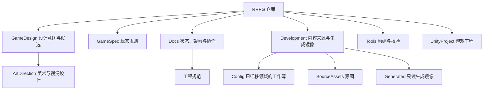

# 文档地图

> 2026-10-10 V17-R3-A：[人物详情执行记录](DevelopmentSpecs/2026-10-10_RRPG_V17-R3-A_Person-Detail_Execution-Record.md)。**R3-A PRODUCT ACCEPTED / Final Closeout Prepared**；制作人已明确「验收通过」。Disposable清理后完整Compiler264/264、EditMode1495/1495、PlayMode111/111通过；验收后最新存档及22/22保护核验一致。Handoff80已落盘；生成时Commit/Push尚未执行。R3-B未启动，Authority及Deferred边界保留。下方旧阶段条目按发布日期读取。

> 2026-10-09 V17-R3-P：接手人物详情 / 集中管理先读[已验收规划](DevelopmentSpecs/2026-10-09_RRPG_V17-R3_Person-Management_Development-Spec-V0.1.md)，再按[GameSpec Authority矩阵](../GameSpec/README.md)核对规则与Current代码。R3-P PLANNING ACCEPTED / PUBLISHED；A/B未实施。发布成功后下一阶段R3-A，按制作人连续推进确认无需重复授权，当前任务仅规划收尾；不新建第二套Authority。

> 最后核对：2026-10-08（V16-P Planning Published Main：3f93c13；V16-A Foundation已实现 / 已验收，B已获产品验收、Work Package Closed / Published main；C1 Work Package Closed / Product Accepted / Published main；C2 Work Package Closed / Product Accepted / Published main；D Work Package Closed / Product Accepted / Published main；既有日内A～D已Published Main）

## 仓库地图

V17-R2视觉/空间技术原型已获制作人验收，收尾发布状态见[执行记录](DevelopmentSpecs/2026-10-09_RRPG_V17-R2_Execution-Record.md)与[Current Snapshot](项目状态快照.md)，技术职责见[Architecture §27.6](Architecture/技术架构总览.md#v17-r2-technical-prototype)。**Technical Prototype PASS / Art Master NOT FROZEN**；不从本包推导正式画风、量产或下一工作包授权。

## 我要做什么

下表供制作人与 AI 共用，先按任务进入对应资料；每份资料的适用领域与状态继续有效。

| 要做什么 | 去哪看／去哪改 |
|---|---|
| 接手开发17.0动态Farm / Kitchen资源闭环 | [V17-R1执行记录](DevelopmentSpecs/2026-10-08_RRPG_V17-R1_Execution-Record.md) → [Current Snapshot](项目状态快照.md) / [Architecture §27.5](Architecture/技术架构总览.md#v17-r1-current) / [对象映射](Architecture/核心对象与术语映射.md#v16-building-objects)；R1已验收关闭并发布main（dbea0b5三方核验），完整V17路线未冻结，不授权后续工作包 |
| 接手开发16.0 Village Product Home / Building | [Current Design](../GameDesign/当前设计状态.md#v16-design-landing) / [Village §7.16](../GameDesign/07%20Village.md) → [GameSpec Authority 矩阵](../GameSpec/README.md)中的 [Product Home](../GameSpec/Village/Product-Home-World-GameSpec-V0.1.md) / [Building World](../GameSpec/Village/Village-Building-World-GameSpec-V0.1.md) → [Architecture Current / Deferred](Architecture/技术架构总览.md#v16-product-world-target) / [术语](Architecture/核心对象与术语映射.md#v16-building-objects) → [V16 Development Spec](DevelopmentSpecs/2026-10-07_RRPG_Village-Product-Home-and-Building-Foundation_Development-Spec-V0.1.md)。V16-A Foundation已实现并获制作人验收与收尾授权；Current发布状态查项目状态快照，B已获产品验收、Work Package Closed / Published main；V16-P/A/B/C1/C2/D均已验收发布；仅D的Building PNG/Sprite范围关闭，不跨后续范围 |
| 追溯 Village Visual / Interaction / Building 采用理由 | [2026-10-07 Checkpoint](DesignCheckpoints/2026-10-07_RRPG_Village-Visual-Interaction-and-Building_Architecture-Checkpoint-V0.1.md)及 [D-022](决策记录.md#d-022)；Checkpoint 保存讨论 Closure / Rejected / Deferred，不承担 Runtime 授权；Norland-like 非永久美术冻结 |
| 讨论 / 接手 Autonomous Life（自主生活）产品规则 | 先看 `GameDesign/当前设计状态.md` 与 `GameSpec/Village/Village-GameSpec-V0.1.md` 第12～13章；当前日内规则以活动正文为准，完整日期化产品证据看 [Autonomous Life Product Spec V0.2](DesignCheckpoints/2026-10-04_RRPG_Autonomous-Life-Vertical-Slice_Product-Spec-V0.2.md) |
| 设计 / 实现 Autonomous Life 技术架构或 WP-AL | Current先读[技术架构总览](Architecture/技术架构总览.md)和[对象映射](Architecture/核心对象与术语映射.md)：WP-AL-1～4与日内A～D已发布main，证据见[WP-AL-3 Closeout](DevelopmentSpecs/2026-10-04_RRPG_WP-AL-3_Autonomous-Selection_Closeout.md)。完整[Target Technical Architecture](DevelopmentSpecs/2026-10-04_RRPG_Autonomous-Life_Technical-Architecture-V0.1.md)不等于全部Current；后续WP须按新授权进入[DevelopmentSpecs导航](DevelopmentSpecs/README.md) |
| 讨论 / 接手 WP-AL-3 Selection & Arbitration | 产品规则读[Village GameSpec](../GameSpec/Village/Village-GameSpec-V0.1.md) §12；Freeze读[当前设计状态](../GameDesign/当前设计状态.md#wp-al-3-authority)与[Final Checkpoint](DesignCheckpoints/2026-10-04_RRPG_WP-AL-3_Autonomous-Selection_Design-Checkpoint-V0.2-Final.md)。已实现职责读[Current Architecture §25](Architecture/技术架构总览.md#wp-al-3-current) / [对象映射§20](Architecture/核心对象与术语映射.md#wp-al-3-objects)，实施和Review证据读[Closeout](DevelopmentSpecs/2026-10-04_RRPG_WP-AL-3_Autonomous-Selection_Closeout.md)；开发期契约读[Spec](DevelopmentSpecs/2026-10-04_RRPG_WP-AL-3_Autonomous-Selection_Development-Spec-V0.1.md)。Executed / Verified / Review PASS / Published Main，Prototype / Calibration仍Not Frozen |
| 讨论 / 接手 WP-AL-4 Social Feedback / Historical Reciprocity | 产品规则读[Village §12.6.1](../GameSpec/Village/Village-GameSpec-V0.1.md#wp-al-4-feedback)；已实现职责读[Current Architecture §26](Architecture/技术架构总览.md#wp-al-4-current) / [对象映射§21](Architecture/核心对象与术语映射.md#wp-al-4-objects)，证据与TMP例外读[Closeout](DevelopmentSpecs/2026-10-05_RRPG_WP-AL-4_Social-Feedback_Closeout.md)。开发期契约读[Spec](DevelopmentSpecs/2026-10-04_RRPG_WP-AL-4_Social-Feedback_Development-Spec-V0.1.md)，设计证据读[Final](DesignCheckpoints/2026-10-04_RRPG_WP-AL-4_Social-Feedback_Design-Checkpoint-V0.1-Final.md)。Executed / Verified / Runtime Review PASS / Published Main；已发布main，Prototype / Calibration Not Frozen，WP-AL-5未启动 |
| 讨论人物、身份或卡牌设计 | 从 [设计导航](../GameDesign/README.md)进入 [Identity 专题](../GameDesign/Identity/README.md)；其工作簿是设计候选工作台，**不是 Runtime 配置** |
| 讨论、恢复或继续 RRPG 美术 / 视觉方向 | 从 [Art Direction 专题](../GameDesign/ArtDirection/README.md)进入；先读顶层美术架构，再按视觉参考与对照矩阵理解具体游戏参照；该专题负责美术方向与视觉语言，不承担 Gameplay GameSpec 或当前实现状态 |
| 迁移开发16.0前核对全仓一致性 | [完整逐份审计清单与结果](2026-10-06_全仓文档一致性审计.md)；接手按Bootstrap与[最新交接](开发验收交接.md)，尚未启动视觉开发 |
| 查某条玩法规则是否已确认 | 从 [GameSpec 规则入口](../GameSpec/README.md)的领域矩阵定位当前规格；设计候选不能覆盖规则 |
| 改怪物数值或敌方图片 | 先看 [配置表操作说明](../Development/Config/README.md)；改 `Development/Config/` 工作簿与 `Development/SourceAssets/Enemy/` 源图，再运行已有导表流程 |
| 换人物图片或事件插图 | 先看 [美术素材配置操作手册](DevelopmentSpecs/2026-09-20_RRPG_美术素材配置操作手册_V0.1.md)，再进入下表的分领域手册；这些领域当前仍有手工绑定步骤 |
| 查功能现在是什么、证据在哪里 | 先看 [项目状态快照](项目状态快照.md)的 Current 摘要，再从 [DevelopmentSpecs 状态导航](DevelopmentSpecs/README.md)、[项目日志](项目日志.md)或 Git History 进入专项证据；[开发验收交接](开发验收交接.md)只保存最近一次任务 |
| 理解技术整体或具体对象 | 整体读 [技术架构总览](Architecture/技术架构总览.md)，对象及术语查 [核心对象与术语映射](Architecture/核心对象与术语映射.md) |
| 在引擎里找到UI、卡片模板、图片 / 字体或布局配置 | [引擎场景层级与配置查找指南](引擎场景层级与配置查找指南.md)：完整宿主路径、Inspector分组、Prefab / Catalog / 工作簿入口 |
| 验收本轮架构优化、查看新增 / 修改 / 清理清单 | [架构优化总结与验收清单](DevelopmentSpecs/2026-10-04_RRPG_架构优化总结与验收清单.md)；已执行的历史38文件范围查该报告及Git，不从最近Handoff读取旧清单 |
| 查代码如何跨模块连接、状态在哪里保存 | [技术架构总览](Architecture/技术架构总览.md) §17 程序集、§21 Event / Encounter、§22 产品引用链；这些章节记录实现，不重新冻结玩法 |
| 查本次引擎整理与重构做到了哪里 | [优化总结与验收入口](DevelopmentSpecs/2026-10-04_RRPG_架构优化总结与验收清单.md)、[工程审计与实施记录](DevelopmentSpecs/2026-10-02_RRPG_工程现状与引用审计.md)；审计附录中的对象快照是历史证据，操作前回读 Editor |
| 查生成结果、工具或游戏代码 | 从 [Development 导航](../Development/README.md)进入；`Development/Generated/` 是只读生成镜像，`Tools/` 是构建校验工具，`UnityProject/` 是游戏工程 |
| 查开发规范或让 AI 接手 | [工程规范](工程规范.md)负责持久工程原则；[根规则](../.clinerules.md)、[AI开发执行规则](AI开发执行规则.md)负责 Agent 工作流；首次接手顺序见下文 |

两份 Current Architecture 均供人和 AI 阅读，按技术主题分工，不按读者身份拆分 Authority。Monster Definition / Enemy Presentation 的 M0–M4 已进入正式共享 `main`；其它领域仍须逐域核对。

本地工程整理材料只有三个活动入口：总结负责交付与后续边界，审计负责历史证据，场景指南负责日常查找。已获收尾发布授权；准确发布SHA与远端同步查最终交接及Git。日期化报告中的旧路径、阶段限制和文件数按当时语境读取；当前技术职责查Architecture，当前实现 / 发布状态查项目状态快照及实际Git，不让旧报告成为第二套当前事实源。

## 手册、执行规格与历史证据怎么选

以下只按用途导航，不改变源文件的状态或权威。`Current` 表示当前适用，`Target` 描述目标，其确认范围须查对应决策（本次配置目标见 D-019）；`Candidate` 是候选，`Historical / Superseded` 是历史或已被替代的资料。判断时同时看领域、职责和后续证据，不仅比较日期。

| 用途 | 入口与读法 |
|---|---|
| 当前内容操作手册 | [配置表操作说明](../Development/Config/README.md)、[美术总手册](DevelopmentSpecs/2026-09-20_RRPG_美术素材配置操作手册_V0.1.md)、[人物视觉手册](DevelopmentSpecs/2026-09-19_RRPG_Person-Visual-Binding-V0.1_Manual-Configuration-Guide.md)、[事件插图手册](DevelopmentSpecs/2026-09-19_RRPG_Journey-Event-Illustration-Binding-V0.1_Manual-Configuration-Guide.md)；各自只用于明确覆盖的领域 |
| 开发期执行规格 | 先读 [DevelopmentSpecs 状态导航](DevelopmentSpecs/README.md)，再读取当前任务明确指定的单份规格；例如 [静态配置迁移 FDS](DevelopmentSpecs/2026-09-22_RRPG_Static-Configuration-Migration-FDS-V0.1.md)约束迁移，不因首波完成而授权继续迁移其它领域 |
| 已执行任务的证据 | [项目状态快照](项目状态快照.md)、[项目日志](项目日志.md)和专项关闭报告，例如 [M4 Closeout](DevelopmentSpecs/2026-09-23_RRPG_M4-Monster-Legacy-Physical-Retirement-Closeout-Report-V0.1.md) §11.8；报告中较早的未提交状态按当时语境读取 |
| 候选讨论与历史规划 | [DesignCheckpoints 状态导航](DesignCheckpoints/README.md)供专题追溯；[旧美术批量导入规划](DevelopmentSpecs/2026-09-20_RRPG_美术批量导入与Art-Import-Skill规划_V0.1.md)已标为 SUPERSEDED / DO NOT IMPLEMENT；旧 CSV/SO 手册已退休，历史原文查 Git History，当前内容操作从 [Development 导航](../Development/README.md)分流 |

部分已执行工作包的规格首页仍保留发布时的 `Ready for Execution / Landing`。这不是当前任务队列；应从项目状态快照查后续完成记录，再结合 Git 和任务授权判断。最近一次 Handoff 会被后续任务替换，长期证据须查对应任务记录或 Git 历史。

> 本文件帮助制作人和 AI 找到同一份正确依据。中文说明负责解释用途，英文路径和对象名保持与仓库及代码对应；不另建按读者身份划分的规则或架构 Authority。

------------------------------------------------------------------------

# AI 接手推荐阅读顺序

## Step 1：项目入口与项目理解

阅读：`README.md` → `AI_CONTEXT.md`

目的：进入仓库并理解项目定位、核心循环与关键领域概念。`AI_CONTEXT.md` 是项目理解入口，不是规则 Authority，也不承担完整开发协作规则。

## Step 2：开发协作规则

阅读：[.clinerules.md](../.clinerules.md) → [AI开发执行规则](AI开发执行规则.md)（完整开发与Closeout，按需）→ [AI多Agent开发协作协议](AI多Agent开发协作协议.md)（并行、文件所有权、冲突、Agent交接与对话迁移时）

确认：不可跳过的开发约束、权限、工具、验证和交接流程。这些文件不替代领域 GameSpec。

## Step 3：当前事实

阅读：`Docs/项目状态快照.md` → `Docs/开发验收交接.md`

确认：项目状态快照负责当前实现与进度；开发验收交接负责固定Handoff字段/格式及最近一次真实交接事实，流程以执行手册为准。

## Step 4：设计意图与设计状态

阅读：`GameDesign/README.md` → `GameDesign/当前设计状态.md` → 当前专题文件

理解：为什么这样设计、当前 Freeze Level、玩家体验目标与长期产品方向。

## Step 5：规则 Authority

阅读：先进入 `GameSpec/README.md`，由其领域 Authority 矩阵定位对应 Current GameSpec。

确认：当前冻结规则、系统行为约束、未冻结边界与验收标准。低权威文件、Draft、辅助说明和实现不得覆盖矩阵指向的 Current GameSpec。

## Step 6：Current Architecture

阅读：[技术架构总览](Architecture/技术架构总览.md) → [核心对象与术语映射](Architecture/核心对象与术语映射.md)。

用于理解： - 系统职责划分； - 数据 Authority； - 生命周期关系； -
模块边界； - 架构演变原因。

WP-AL-3已实现 / Review PASS并发布main的Selection职责见[总览§25](Architecture/技术架构总览.md#wp-al-3-current)、[对象映射§20](Architecture/核心对象与术语映射.md#wp-al-3-objects)及[Closeout](DevelopmentSpecs/2026-10-04_RRPG_WP-AL-3_Autonomous-Selection_Closeout.md)；不能从部分Current推导整份Autonomous Life Target完成。

两份长期文档为 Current Architecture，负责技术对象职责、数据所有权、生命周期、依赖方向与 Runtime / Persistence 边界；不承担玩家规则、Freeze 裁决或实时开发进度。具体 Candidate / Not Frozen / Legacy 条目不会随文档整体转正。规则仍服从 GameSpec，实时实现与验收仍核对项目状态和开发验收交接。

原 Code Architecture Audit 与 Architecture-Terminology Alignment Review 已于 2026-09-16 移出活动仓库；其有效长期事实已经归入上述两份 Current Architecture。历史追溯通过 Git 历史或仓库外个人归档，不再把旧审计稿作为活动导航或默认 AI 开发上下文。

## Step 7：开发执行规格

阅读：[DevelopmentSpecs 状态导航](DevelopmentSpecs/README.md)后，再读取当前任务明确指向的单份规格。

用于理解： - Work Package 开发规格； - 阶段目标； - 实现边界； - 验证
Gate。DevelopmentSpecs 只承担开发期 Binding，不承担长期玩家规则 Authority；其规则输入仍以 GameSpec 为准。

## Step 8：技术实现

阅读： - Development/ - UnityProject/

用于理解： - Runtime 架构； - 数据结构； - 当前代码实现； - 工程状态。

代码回答"现在实现是什么"，不是"游戏设计是什么"。

------------------------------------------------------------------------

# 文档职责关系

  文件                     职责
  ------------------------ --------------------------
  README.md                仓库总入口
  AI_CONTEXT.md            项目理解入口，不是规则 Authority
  .clinerules.md           Agent最高硬规则入口（Git授权、Hard Stop、Disposable Tests、关闭硬条件）
  Docs/AI开发执行规则.md   完整开发与Closeout流程Authority
  Docs/AI多Agent开发协作协议.md 并行协作、文件所有权、冲突、交接和对话迁移
  Docs/文档地图.md         文档导航
  Docs/开发验收交接.md     固定Handoff格式与最近一次真实交接事实
  Docs/项目状态快照.md     当前状态
  Docs/项目日志.md         已确认变化时间线
  GameDesign/README.md     设计导航与 Freeze Taxonomy
  GameDesign/当前设计状态.md 当前设计状态与 Freeze Ledger
  GameSpec/README.md       游戏规则层唯一总入口
  Docs/Architecture/       两份 Current Architecture；历史 Audit Record 已迁出
  Docs/DevelopmentSpecs/README.md 状态导航；目录内规格是开发期 Binding，不是长期玩家规则 Authority
  Development/             技术实现说明
  UnityProject/            实际代码和资源

------------------------------------------------------------------------

# 核心原则

不同文档职责不同：

-   AI_CONTEXT：如何理解项目，不提供规则 Authority；
-   `.clinerules.md` / AI开发执行规则：如何安全开发与验证；
-   文档地图：去哪里找资料；
-   GameDesign：为什么这样设计；
-   GameSpec README：先定位领域 Authority，再读取规则是什么；
-   Architecture：技术对象职责、数据所有权、生命周期、依赖方向与持久化边界；
-   DevelopmentSpecs：当前阶段如何实现，只承担开发期 Binding；
-   Code：当前实际实现。

禁止：

代码 → 推导设计

正确：

设计\
↓\
规则\
↓\
架构\
↓\
开发规格\
↓\
代码

------------------------------------------------------------------------

# AI读取原则

第一次接手 RRPG：

接手仓库的最小顺序与根AGENTS Adapter一致：README → AI_CONTEXT → 本文档地图 → `.clinerules.md` → GameDesign README → GameSpec README → 项目状态快照。随后按任务进入本地图对应的AI执行 / 协作规则、Current Design、领域GameSpec、Architecture、DevelopmentSpec及Code；开发验收交接只保留最近一次真实交接，不代替当前任务总结。

具体任务无需扫描全部文档，应根据问题读取对应资料。

------------------------------------------------------------------------

# 注意

RRPG 是长期共同体经营 + 远征式 RPG 卡牌构筑项目。

分析时：

不要自动套用传统 Roguelike、地图探索、普通 RPG 架构。

所有判断优先基于：

-   当前 GameDesign 状态；
-   `GameSpec/README.md` 指向的领域 Current GameSpec；
-   当前任务明确采用的 DevelopmentSpec（仅开发期 Binding）；
-   已验证代码事实。

WP-AL-4 Social Feedback / Historical Reciprocity已真实实现并Review PASS，已发布main；Current技术入口为[总览§26](Architecture/技术架构总览.md#wp-al-4-current)与[对象映射§21](Architecture/核心对象与术语映射.md#wp-al-4-objects)。完整Target其它部分仍按原分工读取，不能由本包完成推导Recognition / Event / LifeEpisode已实现。

## 日内时间、工作、持续活动与现场互动 A→B→C→D

开发期 Binding：[A V0.2](DevelopmentSpecs/2026-10-05_RRPG_Intraday-Time-Expedition-Arrival_Development-Spec-V0.2.md)、[B～D V0.1](DevelopmentSpecs/2026-10-05_RRPG_Intraday-Work-Lifecycle-Onsite_Development-Spec-V0.1.md)。产品边界：[Expedition §19](../GameSpec/Expedition/Expedition-Progression-GameSpec-V0.1.md#intraday-arrival)、[Village §13](../GameSpec/Village/Village-GameSpec-V0.1.md#intraday-time-a)、Save / Resource GameSpec。

A～D 已 Published Main / Current Implementation / Verified（发布点 `93a9e8cd6e0409ce335753221276bf88fe35f53f`）；Current 技术入口：[总览](Architecture/技术架构总览.md#intraday-a-target)、[对象映射](Architecture/核心对象与术语映射.md#intraday-a-target)。测试证据、TMP 例外、文件范围与剩余事项：[实施记录](DevelopmentSpecs/2026-10-05_RRPG_Intraday-AD_Execution-Record.md)。原锚点为兼容引用保留，正文明确 main Current。开发16.0从[当前交接](开发验收交接.md)恢复村庄视觉与交互的后续边界；后续实现尚未启动。WP-AL-1～4 已发布事实保留；原 WP-AL-5 范围/编号独立 Deferred，未启动。
